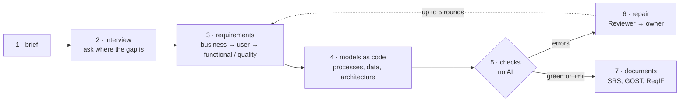
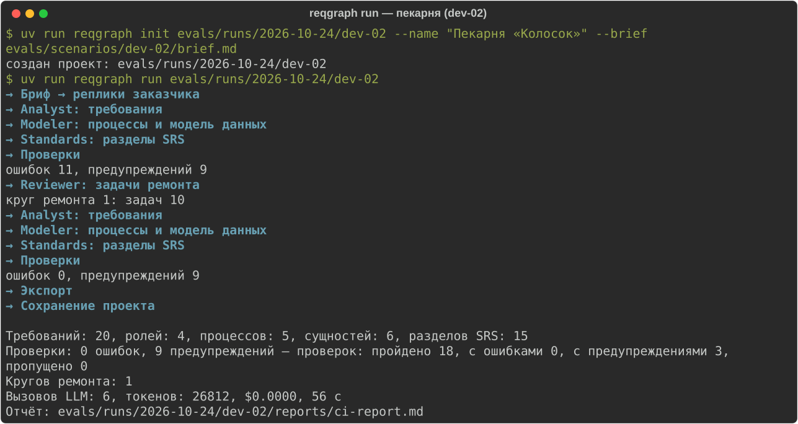

# reqgraph

**English** | [Русский](README.ru.md)

[](https://github.com/Axx-Axvd/reqgraph/actions/workflows/ci.yml)

reqgraph takes a short description of what a client needs, interviews the client and produces the system requirements, process and data diagrams, and then two documents: a software requirements specification (SRS) under ISO/IEC/IEEE 29148 and a technical specification under the Russian standard GOST 34.602-2020. The work is done by several AI agents, but everything they produce goes through deterministic checks that involve no AI. Errors go back to the agents for fixing until the requirements and diagrams are consistent.

The project is developed as a thesis. As of 26 October 2026, sprints S0–S2 (the core and the agents) are complete and S3, the interview and the simulated client, is in progress. The command line already covers the path from a brief to a checked report. Document export is planned for S4, the web interface for S5, and version 1.0 for 21 February 2027.

## Contents

- [Purpose](#purpose)
- [Approach](#approach)
- [How it works](#how-it-works)
- [What changes](#what-changes)
- [Evaluation](#evaluation)
- [Project status](#project-status)
- [Getting started](#getting-started)
- [Repository layout](#repository-layout)
- [Limitations](#limitations)
- [Stack](#stack)
- [License](#license)

## Purpose

Before development starts, someone has to establish what the system must do. Usually this is an analyst who interviews the client, records requirements and draws process and data diagrams. Projects go wrong at this stage more often than at any other, and the mistakes repeat from one project to the next.

Interviews are conducted from memory. The main scenario gets discussed, while questions such as what happens when the doctor is ill or the patient does not show up are never asked. Requirements for performance and for where personal data must be stored are missed the same way. These gaps surface later, when fixing them is expensive.

Requirements get lost between the interview and the document. A week later it is no longer possible to say where a requirement came from, or what the client said that never reached the document.

Diagrams are maintained separately from the text. A step is added to the text but not to the diagram. The data model keeps tables that no requirement needs.

A language model can write a specification in a minute, and the result reads convincingly. But nobody checks it: a diagram may be invalid, a requirement may be vague ("the page must load quickly"), and a process may have a branch with no way out.

Finally, projects in Russia often need both an SRS and a GOST specification. Both are filled in by hand and separately, and after a few edits they start to contradict each other.

## Approach

reqgraph treats requirements the way software teams treat code. Code is not accepted on trust: every change goes through automatic checks (CI), and a failing change is rejected. reqgraph applies the same process to requirements and diagrams.

To make this possible, all artifacts are stored in one graph. Every requirement, process step and interview turn is a separate node with its own identifier, and the edges between nodes record origin and implementation: a requirement is derived from a given turn, a process step implements a given requirement. Diagrams are also stored as text (JSON for processes, DBML for data, PlantUML and Structurizr for other models), so they can be parsed and checked by a program. The language model does not write BPMN: it describes the process in a simplified format, and a compiler builds the BPMN from it, so the diagram always conforms to the standard.

There are 22 checks, 21 of which are working now; the last one arrives with the GOST export. They detect specific defects: an invalid diagram file, a process with no way out, wording without a measurable criterion, a requirement not implemented in any diagram, a diagram element with no requirement behind it. The same input always gives the same result.

The interview is not conducted from memory either. A coverage tracker counts what is already known across nine areas (goals, stakeholders, scenarios, exceptions, data, rules, integrations, quality requirements, constraints), and the next question targets the least covered area.

## How it works



1. The user describes the task in a few sentences, for example "a dental clinic wants online booking".
2. The Interviewer agent asks one question at a time about the least covered area. The interview can be paused and resumed from the same point.
3. After each answer the Analyst agent records requirements of four kinds: business (why the client needs it), user (who does what), functional (what the system does) and non-functional (performance, reliability, legal requirements). Every requirement links to the interview turn it was derived from.
4. The Modeler agent describes the processes and the data model and links every step and table to a requirement.
5. The checks run.
6. On errors, the Reviewer agent passes each error to the agent responsible for it, which then fixes it. There are at most five repair rounds; remaining errors are listed in the report with an explanation.
7. The Standards agent fills in the document sections, and the SRS, the GOST specification and a ReqIF file for requirements management tools are built from the same graph.

Nodes approved by a person are never changed by the agents. The final decision stays with the analyst.

A run on a bakery brief:



## What changes

| | Common practice | With reqgraph |
|---|---|---|
| Interview | from memory; exceptions and quality requirements are missed | the next question is chosen by gaps in coverage |
| Origin of a requirement | cannot be traced after a week | every requirement links to the client's answer |
| Diagrams | drawn separately, drift from the text | stored as code, linked to requirements, checked |
| Text from a language model | not checked | 21 checks without AI; errors go back to the agents |
| SRS and GOST specification | filled in twice by hand | one graph, two documents |
| First draft | about a day | target: about an hour |

## Evaluation

The approach has to be confirmed by measurement. Four hypotheses are tested:

- H1: an interviewer with a coverage tracker uncovers more requirements that the client knows but does not volunteer;
- H2: checks with a repair loop yield more correct diagrams than the same agents without checks;
- H3: traceability checks keep the text and the diagrams from drifting apart;
- H4: the documents are no worse than a junior analyst's draft and take a tenth of the time. Three experts rate them blind.

For a fair comparison, all methods use the same model, the same inputs and the same budget.

The main difficulty is measuring "uncovers more". Hundreds of interviews with a real client are not feasible, so a simulator plays the client. Each scenario has a short brief and a closed list of 25–60 requirements known only to the simulator. The simulator reveals a requirement only when the question actually concerns it, so the interviewer that asks better questions finds more. The simulator and the judge that matches found requirements against the closed list run on a different model family than the agents, so that the system does not grade itself. In addition, 20% of the judge's decisions are checked manually.

Target values:

| Metric | Minimum (MVP) | Thesis target |
|---|---|---|
| Hidden requirements found | 70% | 85% |
| Valid diagrams | 95% | 100% |
| Processes that can always complete | 80% | 95% |
| Functional requirements reflected in diagrams | 80% | 95% |
| Vague requirements | at most 15% | at most 5% |

There are 15 scenarios: three are used to tune the prompts and twelve are reserved for the final evaluation. The final scenarios are sealed with hashes and stay closed until the final run. Every run records the model, temperature, seed, prompt versions, token counts, cost and time. Failed runs are recorded the same way as successful ones, in the [work log](docs/journal.md). Development uses free models and experiments use low-cost ones, with a budget of at most $20 per month.

The full method is described in [docs/tech-design/09_eval.md](docs/tech-design/09_eval.md) (in Russian).

## Project status

| Sprint | Dates | Scope | Status |
|---|---|---|---|
| S0 | 19.10–01.11.2026 | repository, CI, database, model access layer, model testing | complete |
| S1 | 02.11–15.11 | graph, process format and BPMN compiler, checks | complete |
| S2 | 16.11–29.11 | agents and the repair loop, version 0.1 | complete |
| S3 | 30.11–13.12 | interviewer with coverage, simulator, 15 scenarios, metrics | in progress |
| S4 | 14.12–27.12 | SRS, GOST specification, ReqIF, baseline methods, first run, version 0.5 | planned |
| S5 | 11.01–24.01.2027 | web interface: sign-in, interview in the browser, graph, BPMN, report, download | planned |
| S6 | 25.01–07.02 | full comparison, ablations, expert assessment, live interviews, statistics | planned |
| S7 | 08.02–21.02 | version 1.0, technical report, video, thesis chapters | planned |

The project is ahead of schedule: S3 is planned to start on 30 November. Implemented so far:

- the graph and its storage in project files, the process format with a compiler to BPMN 2.0, data models in DBML, diagram rendering through Kroki, 21 checks and the `reqgraph check` command;
- the run graph on LangGraph, the Analyst, Modeler, Standards and Reviewer agents, a repair loop that detects repeated errors, the `reqgraph init` and `reqgraph run` commands ([demo](docs/demo/m2.md));
- `reqgraph interview` with pause and resume, 15 scenarios with hidden requirements. The simulated client and the metrics are under review.

Tasks with acceptance criteria are listed in [docs/backlog.md](docs/backlog.md); decisions and their rationale are in [docs/adr/](docs/adr/README.md).

## Getting started

Requirements: [uv](https://docs.astral.sh/uv/), Node.js 22+ and pnpm 10. Windows setup: [docs/setup/windows.md](docs/setup/windows.md).

```bash
uv sync                           # Python 3.12 and dependencies
uv run pytest -q                  # tests, no network needed
uv run python scripts/doctor.py   # environment readiness check
uv run reqgraph --version
```

Running a brief requires free provider keys in `.env`; see [docs/setup/accounts.md](docs/setup/accounts.md).

```bash
uv run reqgraph init projects/smile --name "Smile dental clinic" --brief brief.md
uv run reqgraph run projects/smile         # Analyst → Modeler → Standards → checks → repair
uv run reqgraph check projects/smile       # checks only, no AI
uv run reqgraph interview projects/smile   # interview: /готово to finish, /пауза to pause
```

Exit code 0 means no errors; 1 means errors remain and are listed in `reports/ci-report.md`; 2 means the run did not start. Prompts and check messages are currently in Russian. The full list of commands is in [CLAUDE.md](CLAUDE.md).

<details>
<summary>Development commands</summary>

```bash
uv run ruff check . && uv run ruff format --check .
uv run mypy packages/core evals/reqgraph_evals
uv run pre-commit install          # pre-commit hooks, once
pnpm install && pnpm -C apps/web lint && pnpm -C apps/web build
pnpm db:start && pnpm db:reset     # local Postgres for Supabase, requires Docker
pnpm db:test                       # access rule tests (RLS)
uv run reqgraph schemas            # JSON Schemas from the Pydantic models
```

</details>

## Repository layout

| Path | Contents |
|---|---|
| `packages/core` | the library and the `reqgraph` command: graph, process format, checks, agents, model access, export, simulator |
| `evals/` | scenarios with hidden requirements, the experiment harness, run reports |
| `apps/web`, `apps/api` | web interface on Next.js and API on FastAPI (from S5) |
| `supabase/` | database migrations and access rules |
| [examples/garage61](examples/garage61/README.md) | a reference project built by hand: the "Garage 61" car service |
| [docs/tech-design/](docs/tech-design/README.md) | the technical design, by section (in Russian) |
| [docs/journal.md](docs/journal.md) | the work log, including failed attempts |

## Limitations

reqgraph does not generate application code and does not estimate effort. It does not replace the analyst: any requirement can be edited or locked against changes. The texts of ISO and GOST standards are not stored in the repository, only original checklists and section names. reqgraph is not a full BPMN editor: diagrams are viewed in the browser and edited through the process format. Version 1 has no team collaboration, roles or voice input.

## Stack

Python 3.12, LangGraph, pydantic-ai, pydantic-evals, FastAPI, PM4Py, Kroki, pandoc, Next.js, Supabase, bpmn-js. Open-weight models are used through OpenRouter, Groq and Google AI Studio, and through Ollama for offline work.

## License

[MIT](LICENSE). The texts of ISO and GOST standards are not part of the repository.

The check that a process can always complete is built on [pm4py](https://pypi.org/project/pm4py/), licensed under AGPL-3.0-or-later, so a build or a public demo that includes pm4py is distributed under the AGPL; all sources are open in this repository (ADR-014). bpmn-js is distributed under MIT with the condition that the bpmn.io watermark stays visible. Other dependencies are MIT, BSD, Apache-2.0, LGPL (psycopg) and MPL-2.0 (hypothesis, tests only). A new dependency is added only with a justification in its pull request.
