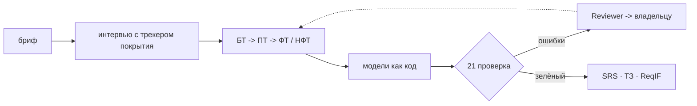

# reqgraph

**Verifiable primary documentation for software projects.** A multi-agent system that interviews a stakeholder, writes business, user, functional and non-functional requirements, builds process, data and architecture models as code, runs them through deterministic checks (CI for requirements) and exports an ISO/IEC/IEEE 29148 SRS and a GOST 34.602-2020 specification from one artifact graph.

> Status: **design phase** (October 2026). The technical design, roadmap and a reference project are in place; code starts with task T-001. Target release v1.0: 21 February 2027.

---

## Кратко по-русски

reqgraph проводит интервью с заказчиком, формулирует БТ, ПТ, ФТ и НФТ, строит модели процессов (BPMN), данных (ERD), UML и C4 как код, проверяет их детерминированными проверками и собирает SRS по ISO/IEC/IEEE 29148 и ТЗ по ГОСТ 34.602-2020 из одного графа артефактов. Ошибки проверок возвращаются агентам, пока граф не станет согласованным.

## Документация

| Где | Что |
|---|---|
| [docs/tech-design/](docs/tech-design/README.md) | технический проект по разделам: архитектура, агенты, данные, проверки, модели, деплой, план, оценка |
| [docs/tech-design.pdf](docs/tech-design.pdf) | то же в виде PDF с инфографикой |
| [docs/adr/](docs/adr/README.md) | 12 архитектурных решений |
| [docs/backlog.md](docs/backlog.md) | задачи T-001 … T-703 с критериями приёмки |
| [examples/garage61/](examples/garage61/README.md) | эталонный проект: автосервис «Гараж 61» (черновик, на проверке) |
| [CLAUDE.md](CLAUDE.md) | правила для Claude Code |

## План

| Спринт | Даты | Результат |
|---|---|---|
| S0 | 19.10 – 01.11.2026 | репозиторий, CI, база, роутер моделей |
| S1 | 02.11 – 15.11 | граф, DSL процессов, 21 проверка |
| S2 | 16.11 – 29.11 | агенты и цикл ремонта, v0.1 (CLI) |
| S3 | 30.11 – 13.12 | интервьюер, симулятор заказчика, 15 сценариев |
| S4 | 14.12 – 27.12 | SRS, ТЗ, ReqIF, evals v1, v0.5 |
| S5 | 11.01 – 24.01.2027 | веб-демо и деплой |
| S6 | 25.01 – 07.02 | эксперименты и экспертная оценка |
| S7 | 08.02 – 21.02 | релиз v1.0, техотчёт |

## Стек

Python 3.12 · LangGraph · Pydantic · FastAPI · PM4Py · Next.js · Supabase · Kroki · bpmn-js · open-weight LLM через OpenRouter / Groq / Ollama.

## Лицензия

[MIT](LICENSE). Тексты стандартов ISO и ГОСТ в репозиторий не входят: только собственные чек-листы и названия разделов.
