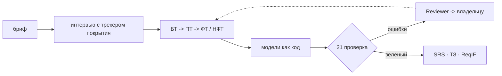

# reqgraph

[](https://github.com/Axx-Axvd/reqgraph/actions/workflows/ci.yml)

**Verifiable primary documentation for software projects.** A multi-agent system that interviews a stakeholder, writes business, user, functional and non-functional requirements, builds process, data and architecture models as code, runs them through deterministic checks (CI for requirements) and exports an ISO/IEC/IEEE 29148 SRS and a GOST 34.602-2020 specification from one artifact graph.

> Status: **sprint S0** (October 2026). The technical design, roadmap and a reference project are in place; the monorepo skeleton is ready (T-001). Target release v1.0: 21 February 2027.

---

## Кратко по-русски

reqgraph проводит интервью с заказчиком, формулирует БТ, ПТ, ФТ и НФТ, строит модели процессов (BPMN), данных (ERD), UML и C4 как код, проверяет их детерминированными проверками и собирает SRS по ISO/IEC/IEEE 29148 и ТЗ по ГОСТ 34.602-2020 из одного графа артефактов. Ошибки проверок возвращаются агентам, пока граф не станет согласованным.



## Быстрый старт

Нужны [uv](https://docs.astral.sh/uv/), Node.js ≥ 22 и pnpm 10 (подробно для Windows — [docs/setup/windows.md](docs/setup/windows.md)).

```bash
uv sync                          # Python 3.12 и зависимости (uv.lock)
uv run pytest -q                 # тесты без сети
uv run ruff check . && uv run ruff format --check .
uv run mypy packages/core
uv run reqgraph --version
pnpm install                     # apps/web
pnpm -C apps/web lint
pnpm -C apps/web build
uv run pre-commit install        # хуки перед коммитом (один раз)
uv run python scripts/doctor.py  # готовность окружения
```

Структура: `packages/core` — библиотека и CLI `reqgraph`, `apps/api` — FastAPI и воркер (с T-501), `apps/web` — Next.js (с S5).

## Документация

| Где | Что |
|---|---|
| [docs/tech-design/](docs/tech-design/README.md) | технический проект по разделам: архитектура, агенты, данные, проверки, модели, деплой, план, оценка |
| [docs/tech-design.pdf](docs/tech-design.pdf) | то же в виде PDF с инфографикой (снимок 20.10.2026; при расхождении главнее Markdown) |
| [docs/adr/](docs/adr/README.md) | 16 записей о решениях (15 принято, 1 отклонено) |
| [docs/backlog.md](docs/backlog.md) | задачи T-001 … T-703 с критериями приёмки (и issues на GitHub) |
| [docs/setup/](docs/setup/) | окружение Windows, ключи и сервисы, офлайн-профиль, доска GitHub Projects |
| [docs/research/](docs/research/) | проверенные версии зависимостей и моделей (21.10.2026) |
| [examples/garage61/](examples/garage61/README.md) | эталонный проект: автосервис «Гараж 61» (черновик, на проверке) |
| [CLAUDE.md](CLAUDE.md) | правила для Claude Code |

## План

| Спринт | Даты | Результат |
|---|---|---|
| S0 | 19.10 – 01.11.2026 | репозиторий, CI, база, LLM-слой, probe моделей |
| S1 | 02.11 – 15.11 | граф, DSL процессов, 21 проверка |
| S2 | 16.11 – 29.11 | агенты и цикл ремонта, v0.1 (CLI) |
| S3 | 30.11 – 13.12 | интервьюер, симулятор заказчика, 15 сценариев |
| S4 | 14.12 – 27.12 | SRS, ТЗ, ReqIF, evals v1, v0.5 |
| S5 | 11.01 – 24.01.2027 | веб-демо и деплой |
| S6 | 25.01 – 07.02 | эксперименты и экспертная оценка |
| S7 | 08.02 – 21.02 | релиз v1.0, техотчёт |

## Стек

Python 3.12 · LangGraph · pydantic-ai · FastAPI · PM4Py · Kroki · pandoc · Next.js · Supabase · bpmn-js · open-weight LLM через OpenRouter / Groq / Google AI Studio / Ollama.

## Лицензия

[MIT](LICENSE). Тексты стандартов ISO и ГОСТ в репозиторий не входят: только собственные чек-листы и названия разделов.

### Лицензии зависимостей

Собственный код reqgraph — MIT. Проверка soundness процессов использует [pm4py](https://pypi.org/project/pm4py/) (AGPL-3.0-or-later), поэтому сборка и публичное демо вместе с pm4py подчиняются AGPL; исходники открыты в этом репозитории (ADR-014). bpmn-js (MIT с условием) требует оставлять видимым водяной знак bpmn.io. Остальные зависимости — MIT, BSD, Apache-2.0, LGPL (psycopg) и MPL-2.0 (hypothesis, только тесты).

Сейчас (S0) в runtime только typer (MIT); веб — Next.js и React (MIT); инструменты разработки — ruff, mypy, pytest, pre-commit, TypeScript, ESLint (MIT и Apache-2.0). Новая зависимость добавляется с обоснованием в PR (см. CLAUDE.md).
