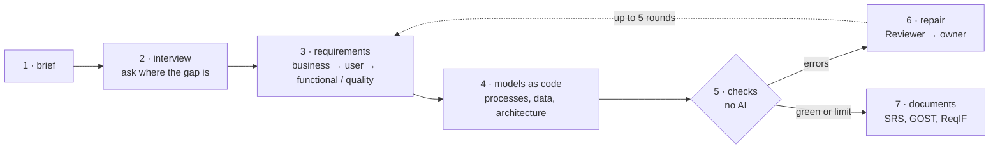

# reqgraph

**English** | [Русский](README.ru.md)

[](https://github.com/Axx-Axvd/reqgraph/actions/workflows/ci.yml)

**reqgraph turns a conversation with a client into software requirements you can check.** A team of AI agents interviews the client, writes the requirements, draws the diagrams, and a strict checker that uses no AI catches the mistakes and sends them back to the agents until everything agrees. At the end, the same set of requirements becomes two documents: a software requirements specification (ISO/IEC/IEEE 29148) and a Russian technical specification (GOST 34.602-2020).

> **Status, 26 October 2026:** sprints S0–S2 are done; S3 (interview and client simulator) is in progress, ahead of the plan. You can already run it from the command line: brief → requirements → diagrams → checks → repair. Documents (SRS, GOST) come in S4, the web demo in S5. Release v1.0: 21 February 2027.

---

## Contents

- [The problem](#the-problem)
- [The idea](#the-idea)
- [How it works](#how-it-works)
- [Before and after](#before-and-after)
- [Goals and how we measure them](#goals-and-how-we-measure-them)
- [Project progress](#project-progress)
- [Try it](#try-it)
- [What is inside the repository](#what-is-inside-the-repository)
- [What reqgraph does not do](#what-reqgraph-does-not-do)
- [Tech stack](#tech-stack)
- [License](#license)

## The problem

Before anyone writes code, someone has to find out what the software must do. A business analyst talks to the client, writes down the requirements and draws diagrams: how the work flows, what data is stored. This "primary documentation" is where many projects go wrong, and it goes wrong in the same ways again and again:

1. **Interviews run from memory.** The analyst asks about the main scenario and forgets the rest: what happens when something goes wrong, how fast the system must be, which laws apply. Those gaps surface months later, when they are expensive to fix.
2. **Requirements get lost on the way.** Between "the client said it" and "it is in the document" there is no link, so nobody can tell where a requirement came from or whether something was dropped.
3. **Text and diagrams drift apart.** Diagrams are drawn separately from the text. A step is added to the text but not to the diagram; a table in the data model belongs to no requirement at all.
4. **AI writes smooth but unchecked text.** Today you can ask a chatbot for a requirements document, and you get something that reads well. But nobody checks it: a diagram may be invalid, a requirement may be vague ("the page loads fast"), a process may have a dead end.
5. **The same content is typed twice.** Teams in Russia often need both an international SRS and a document by the Russian GOST standard. They are filled in by hand, separately, and then disagree.

## The idea

Treat requirements the way programmers treat code.

Programmers do not trust code because it looks good: every change goes through automatic checks (tests, linters, "CI"), and broken code does not get in. reqgraph brings the same discipline to requirements:

- **One source of truth.** Every requirement, diagram element and interview answer is a node in one graph, with an id and links: *this requirement came from that answer*, *this process step implements that requirement*.
- **Diagrams are code.** Processes, data models and architecture are written as text (a JSON process format, DBML, PlantUML, Structurizr), so a program can read and check them. The AI never draws a BPMN diagram directly: it describes the process in a simple format, and a compiler turns it into a valid BPMN diagram.
- **Strict checks without AI.** 22 deterministic checks look for real defects: invalid diagrams, process steps that lead nowhere, vague wording, requirements that no diagram implements, diagram elements that belong to no requirement. The same input always gives the same result.
- **A repair loop.** When a check fails, a Reviewer agent turns the error into a task for the agent that owns it, and the agent fixes it. This repeats until the report is green or the iteration limit is reached; then whatever is left is explained in the report.
- **An interviewer that knows what it has not asked yet.** A coverage tracker counts what is already known in 9 areas (goals, people, scenarios, exceptions, data, rules, integrations, quality requirements, constraints) and points the interviewer to the emptiest one.

## How it works



1. **Brief.** You describe the idea in a few sentences: "a dental clinic wants online booking".
2. **Interview.** The **Interviewer** agent asks one question at a time, always about the area that is covered least. You can pause and continue later.
3. **Requirements.** The **Analyst** agent turns every answer into requirements of four kinds: business (why), user (who does what), functional (what the system does) and non-functional (how well: speed, reliability, law). Each one links back to the answer it came from.
4. **Models.** The **Modeler** agent describes the processes and the data model and links every step and table to the requirement it implements.
5. **Checks.** 22 checks in five groups: schema (is the file valid), soundness (can every process finish), ISO 29148 (is the wording clear and measurable), traceability (does everything link up), templates (are all document sections filled).
6. **Repair.** The **Reviewer** agent hands each error to its owner; the loop repeats.
7. **Documents.** The **Standards** agent fills in the document sections; exporters build the SRS, the GOST specification and a ReqIF file for requirement tools, all from the same graph.

Nodes marked *approved* by a person are never changed by the agents: the analyst stays in charge.


## Before and after

| | Usually | With reqgraph |
|---|---|---|
| Interview | from memory; quality requirements and exceptions get forgotten | a coverage tracker over 9 areas picks the next question |
| Where a requirement came from | unknown after a week | every requirement links to the interview answer |
| Diagrams | drawn separately, drift away from the text | written as code, linked to requirements, checked |
| AI-generated text | reads well, nobody checks it | 22 checks without AI; errors go back to the agents |
| SRS and GOST documents | filled in by hand, twice | one graph, two exporters, a completeness check |
| Changes | one edit quietly breaks something else | every change goes through the checks again |
| Time to a first draft | about a day | goal: about an hour (hypothesis H4 below) |

## Goals and how we measure them

reqgraph is also a research project: it has to *prove* that the approach works, not just look good. Four hypotheses are tested on the same inputs, with the same AI model and budget for every method:

| | Hypothesis, in plain words | How we check |
|---|---|---|
| **H1** | An interviewer with a coverage tracker finds more of what the client knows but did not say | "hidden requirements" found (recall) |
| **H2** | The check-and-repair loop gives more correct diagrams | share of valid diagrams and of processes that can finish |
| **H3** | Traceability checks stop text and diagrams from drifting apart | share of requirements implemented in a model; share of elements without a requirement |
| **H4** | reqgraph documents are no worse than a junior analyst's draft, at a tenth of the time | blind ratings by three experts |

**How "hidden requirements" work.** A real client cannot be interviewed hundreds of times, so a **simulated client** plays the role. Each test scenario has a short brief and a secret list of 25–60 requirements that only the simulated client knows. It tells one of them only when the question is actually about it, so an interviewer that asks better questions finds more. The simulator and the judge that matches the found requirements against the secret list use a different family of AI models than the agents, so the system does not grade its own homework, and a person checks a random 20% of the judge's decisions.

**Acceptance thresholds:**

| Metric | MVP | Thesis goal |
|---|---|---|
| Hidden requirements found | ≥ 70% | ≥ 85% |
| Valid diagrams | ≥ 95% | 100% |
| Processes that can always finish | ≥ 80% | ≥ 95% |
| Functional requirements implemented in a model | ≥ 80% | ≥ 95% |
| Vague requirements | ≤ 15% | ≤ 5% |

**Rules of a fair experiment:** 15 scenarios: 3 for tuning, 12 for the final test. The 12 test scenarios are sealed with hashes and are not opened until the final run. Every run records the model, temperature, seed, prompt versions, tokens, cost and time. Failed runs and rejected ideas are written down just like the successful ones ([docs/journal.md](docs/journal.md)). Development runs on free models, experiments on cheap ones: at most $20 a month.

The full method: [docs/tech-design/09_eval.md](docs/tech-design/09_eval.md).

## Project progress

| Sprint | Dates | Goal | Status |
|---|---|---|---|
| S0 · Foundation | 19.10–01.11.2026 | repository, CI, database, AI layer, model benchmark | ✅ done |
| S1 · Graph, process format, checks | 02.11–15.11 | the core without AI: graph, BPMN compiler, checks | ✅ done |
| S2 · Agents and repair loop | 16.11–29.11 | **v0.1**: from a brief to requirements, diagrams and a checked report | ✅ done |
| S3 · Interview and simulator | 30.11–13.12 | interviewer with coverage, simulated client, 15 scenarios, metrics | 🔄 in progress |
| S4 · Documents and first evaluation | 14.12–27.12 | **v0.5**: SRS, GOST, ReqIF; baselines; first run on tuning scenarios | ⏳ planned |
| S5 · Web and deploy | 11.01–24.01.2027 | public demo: sign-in, interview in the browser, graph, BPMN, report, download | ⏳ planned |
| S6 · Experiments | 25.01–07.02 | full comparison, ablations, expert ratings, live interviews, statistics | ⏳ planned |
| S7 · Release | 08.02–21.02 | **v1.0**, technical report, demo video, thesis chapters | ⏳ planned |

**What exists today:**

- **S0–S1:** the artifact graph and its storage in plain files, the process format and its compiler to BPMN 2.0, data models (DBML), diagrams rendered to SVG through Kroki, 21 working checks and the `reqgraph check` command.
- **S2:** the run graph on LangGraph and four agents (Analyst, Modeler, Standards, Reviewer), the repair loop with a detector of repeated errors, the `reqgraph init` and `reqgraph run` commands, the M2 demo ([docs/demo/m2.md](docs/demo/m2.md)).
- **S3 so far:** `reqgraph interview` with coverage, pause and resume (T-301); 15 scenarios with hidden requirements, the test set sealed (T-303). Under review: the simulated client (T-302) and the metrics on pydantic-evals (T-304).

Every task, its acceptance criteria and status: [docs/backlog.md](docs/backlog.md). What was done each day, including failures: [docs/journal.md](docs/journal.md). Decisions and why: [docs/adr/](docs/adr/README.md).

## Try it

You need [uv](https://docs.astral.sh/uv/), Node.js ≥ 22 and pnpm 10 (Windows: [docs/setup/windows.md](docs/setup/windows.md)).

```bash
uv sync                           # Python 3.12 and dependencies
uv run pytest -q                  # tests, no network needed
uv run python scripts/doctor.py   # is the environment ready
uv run reqgraph --version
```

From a brief to a checked report (needs free API keys in `.env`, see [docs/setup/accounts.md](docs/setup/accounts.md)):

```bash
uv run reqgraph init projects/smile --name "Smile dental clinic" --brief brief.md
uv run reqgraph run projects/smile         # Analyst → Modeler → Standards → checks → repair
uv run reqgraph check projects/smile       # the checks again, no AI
uv run reqgraph interview projects/smile   # the interview: /готово to finish, /пауза to pause
```

Exit codes: 0 means no errors, 1 means errors are left (see `reports/ci-report.md`), 2 means the run did not start. The agents' prompts and check messages are in Russian, the language of the first users. More commands: [CLAUDE.md](CLAUDE.md).

<details>
<summary>Developer commands</summary>

```bash
uv run ruff check . && uv run ruff format --check .
uv run mypy packages/core evals/reqgraph_evals
uv run pre-commit install          # hooks before every commit (once)
pnpm install && pnpm -C apps/web lint && pnpm -C apps/web build
pnpm db:start && pnpm db:reset     # local Postgres for Supabase (needs Docker)
pnpm db:test                       # row-level security tests
uv run reqgraph schemas            # JSON Schemas from the Pydantic models
```

</details>

## What is inside the repository

| Where | What |
|---|---|
| `packages/core` | the library and the `reqgraph` command: graph, process format, checks, agents, AI layer, exporters, simulator |
| `evals/` | scenarios with hidden requirements, the experiment harness, reports of every run |
| `apps/web`, `apps/api` | the web demo (Next.js) and its API (FastAPI), from S5 |
| `supabase/` | database migrations and access rules |
| [examples/garage61](examples/garage61/README.md) | a hand-made reference project: a car service called "Garage 61" |
| [docs/tech-design/](docs/tech-design/README.md) | the technical design, section by section (in Russian) |
| [docs/adr/](docs/adr/README.md) | 17 decision records (16 accepted, 1 rejected) |
| [docs/backlog.md](docs/backlog.md) · [docs/journal.md](docs/journal.md) | tasks with acceptance criteria · the work diary |

## What reqgraph does not do

- It does not write the application code and does not estimate effort.
- It does not replace the analyst: every requirement can be edited or locked, and the agents never touch what a person approved.
- It does not store the texts of ISO or GOST standards: only its own checklists and section names.
- It is not a full BPMN editor: diagrams are viewed in the browser and edited through the process format.
- Version 1 has no teams, roles, real-time co-editing or voice.

## Tech stack

Python 3.12 · LangGraph · pydantic-ai · pydantic-evals · FastAPI · PM4Py · Kroki · pandoc · Next.js · Supabase · bpmn-js · open-weight models through OpenRouter, Groq, Google AI Studio and Ollama (offline).

## License

[MIT](LICENSE). The texts of ISO and GOST standards are not part of the repository: only its own checklists and section names.

The process soundness check uses [pm4py](https://pypi.org/project/pm4py/) (AGPL-3.0-or-later), so a build or a public demo that includes pm4py is covered by the AGPL; all sources are open in this repository (ADR-014). bpmn-js (MIT with a condition) requires the bpmn.io watermark to stay visible. Other dependencies are MIT, BSD, Apache-2.0, LGPL (psycopg) and MPL-2.0 (hypothesis, tests only). A new dependency is added only with a reason in its pull request.
