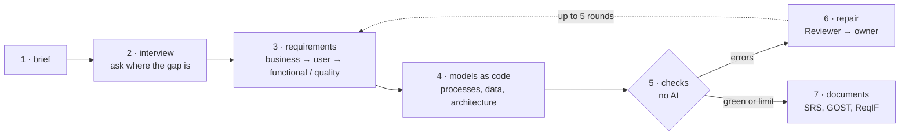

# reqgraph

**English** | [Русский](README.ru.md)

[](https://github.com/Axx-Axvd/reqgraph/actions/workflows/ci.yml)

reqgraph takes a short description of what a client wants, interviews the client, and gives you the requirements, process and data diagrams, and in the end two documents: an SRS by ISO/IEC/IEEE 29148 and a Russian technical specification by GOST 34.602-2020. The work is done by several AI agents, but everything they produce goes through checks that have no AI in them at all. If a check finds a mistake, the agent fixes it, and this goes on until everything adds up.

This is my thesis project. As of 26 October 2026 the core and the agents are done (sprints S0–S2) and S3 is in progress: the interview and a simulated client. From the command line you can already go from a brief to a checked report. Documents come in S4, the website in S5, version 1.0 on 21 February 2027.

## Why

Before anyone writes code, someone has to find out what actually needs to be built. Usually that's an analyst: they talk to the client, ask questions, write down requirements, draw diagrams. This is the stage where projects go wrong most often, and they go wrong the same way every time.

The interview runs from memory. You ask about the main scenario and forget to ask what happens when the doctor is sick or the patient doesn't show up. You forget about speed, and about where the law says personal data has to be stored. It comes up later, when changing it is expensive.

Requirements get lost along the way. A week later nobody can say where a requirement came from, or what the client said that never made it into the document.

Diagrams live separately from the text. A step gets added to the text but not to the diagram. The data model has a table that no requirement needs.

A neural network can write a spec in a minute these days, and it reads fine. But nobody checks it: the diagram can be invalid, a requirement can be vague ("the page should load fast"), a process can have a branch that leads nowhere.

On top of that, in Russia you often need two documents at once, an SRS and a GOST spec. People fill them in by hand, separately, and after a couple of edits they contradict each other.

## How I'm solving it

The idea is to treat requirements the way programmers treat code. Nobody takes code on trust: every change goes through automatic checks (CI), and if they're red, the change doesn't get in. Same here, except what gets checked is requirements and diagrams.

To make that possible, everything lives in one graph. Every requirement, every process step, every line of the interview is a separate node with its own id, with links between them: this requirement came from that answer, this process step implements that requirement. Diagrams are written as text too (JSON for processes, DBML for data, PlantUML and Structurizr for the rest), so a program can read and check them. The model never draws BPMN itself: it describes the process in a simple format, and a compiler builds the BPMN from it, so the diagram is always valid.

There are 22 checks, 21 of them work now (the last one comes with the GOST export). They catch specific things: a diagram that won't open, a process you can't get out of, wording without a number where a number is needed, a requirement that no diagram implements, a diagram element that no requirement needs. Same input, same result, every time.

The interview doesn't run from memory either. A coverage tracker counts what is already known across nine areas (goals, people, scenarios, exceptions, data, rules, integrations, quality requirements, constraints), and the next question goes where the gap is.

## How it works



1. You write a brief, a couple of sentences like "a dental clinic wants online booking".
2. The Interviewer asks one question at a time, about the area where least is known. You can pause the interview and pick it up later from the same place.
3. After every answer the Analyst writes down requirements: business (why the clinic needs this), user (who does what), functional (what the system does) and non-functional (how fast, how reliable, which laws apply). Each requirement links back to the line of the interview it came from.
4. The Modeler draws the processes and the data model and ties every step and table to a requirement.
5. The checks run.
6. If something is red, the Reviewer hands each error to the agent that owns it, and that agent fixes it. At most five rounds; whatever isn't fixed stays in the report with an explanation.
7. The Standards agent fills in the document sections, and the SRS, the GOST spec and a ReqIF file for requirements tools are all built from the same graph.

Anything a person marked as approved, the agents leave alone. The analyst always has the last word.

This is what a run on a bakery brief looks like:


## What should change

| | Usually | With reqgraph |
|---|---|---|
| Interview | from memory, exceptions and quality requirements get forgotten | the next question is picked by the gaps in coverage |
| Where a requirement came from | nobody remembers a week later | every one links to the client's answer |
| Diagrams | drawn separately, drift away from the text | written as code, linked to requirements, checked |
| Text from a neural network | nobody checks it | 21 checks without AI, errors go back to the agents |
| SRS and GOST spec | twice, by hand | one graph, two documents |
| First draft | about a day | the goal is about an hour |

## How I'm going to check that it works

Building the system isn't enough, I have to show with numbers that it's better. I'm testing four hypotheses:

- H1: an interviewer with a coverage tracker gets more out of the client, things the client knows but wouldn't mention on their own;
- H2: checks plus repair give more correct diagrams than the same agents without checks;
- H3: the link checks keep the text and the diagrams from drifting apart;
- H4: the documents are no worse than a junior analyst's draft, in a tenth of the time. Three experts rate them blind.

To keep the comparison fair, every method gets the same model, the same inputs and the same budget.

The tricky part is how to measure "found more". You can't interview a real client hundreds of times, so a simulator plays the client. Every scenario has a short brief and a closed list of 25–60 requirements that only the simulator knows. It talks about a requirement only if the question is really about it. So whoever asks better questions finds more. The simulator and the judge that compares what was found with the closed list run on a different family of models than the agents, otherwise the system would be grading itself. On top of that I check 20% of the judge's decisions by hand.

The targets I set for myself:

| What | Minimum (MVP) | Thesis goal |
|---|---|---|
| Hidden requirements found | 70% | 85% |
| Valid diagrams | 95% | 100% |
| Processes you can always get out of | 80% | 95% |
| Functional requirements that are in a diagram | 80% | 95% |
| Vague requirements | 15% at most | 5% at most |

There are 15 scenarios: I tune the prompts on three, and twelve are kept for the final test. Those twelve are sealed with hashes and nobody opens them until the final run. Every run records the model, temperature, seed, prompt versions, tokens, money and time. Failed runs get written down just like the good ones, they're in the [journal](docs/journal.md). I develop on free models and run experiments on cheap ones, $20 a month at most.

The full method is in [docs/tech-design/09_eval.md](docs/tech-design/09_eval.md) (in Russian).

## Where the project is now

| Sprint | Dates | What's in it | Status |
|---|---|---|---|
| S0 | 19.10–01.11.2026 | repository, CI, database, the layer that talks to models, a small exam for models | done |
| S1 | 02.11–15.11 | the graph, the process format and its BPMN compiler, the checks | done |
| S2 | 16.11–29.11 | agents and the repair loop, version 0.1 | done |
| S3 | 30.11–13.12 | interviewer with coverage, the simulator, 15 scenarios, metrics | in progress |
| S4 | 14.12–27.12 | SRS, GOST spec, ReqIF, baseline methods to compare against, first run, version 0.5 | ahead |
| S5 | 11.01–24.01.2027 | the website: sign-in, interview in the browser, graph, BPMN, report, download | ahead |
| S6 | 25.01–07.02 | the full comparison, ablations, experts, live interviews, statistics | ahead |
| S7 | 08.02–21.02 | version 1.0, technical report, video, thesis chapters | ahead |

I'm ahead of schedule, S3 isn't supposed to start until 30 November. What's there already:

- the graph and its storage in plain files, the process format with a compiler to BPMN 2.0, data models in DBML, diagram images through Kroki, 21 checks and the `reqgraph check` command;
- the run graph on LangGraph, the Analyst, Modeler, Standards and Reviewer agents, a repair loop that notices when an agent is going in circles, the `reqgraph init` and `reqgraph run` commands ([demo](docs/demo/m2.md));
- `reqgraph interview` with pause and resume, 15 scenarios with hidden requirements. The simulated client and the metrics are in review right now.

All tasks with their acceptance criteria are in [docs/backlog.md](docs/backlog.md), what was decided and why is in [docs/adr/](docs/adr/README.md).

## Running it

You'll need [uv](https://docs.astral.sh/uv/), Node.js 22+ and pnpm 10. There's a separate guide for Windows: [docs/setup/windows.md](docs/setup/windows.md).

```bash
uv sync                           # Python 3.12 and dependencies
uv run pytest -q                  # tests, no network needed
uv run python scripts/doctor.py   # check that the environment is ready
uv run reqgraph --version
```

To run a brief you need free provider keys in `.env`; where to get them is in [docs/setup/accounts.md](docs/setup/accounts.md).

```bash
uv run reqgraph init projects/smile --name "Smile dental clinic" --brief brief.md
uv run reqgraph run projects/smile         # Analyst → Modeler → Standards → checks → repair
uv run reqgraph check projects/smile       # just the checks, no AI
uv run reqgraph interview projects/smile   # the interview, /готово to finish, /пауза to pause
```

Exit code 0 means no errors. 1 means some errors are left, they're in `reports/ci-report.md`. 2 means the run didn't start at all. The prompts and check messages are in Russian for now, since that's who the first users are. The rest of the commands are in [CLAUDE.md](CLAUDE.md).

<details>
<summary>For development</summary>

```bash
uv run ruff check . && uv run ruff format --check .
uv run mypy packages/core evals/reqgraph_evals
uv run pre-commit install          # pre-commit hooks, once
pnpm install && pnpm -C apps/web lint && pnpm -C apps/web build
pnpm db:start && pnpm db:reset     # local Postgres for Supabase, needs Docker
pnpm db:test                       # access rule tests (RLS)
uv run reqgraph schemas            # JSON Schemas from the Pydantic models
```

</details>

## What's where

- `packages/core` is the library itself and the `reqgraph` command: graph, process format, checks, agents, talking to models, export, the simulator.
- `evals/` has the scenarios with hidden requirements, the experiment setup and the run reports.
- `apps/web` and `apps/api` are the website on Next.js and its API on FastAPI, coming in S5.
- `supabase/` has the database migrations and access rules.
- [examples/garage61](examples/garage61/README.md) is a reference project done by hand: a car service called "Garage 61".
- [docs/tech-design/](docs/tech-design/README.md) is the technical design, section by section (in Russian).
- [docs/journal.md](docs/journal.md) is the diary: what I did each day and what didn't work.

## What reqgraph doesn't do

It doesn't write the application code and doesn't estimate how long things will take. It doesn't replace the analyst: any requirement can be edited or locked. The texts of ISO and GOST standards are not in the repository, only my own checklists and section names. It won't be a full BPMN editor either, in the browser you only look at diagrams, and you change them through the process format. Teams, roles and voice input aren't in the first version.

## Stack

Python 3.12, LangGraph, pydantic-ai, pydantic-evals, FastAPI, PM4Py, Kroki, pandoc, Next.js, Supabase, bpmn-js. The models are open-weight, through OpenRouter, Groq and Google AI Studio, and Ollama for working offline.

## License

[MIT](LICENSE). The texts of ISO and GOST standards are not part of the repository.

The check that a process can always finish is built on [pm4py](https://pypi.org/project/pm4py/), which is AGPL-3.0-or-later. So a build or a public demo that includes pm4py falls under the AGPL; all the sources are here (ADR-014). bpmn-js is MIT with a condition to keep the bpmn.io watermark visible. Other dependencies are MIT, BSD, Apache-2.0, LGPL (psycopg) and MPL-2.0 (hypothesis, tests only). I only add a new dependency if I can explain in the PR why it's needed.
