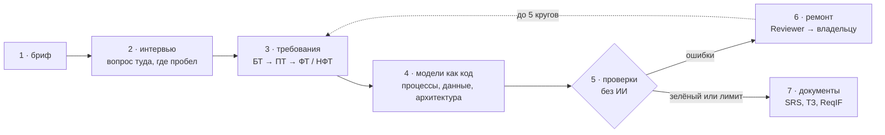

# reqgraph

[English](README.md) | **Русский**

[](https://github.com/Axx-Axvd/reqgraph/actions/workflows/ci.yml)

reqgraph получает от заказчика короткое описание задачи, проводит с ним интервью и формирует требования к системе, схемы процессов и данных, а затем два документа: спецификацию требований (SRS) по ISO/IEC/IEEE 29148 и техническое задание по ГОСТ 34.602-2020. Работу выполняют несколько ИИ-агентов, но каждый их результат проходит детерминированные проверки, в которых ИИ не участвует. Найденные ошибки возвращаются агентам на исправление, пока требования и схемы не станут согласованными.

Проект выполняется как дипломная работа. На 28 октября 2026 года завершены спринты S0–S2 (ядро и агенты), S3 (интервью, симулятор заказчика и метрики) выполнен, осталось согласование доменов сценариев с руководителем. Из командной строки уже доступен путь от брифа до проверенного отчёта. Экспорт документов запланирован на S4, веб-интерфейс на S5, выпуск версии 1.0 на 21 февраля 2027 года.

## Содержание

- [Назначение](#назначение)
- [Подход](#подход)
- [Как это работает](#как-это-работает)
- [Что меняется](#что-меняется)
- [Оценка результатов](#оценка-результатов)
- [Состояние проекта](#состояние-проекта)
- [Запуск](#запуск)
- [Структура репозитория](#структура-репозитория)
- [Ограничения](#ограничения)
- [Стек](#стек)
- [Лицензия](#лицензия)

## Назначение

До начала разработки нужно определить, что именно должна делать система. Обычно этим занимается аналитик: проводит интервью с заказчиком, фиксирует требования, рисует схемы процессов и данных. На этом этапе проекты ошибаются чаще всего, и ошибки повторяются от проекта к проекту.

Интервью ведётся по памяти. Основной сценарий обсуждают, а что будет, если врач заболел или пациент не пришёл, не спрашивают. Так же выпадают требования к скорости работы и к месту хранения персональных данных. Обнаруживается это позже, когда исправление обходится дорого.

Требования теряются по пути от интервью к документу. Через неделю уже нельзя сказать, откуда взялось требование и что из сказанного заказчиком в документ не попало.

Схемы ведутся отдельно от текста. В текст добавляют шаг, а на схему нет. В модели данных остаются таблицы, которые не нужны ни одному требованию.

Языковые модели пишут техническое задание за минуту, и текст выглядит убедительно. Но его никто не проверяет: схема может быть некорректной, требование размытым («страница должна загружаться быстро»), у процесса может быть ветка, из которой нет выхода.

Наконец, в российских проектах часто нужны сразу SRS и ТЗ по ГОСТ. Их заполняют вручную и по отдельности, и после нескольких правок документы начинают противоречить друг другу.

## Подход

С требованиями предлагается работать так же, как с программным кодом. Код не принимают на веру: каждое изменение проходит автоматические проверки (CI), и при ошибке изменение не принимается. В reqgraph так же проверяются требования и схемы.

Для этого все артефакты хранятся в одном графе. Каждое требование, шаг процесса и реплика интервью являются отдельными узлами со своими идентификаторами, а связи между узлами фиксируют происхождение и реализацию: требование выведено из такой-то реплики, шаг процесса реализует такое-то требование. Схемы тоже хранятся в текстовом виде (JSON для процессов, DBML для данных, PlantUML и Structurizr для остальных моделей), поэтому их можно разбирать и проверять программно. BPMN языковая модель не пишет: она описывает процесс в упрощённом формате, а BPMN из него собирает компилятор, поэтому схема всегда соответствует стандарту.

Проверок 22, сейчас работают 21; последняя появится вместе с экспортом по ГОСТ. Они находят конкретные дефекты: некорректный файл схемы, процесс без выхода, формулировку без числового критерия, требование, не реализованное ни в одной схеме, элемент схемы без требования. Один и тот же вход всегда даёт один и тот же результат.

Интервью тоже ведётся не по памяти. Трекер покрытия считает, сколько уже известно по девяти областям (цели, участники, сценарии, исключения, данные, правила, интеграции, требования к качеству, ограничения), и следующий вопрос задаётся по наименее покрытой области.

## Как это работает



1. Пользователь описывает задачу в нескольких предложениях, например «стоматология хочет онлайн-запись».
2. Агент Interviewer задаёт по одному вопросу о наименее покрытой области. Интервью можно приостановить и продолжить с того же места.
3. Агент Analyst после каждого ответа фиксирует требования четырёх видов: бизнес-требования (зачем это заказчику), пользовательские (кто и что делает), функциональные (что делает система) и нефункциональные (скорость, надёжность, требования законодательства). У каждого требования есть ссылка на реплику, из которой оно получено.
4. Агент Modeler описывает процессы и модель данных и связывает каждый шаг и каждую таблицу с требованием.
5. Выполняются проверки.
6. При ошибках агент Reviewer передаёт каждую ошибку агенту, который за неё отвечает, и тот её исправляет. Кругов исправления не больше пяти; оставшиеся ошибки попадают в отчёт с пояснением.
7. Агент Standards заполняет разделы документов, и из того же графа собираются SRS, ТЗ по ГОСТ и файл ReqIF для систем управления требованиями.

Узлы, утверждённые человеком, агенты не изменяют. Окончательное решение остаётся за аналитиком.

Прогон на брифе пекарни:


## Что меняется

| | Обычная практика | С reqgraph |
|---|---|---|
| Интервью | по памяти, исключения и требования к качеству выпадают | следующий вопрос выбирается по пробелам в покрытии |
| Происхождение требования | через неделю восстановить нельзя | у каждого требования есть ссылка на ответ заказчика |
| Схемы | рисуются отдельно и расходятся с текстом | хранятся как код, связаны с требованиями и проверяются |
| Текст от языковой модели | не проверяется | 21 проверка без ИИ, ошибки возвращаются агентам |
| SRS и ТЗ | заполняются дважды вручную | один граф, два документа |
| Первый черновик | около дня | цель — около часа |

## Оценка результатов

Работоспособность подхода нужно подтвердить измерениями. Проверяются четыре гипотезы:

- H1: интервьюер с трекером покрытия выявляет больше требований, которые заказчик знает, но сам не называет;
- H2: проверки с циклом исправления дают больше корректных схем, чем те же агенты без проверок;
- H3: проверки трассировки не дают тексту и схемам расходиться;
- H4: документы не уступают черновику junior-аналитика, а времени на них уходит в десять раз меньше. Оценку дают три эксперта вслепую.

Для честного сравнения все методы используют одну модель, одни и те же входные данные и один бюджет.

Основная сложность в том, как измерить «выявил больше». Провести сотни интервью с реальным заказчиком невозможно, поэтому его роль играет симулятор. В каждом сценарии есть короткий бриф и закрытый список из 25–60 требований, известный только симулятору. Симулятор сообщает требование, только если вопрос действительно его касается, поэтому больше находит тот, кто лучше спрашивает. Симулятор и судья, который сопоставляет найденные требования с закрытым списком, работают на моделях другого семейства, чем агенты, чтобы система не оценивала сама себя. Кроме того, 20% решений судьи проверяются вручную.

Целевые значения:

| Показатель | Минимум (MVP) | Цель диплома |
|---|---|---|
| Доля найденных скрытых требований | 70% | 85% |
| Корректные схемы | 95% | 100% |
| Процессы, из которых всегда есть выход | 80% | 95% |
| Функциональные требования, отражённые в схемах | 80% | 95% |
| Размытые требования | не более 15% | не более 5% |

Сценариев 15: три используются для настройки промптов, двенадцать оставлены для итоговой проверки. Итоговые сценарии запечатаны хэшами и не открываются до финального прогона. Каждый прогон записывает модель, температуру, seed, версии промптов, число токенов, стоимость и время. Неудачные прогоны фиксируются так же, как удачные, в [журнале работ](docs/journal.md). Разработка ведётся на бесплатных моделях, эксперименты на недорогих, с бюджетом не более $20 в месяц.

Методика подробно описана в [docs/tech-design/09_eval.md](docs/tech-design/09_eval.md).

## Состояние проекта

| Спринт | Сроки | Содержание | Статус |
|---|---|---|---|
| S0 | 19.10–01.11.2026 | репозиторий, CI, база данных, слой работы с моделями, тестирование моделей | завершён |
| S1 | 02.11–15.11 | граф, формат процессов и компилятор в BPMN, проверки | завершён |
| S2 | 16.11–29.11 | агенты и цикл исправления, версия 0.1 | завершён |
| S3 | 30.11–13.12 | интервьюер с покрытием, симулятор, 15 сценариев, метрики | почти завершён: домены сценариев на согласовании |
| S4 | 14.12–27.12 | SRS, ТЗ, ReqIF, базовые методы для сравнения, первый прогон, версия 0.5 | запланирован |
| S5 | 11.01–24.01.2027 | веб-интерфейс: вход, интервью в браузере, граф, BPMN, отчёт, выгрузка | запланирован |
| S6 | 25.01–07.02 | полное сравнение, абляции, экспертная проверка на одном примере, статистика | запланирован |
| S7 | 08.02–21.02 | версия 1.0, технический отчёт, видео, главы диплома | запланирован |

Проект идёт с опережением графика: по плану S3 проходит с 30 ноября по 13 декабря. Сейчас реализованы:

- граф и его хранение в файлах проекта, формат процессов с компилятором в BPMN 2.0, модели данных на DBML, отрисовка схем через Kroki, 21 проверка и команда `reqgraph check`;
- граф прогона на LangGraph, агенты Analyst, Modeler, Standards и Reviewer, цикл исправления с обнаружением повторяющихся ошибок, команды `reqgraph init` и `reqgraph run` ([демо](docs/demo/m2.md));
- `reqgraph interview` с паузой и продолжением, 15 сценариев со скрытыми требованиями, симулятор заказчика с тремя характерами (сотрудничающий, расплывчатый, противоречивый), который раскрывает требование только на вопрос по его теме;
- метрики, которые считает скрипт: recall через эмбеддинги и модель-судью другой семьи, чем агенты, а также неоднозначность, корректность моделей, soundness и трассировка из проверок. Судья согласуется с ручной разметкой автора: каппа Коэна 0,858 при пороге 0,8 ([отчёт](evals/reports/labels/agreement-results-2026-10-28-free-check-dev03.md)).

Первые замеры на сценариях настройки, 12 вопросов, сотрудничающий заказчик: система записывает почти всё, что сказал заказчик, но за 12 вопросов он успевает назвать только 25–60% скрытых требований, поэтому recall 23–50% ([результаты](evals/reports/)). Интервьюер дорабатывается, чтобы не возвращаться к уже раскрытым темам (T-305).

Задачи с критериями приёмки собраны в [docs/backlog.md](docs/backlog.md), принятые решения и их обоснование в [docs/adr/](docs/adr/README.md).

## Запуск

Требуются [uv](https://docs.astral.sh/uv/), Node.js 22+ и pnpm 10. Инструкция для Windows: [docs/setup/windows.md](docs/setup/windows.md).

```bash
uv sync                           # Python 3.12 и зависимости
uv run pytest -q                  # тесты, сеть не нужна
uv run python scripts/doctor.py   # проверка готовности окружения
uv run reqgraph --version
```

Для прогона брифа нужны бесплатные ключи провайдеров в `.env`; где их получить, описано в [docs/setup/accounts.md](docs/setup/accounts.md).

```bash
uv run reqgraph init projects/ulybka --name "Стоматология «Улыбка»" --brief brief.md
uv run reqgraph run projects/ulybka        # Analyst → Modeler → Standards → проверки → исправление
uv run reqgraph check projects/ulybka      # только проверки, без ИИ
uv run reqgraph interview projects/ulybka  # интервью: /готово — завершить, /пауза — приостановить
```

Код возврата 0 означает, что ошибок нет; 1 — ошибки остались, они перечислены в `reports/ci-report.md`; 2 — прогон не запустился. Остальные команды приведены в [CLAUDE.md](CLAUDE.md).

<details>
<summary>Команды для разработки</summary>

```bash
uv run ruff check . && uv run ruff format --check .
uv run mypy packages/core evals/reqgraph_evals
uv run pre-commit install          # хуки перед коммитом, один раз
pnpm install && pnpm -C apps/web lint && pnpm -C apps/web build
pnpm db:start && pnpm db:reset     # локальный Postgres для Supabase, нужен Docker
pnpm db:test                       # тесты прав доступа (RLS)
uv run reqgraph schemas            # JSON Schema из моделей Pydantic
```

</details>

## Структура репозитория

| Путь | Содержимое |
|---|---|
| `packages/core` | библиотека и команда `reqgraph`: граф, формат процессов, проверки, агенты, работа с моделями, экспорт, симулятор |
| `evals/` | сценарии со скрытыми требованиями, стенд экспериментов, отчёты прогонов |
| `apps/web`, `apps/api` | веб-интерфейс на Next.js и API на FastAPI (с S5) |
| `supabase/` | миграции базы данных и правила доступа |
| [examples/garage61](examples/garage61/README.md) | эталонный проект, выполненный вручную: автосервис «Гараж 61» |
| [docs/tech-design/](docs/tech-design/README.md) | технический проект по разделам |
| [docs/journal.md](docs/journal.md) | журнал работ, включая неудачные попытки |

## Ограничения

reqgraph не генерирует код приложения и не оценивает трудоёмкость. Аналитика он не заменяет: любое требование можно исправить или защитить от изменений. Тексты стандартов ISO и ГОСТ в репозитории не хранятся, есть только собственные чек-листы и названия разделов. Полноценным редактором BPMN reqgraph не является: в браузере схемы только просматриваются, изменяются они через формат процессов. Командной работы, ролей и голосового ввода в первой версии нет.

## Стек

Python 3.12, LangGraph, pydantic-ai, pydantic-evals, FastAPI, PM4Py, Kroki, pandoc, Next.js, Supabase, bpmn-js. Используются открытые модели через OpenRouter, Groq и Google AI Studio, для работы без интернета — Ollama.

## Лицензия

[MIT](LICENSE). Тексты стандартов ISO и ГОСТ в репозиторий не входят.

Проверка того, что из процесса всегда есть выход, построена на [pm4py](https://pypi.org/project/pm4py/) под лицензией AGPL-3.0-or-later, поэтому сборка и публичное демо вместе с pm4py распространяются на условиях AGPL; все исходники открыты в этом репозитории (ADR-014). bpmn-js распространяется под MIT с условием сохранять видимым водяной знак bpmn.io. Остальные зависимости под MIT, BSD, Apache-2.0, LGPL (psycopg) и MPL-2.0 (hypothesis, только в тестах). Новая зависимость добавляется только с обоснованием в pull request.
