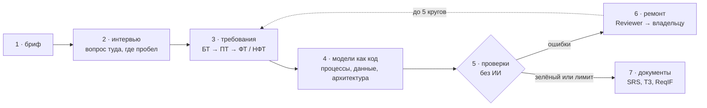

# reqgraph

[English](README.md) | **Русский**

[](https://github.com/Axx-Axvd/reqgraph/actions/workflows/ci.yml)

reqgraph берёт короткое описание задачи от заказчика, проводит с ним интервью и на выходе даёт требования к системе, схемы процессов и данных и, в итоге, два документа: SRS по ISO/IEC/IEEE 29148 и ТЗ по ГОСТ 34.602-2020. Работают несколько ИИ-агентов, но каждый их результат проходит через проверки, в которых ИИ нет вообще. Если проверка нашла ошибку, агент её исправляет, и так пока всё не сойдётся.

Это мой дипломный проект. Сейчас, на 26 октября 2026, готово ядро и агенты (спринты S0–S2), идёт S3: интервью и симулятор заказчика. Из командной строки уже можно пройти путь от брифа до проверенного отчёта. Документы будут в S4, сайт в S5, версия 1.0 — 21 февраля 2027.

## Зачем это нужно

До того как писать код, кто-то должен выяснить, что вообще нужно сделать. Обычно это аналитик: он идёт к заказчику, расспрашивает, записывает требования, рисует схемы. На этом этапе проекты ошибаются чаще всего, и ошибаются одинаково.

Интервью идёт по памяти. Про основной сценарий спросили, а про то, что будет, если врач заболел или пациент не пришёл, забыли. Забыли и про скорость, и про то, где по закону должны лежать персональные данные. Всплывает это потом, когда переделывать дорого.

Требования теряются по дороге. Через неделю уже никто не скажет, откуда взялось требование и что из сказанного заказчиком в документ так и не попало.

Схемы живут отдельно от текста. В тексте шаг добавили, на схеме нет. В модели данных лежит таблица, которая не нужна ни одному требованию.

Нейросеть сейчас может написать ТЗ за минуту, и читается оно хорошо. Но его никто не проверяет: схема может быть неправильной, требование размытым («страница должна грузиться быстро»), а у процесса может быть ветка, которая никуда не ведёт.

И ещё у нас часто нужны сразу два документа, SRS и ТЗ по ГОСТ. Их заполняют руками по отдельности, и через пару правок они начинают противоречить друг другу.

## Как я это решаю

Идея в том, чтобы обращаться с требованиями так же, как программисты обращаются с кодом. Код никто не принимает на веру: каждое изменение прогоняют через автоматические проверки (CI), и если они красные, код не проходит. Здесь то же самое, только проверяются требования и схемы.

Для этого всё хранится в одном графе. Каждое требование, каждый шаг процесса, каждая реплика из интервью там отдельный узел со своим номером, а между ними связи: это требование взято из такого-то ответа, этот шаг процесса реализует такое-то требование. Схемы тоже записаны текстом (JSON для процессов, DBML для данных, PlantUML и Structurizr для остального), поэтому их может читать и проверять программа. BPMN нейросеть сама не рисует вообще: она описывает процесс в простом формате, а BPMN из него собирает компилятор, так что схема всегда валидная.

Проверок 22, работает сейчас 21 (последняя появится вместе с экспортом по ГОСТ). Они ловят конкретные вещи: схема не открывается, из процесса нельзя выйти, формулировка без числа там, где оно нужно, требование не реализовано ни в одной схеме, элемент схемы не нужен ни одному требованию. На одном и том же входе результат всегда один и тот же.

Интервью ведётся не по памяти. Трекер покрытия считает, что уже известно по девяти областям (цели, участники, сценарии, исключения, данные, правила, интеграции, требования к качеству, ограничения), и следующий вопрос идёт туда, где пусто.

## Как это работает



1. Вы пишете бриф, пару предложений вроде «стоматология хочет онлайн-запись».
2. Interviewer задаёт по одному вопросу о той области, где известно меньше всего. Интервью можно поставить на паузу и продолжить потом с того же места.
3. Analyst после каждого ответа записывает требования: бизнес-требования (зачем это клинике), пользовательские (кто что делает), функциональные (что делает система) и нефункциональные (насколько быстро, надёжно, по каким законам). У каждого требования есть ссылка на реплику, из которой оно взято.
4. Modeler рисует процессы и модель данных и привязывает каждый шаг и таблицу к требованию.
5. Запускаются проверки.
6. Если что-то красное, Reviewer раздаёт ошибки тем агентам, чьи они, и те исправляют. Кругов не больше пяти, что не исправилось, остаётся в отчёте с объяснением.
7. Standards заполняет разделы документов, и из того же графа собираются SRS, ТЗ и файл ReqIF для систем управления требованиями.

То, что человек отметил как утверждённое, агенты не трогают. Последнее слово всегда за аналитиком.

Вот так выглядит прогон на брифе пекарни:


## Что должно поменяться

| | Сейчас обычно | С reqgraph |
|---|---|---|
| Интервью | по памяти, исключения и требования к качеству забываются | следующий вопрос выбирается по пробелам в покрытии |
| Откуда требование | через неделю никто не помнит | у каждого есть ссылка на ответ заказчика |
| Схемы | рисуются отдельно и расходятся с текстом | записаны кодом, связаны с требованиями и проверяются |
| Текст от нейросети | никто не проверяет | 21 проверка без ИИ, ошибки уходят обратно агентам |
| SRS и ТЗ | два раза руками | один граф, два документа |
| Черновик | примерно день | цель — примерно час |

## Как я буду проверять, что это работает

Мало сделать систему, надо ещё показать цифрами, что она лучше. Я проверяю четыре гипотезы:

- H1: интервьюер с трекером покрытия вытаскивает из заказчика больше того, что тот знает, но сам не сказал;
- H2: проверки с ремонтом дают больше правильных схем, чем те же агенты без проверок;
- H3: проверки связей не дают тексту и схемам разойтись;
- H4: документы получаются не хуже, чем черновик junior-аналитика, а времени уходит в десять раз меньше. Это оценивают три эксперта вслепую.

Чтобы сравнивать честно, у всех методов одна и та же модель, одни и те же входы и один бюджет.

Главный вопрос в том, как померить «нашли больше». Живого заказчика не опросишь сотни раз, поэтому его играет симулятор. У каждого сценария есть короткий бриф и закрытый список из 25–60 требований, который знает только симулятор. Он рассказывает о требовании, только если вопрос действительно про него. Значит, кто лучше спрашивает, тот больше и находит. Симулятор и судья, который сверяет найденное с закрытым списком, работают на моделях другой семьи, чем агенты, иначе система проверяла бы сама себя. Ещё 20% решений судьи я проверяю руками.

Пороги, которые я себе поставил:

| Что меряем | Минимум (MVP) | Цель диплома |
|---|---|---|
| Найдено скрытых требований | 70% | 85% |
| Корректные схемы | 95% | 100% |
| Процессы, из которых всегда есть выход | 80% | 95% |
| Функциональные требования, которые есть в схемах | 80% | 95% |
| Размытые требования | не больше 15% | не больше 5% |

Сценариев 15: на трёх я настраиваю промпты, двенадцать оставлены на итоговую проверку. Эти двенадцать запечатаны хэшами, и до финального прогона их никто не открывает. Каждый прогон записывает модель, температуру, seed, версии промптов, токены, деньги и время. Неудачные прогоны я записываю так же, как удачные, они в [дневнике](docs/journal.md). Разрабатываю на бесплатных моделях, эксперименты на дешёвых, не больше $20 в месяц.

Подробно методика расписана в [docs/tech-design/09_eval.md](docs/tech-design/09_eval.md).

## Где проект сейчас

| Спринт | Даты | Что в нём | Статус |
|---|---|---|---|
| S0 | 19.10–01.11.2026 | репозиторий, CI, база, слой для работы с моделями, мини-экзамен моделей | готово |
| S1 | 02.11–15.11 | граф, формат процессов и компилятор в BPMN, проверки | готово |
| S2 | 16.11–29.11 | агенты и цикл ремонта, версия 0.1 | готово |
| S3 | 30.11–13.12 | интервьюер с покрытием, симулятор, 15 сценариев, метрики | идёт |
| S4 | 14.12–27.12 | SRS, ТЗ, ReqIF, базовые методы для сравнения, первый прогон, версия 0.5 | впереди |
| S5 | 11.01–24.01.2027 | сайт: вход, интервью в браузере, граф, BPMN, отчёт, выгрузка | впереди |
| S6 | 25.01–07.02 | полное сравнение, абляции, эксперты, живые интервью, статистика | впереди |
| S7 | 08.02–21.02 | версия 1.0, техотчёт, видео, главы диплома | впереди |

Иду с опережением, S3 по плану начинается только 30 ноября. Что уже есть:

- граф и его хранение в обычных файлах, формат процессов с компилятором в BPMN 2.0, модели данных на DBML, картинки схем через Kroki, 21 проверка и команда `reqgraph check`;
- граф прогона на LangGraph, агенты Analyst, Modeler, Standards и Reviewer, цикл ремонта, который замечает, когда агент ходит по кругу, команды `reqgraph init` и `reqgraph run` ([демо](docs/demo/m2.md));
- `reqgraph interview` с паузой и продолжением, 15 сценариев со скрытыми требованиями. Симулятор заказчика и метрики сейчас на проверке.

Все задачи с критериями приёмки лежат в [docs/backlog.md](docs/backlog.md), что и почему решили — в [docs/adr/](docs/adr/README.md).

## Как запустить

Понадобятся [uv](https://docs.astral.sh/uv/), Node.js 22+ и pnpm 10. Для Windows есть отдельная инструкция: [docs/setup/windows.md](docs/setup/windows.md).

```bash
uv sync                           # Python 3.12 и зависимости
uv run pytest -q                  # тесты, сеть не нужна
uv run python scripts/doctor.py   # проверить, что окружение готово
uv run reqgraph --version
```

Чтобы прогнать бриф, нужны бесплатные ключи провайдеров в `.env`, где их взять — в [docs/setup/accounts.md](docs/setup/accounts.md).

```bash
uv run reqgraph init projects/ulybka --name "Стоматология «Улыбка»" --brief brief.md
uv run reqgraph run projects/ulybka        # Analyst → Modeler → Standards → проверки → ремонт
uv run reqgraph check projects/ulybka      # только проверки, без ИИ
uv run reqgraph interview projects/ulybka  # интервью, /готово — закончить, /пауза — пауза
```

Если команда вернула 0, ошибок нет. 1 значит, что ошибки остались, они в `reports/ci-report.md`. 2 значит, что прогон вообще не запустился. Остальные команды собраны в [CLAUDE.md](CLAUDE.md).

<details>
<summary>Для разработки</summary>

```bash
uv run ruff check . && uv run ruff format --check .
uv run mypy packages/core evals/reqgraph_evals
uv run pre-commit install          # хуки перед коммитом, один раз
pnpm install && pnpm -C apps/web lint && pnpm -C apps/web build
pnpm db:start && pnpm db:reset     # локальный Postgres для Supabase, нужен Docker
pnpm db:test                       # тесты прав доступа (RLS)
uv run reqgraph schemas            # JSON Schema из моделей Pydantic
```

</details>

## Что где лежит

- `packages/core` — сама библиотека и команда `reqgraph`: граф, формат процессов, проверки, агенты, работа с моделями, экспорт, симулятор.
- `evals/` — сценарии со скрытыми требованиями, стенд для экспериментов и отчёты прогонов.
- `apps/web` и `apps/api` — сайт на Next.js и его API на FastAPI, появятся в S5.
- `supabase/` — миграции базы и правила доступа.
- [examples/garage61](examples/garage61/README.md) — эталонный проект, сделанный руками: автосервис «Гараж 61».
- [docs/tech-design/](docs/tech-design/README.md) — технический проект по разделам.
- [docs/journal.md](docs/journal.md) — дневник: что делал каждый день и что не получилось.

## Чего reqgraph не делает

Код приложения не пишет и сроки не оценивает. Аналитика не заменяет: любое требование можно поправить или закрыть от изменений. Тексты стандартов ISO и ГОСТ в репозитории не лежат, только мои чек-листы и названия разделов. Полноценным редактором BPMN он тоже не будет, схемы в браузере только смотрят, а правят через формат процессов. Командной работы, ролей и голосового ввода в первой версии нет.

## Стек

Python 3.12, LangGraph, pydantic-ai, pydantic-evals, FastAPI, PM4Py, Kroki, pandoc, Next.js, Supabase, bpmn-js. Модели открытые, через OpenRouter, Groq и Google AI Studio, а для работы без интернета через Ollama.

## Лицензия

[MIT](LICENSE). Тексты стандартов ISO и ГОСТ в репозиторий не входят.

Проверка того, что из процесса всегда есть выход, сделана на [pm4py](https://pypi.org/project/pm4py/), а у него AGPL-3.0-or-later. Поэтому сборка и публичное демо вместе с pm4py идут под AGPL, исходники все здесь (ADR-014). bpmn-js под MIT с условием оставлять видимым водяной знак bpmn.io. Остальные зависимости под MIT, BSD, Apache-2.0, LGPL (psycopg) и MPL-2.0 (hypothesis, только в тестах). Новую зависимость добавляю, только если могу объяснить в PR, зачем она.
