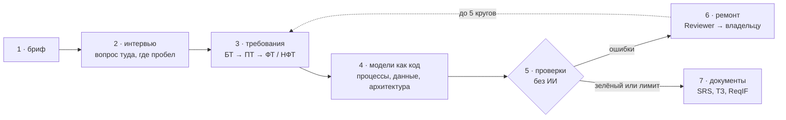

# reqgraph

[English](README.md) | **Русский**

[](https://github.com/Axx-Axvd/reqgraph/actions/workflows/ci.yml)

**reqgraph превращает разговор с заказчиком в требования к программе, которые можно проверить.** Команда ИИ-агентов проводит интервью, записывает требования и рисует схемы, а строгий проверяльщик без ИИ находит ошибки и возвращает их агентам, пока всё не сойдётся. В конце из одного и того же набора требований получаются два документа: спецификация требований по ISO/IEC/IEEE 29148 (SRS) и техническое задание по ГОСТ 34.602-2020.

> **Состояние на 26 октября 2026:** спринты S0–S2 закончены, идёт S3 (интервью и симулятор заказчика) — с опережением плана. Уже сейчас из командной строки работает путь «бриф → требования → схемы → проверки → ремонт». Документы (SRS и ТЗ) появятся в S4, веб-демо — в S5. Релиз v1.0 — 21 февраля 2027.

---

## Содержание

- [Проблема](#проблема)
- [Идея](#идея)
- [Как это работает](#как-это-работает)
- [До и после](#до-и-после)
- [Цели и как мы их измеряем](#цели-и-как-мы-их-измеряем)
- [Ход проекта](#ход-проекта)
- [Попробовать](#попробовать)
- [Что в репозитории](#что-в-репозитории)
- [Чего reqgraph не делает](#чего-reqgraph-не-делает)
- [Стек](#стек)
- [Лицензия](#лицензия)

## Проблема

Прежде чем писать код, кто-то должен выяснить, что программа должна делать. Аналитик разговаривает с заказчиком, записывает требования и рисует схемы: как идёт работа, какие данные хранятся. На этой «первичной документации» спотыкаются многие проекты, и всегда одинаково:

1. **Интервью идёт по памяти.** Аналитик спрашивает про главный сценарий и забывает остальное: что будет, если что-то пошло не так, как быстро должна работать система, какие законы действуют. Пробелы всплывают через месяцы, когда исправлять уже дорого.
2. **Требования теряются по дороге.** Между «заказчик сказал» и «это есть в документе» нет связи: не понять, откуда взялось требование и не выпало ли что-то.
3. **Текст и схемы расходятся.** Схемы рисуют отдельно от текста. В тексте шаг добавили, на схеме — нет; таблица в модели данных не относится ни к одному требованию.
4. **ИИ пишет гладко, но без проверки.** Сегодня можно попросить чат-бот написать требования — и получится читаемый текст. Но его никто не проверяет: схема может быть неверной, требование — размытым («страница грузится быстро»), у процесса — тупик.
5. **Одно и то же вписывают дважды.** В России часто нужны и международная SRS, и ТЗ по ГОСТ. Их заполняют вручную, по отдельности, и потом они расходятся.

## Идея

Относиться к требованиям так, как программисты относятся к коду.

Программисты не верят коду за то, что он красиво выглядит: каждое изменение проходит автоматические проверки (тесты, линтеры, «CI»), и сломанный код не проходит. reqgraph приносит ту же дисциплину в требования:

- **Один источник правды.** Каждое требование, элемент схемы и ответ из интервью — узел одного графа, с номером и связями: *это требование взято из того ответа*, *этот шаг процесса реализует то требование*.
- **Схемы — это код.** Процессы, модели данных и архитектура записаны текстом (формат процесса в JSON, DBML, PlantUML, Structurizr), поэтому программа может их прочитать и проверить. ИИ никогда не рисует BPMN-схему сам: он описывает процесс в простом формате, а компилятор делает из него правильную BPMN-схему.
- **Строгие проверки без ИИ.** 22 детерминированные проверки ищут настоящие дефекты: неверные схемы, шаги процесса, которые никуда не ведут, размытые формулировки, требования, которые не реализует ни одна схема, элементы схем без требований. Один и тот же вход — всегда один и тот же результат.
- **Цикл ремонта.** Если проверка не прошла, агент Reviewer превращает ошибку в задачу для агента-владельца, и тот исправляет. Так до зелёного отчёта или до предела итераций; что осталось — объясняется в отчёте.
- **Интервьюер, который знает, о чём ещё не спросил.** Трекер покрытия считает, что уже известно по 9 областям (цели, участники, сценарии, исключения, данные, правила, интеграции, требования к качеству, ограничения), и направляет интервьюера туда, где пусто.

## Как это работает



1. **Бриф.** Вы описываете идею в паре предложений: «стоматология хочет онлайн-запись».
2. **Интервью.** Агент **Interviewer** задаёт по одному вопросу — всегда о той области, которая покрыта меньше всего. Можно поставить на паузу и продолжить потом.
3. **Требования.** Агент **Analyst** превращает каждый ответ в требования четырёх видов: бизнес-требования (зачем), пользовательские (кто что делает), функциональные (что делает система) и нефункциональные (насколько хорошо: скорость, надёжность, закон). У каждого есть ссылка на ответ, из которого оно взято.
4. **Модели.** Агент **Modeler** описывает процессы и модель данных и связывает каждый шаг и таблицу с требованием, которое они реализуют.
5. **Проверки.** 22 проверки в пяти группах: схема (корректен ли файл), soundness (может ли каждый процесс завершиться), ISO 29148 (понятна ли и измерима формулировка), трассировка (всё ли связано), шаблоны (заполнены ли все разделы документа).
6. **Ремонт.** Агент **Reviewer** отдаёт каждую ошибку её владельцу; круг повторяется.
7. **Документы.** Агент **Standards** заполняет разделы, экспортёры собирают SRS, ТЗ по ГОСТ и файл ReqIF для систем управления требованиями — всё из одного графа.

Узлы, которые человек отметил как *утверждённые*, агенты никогда не меняют: главным остаётся аналитик.


## До и после

| | Обычно | С reqgraph |
|---|---|---|
| Интервью | по памяти; требования к качеству и исключения забываются | трекер покрытия по 9 областям выбирает следующий вопрос |
| Откуда взялось требование | через неделю уже никто не помнит | у каждого требования — ссылка на ответ из интервью |
| Схемы | рисуют отдельно, они расходятся с текстом | записаны кодом, связаны с требованиями, проверяются |
| Текст от ИИ | читается хорошо, никто не проверяет | 22 проверки без ИИ; ошибки возвращаются агентам |
| SRS и ТЗ по ГОСТ | вручную, дважды | один граф, два экспортёра, проверка полноты |
| Правки | одна правка незаметно ломает другое | после любой правки — снова проверки |
| Время до первого черновика | около дня | цель — около часа (гипотеза H4 ниже) |

## Цели и как мы их измеряем

reqgraph — ещё и исследование: подход нужно *доказать*, а не просто показать. Проверяем четыре гипотезы — на одних и тех же входах, с одной моделью ИИ и одним бюджетом для всех методов:

| | Гипотеза простыми словами | Как проверяем |
|---|---|---|
| **H1** | Интервьюер с трекером покрытия находит больше того, что заказчик знает, но не сказал сам | доля найденных «скрытых требований» (recall) |
| **H2** | Цикл «проверка → ремонт» даёт больше правильных схем | доля корректных схем и процессов, которые могут завершиться |
| **H3** | Проверки трассировки не дают тексту и схемам разойтись | доля требований, реализованных в модели; доля элементов без требований |
| **H4** | Документы reqgraph не хуже черновика junior-аналитика при вдесятеро меньшем времени | слепые оценки трёх экспертов |

**Как устроены «скрытые требования».** Настоящего заказчика нельзя опросить сотни раз, поэтому его роль играет **симулятор заказчика**. В каждом сценарии есть короткий бриф и секретный список из 25–60 требований, который знает только симулятор. Он рассказывает о требовании, только когда вопрос действительно о нём, — значит, кто лучше спрашивает, тот больше находит. Симулятор и судья, который сопоставляет найденное с секретным списком, — другой семьи моделей, чем агенты, чтобы система не проверяла сама себя, а 20% решений судьи проверяет человек.

**Пороги приёмки:**

| Метрика | MVP | Цель диплома |
|---|---|---|
| Найдено скрытых требований | ≥ 70% | ≥ 85% |
| Корректные схемы | ≥ 95% | 100% |
| Процессы, которые всегда могут завершиться | ≥ 80% | ≥ 95% |
| Функциональные требования, реализованные в модели | ≥ 80% | ≥ 95% |
| Размытые требования | ≤ 15% | ≤ 5% |

**Правила честного эксперимента:** 15 сценариев — 3 для настройки, 12 для итоговой проверки. 12 тестовых сценариев запечатаны хэшами и не открываются до финального прогона. Каждый прогон записывает модель, температуру, seed, версии промптов, токены, стоимость и время. Неудачные прогоны и отвергнутые идеи записываются так же, как удачные ([docs/journal.md](docs/journal.md)). Разработка идёт на бесплатных моделях, эксперименты — на дешёвых: не больше $20 в месяц.

Методика целиком: [docs/tech-design/09_eval.md](docs/tech-design/09_eval.md).

## Ход проекта

| Спринт | Даты | Цель | Статус |
|---|---|---|---|
| S0 · Фундамент | 19.10–01.11.2026 | репозиторий, CI, база, слой ИИ, мини-экзамен моделей | ✅ готово |
| S1 · Граф, формат процессов, проверки | 02.11–15.11 | ядро без ИИ: граф, компилятор BPMN, проверки | ✅ готово |
| S2 · Агенты и цикл ремонта | 16.11–29.11 | **v0.1**: из брифа — требования, схемы и проверенный отчёт | ✅ готово |
| S3 · Интервью и симулятор | 30.11–13.12 | интервьюер с покрытием, симулятор заказчика, 15 сценариев, метрики | 🔄 идёт |
| S4 · Документы и первая оценка | 14.12–27.12 | **v0.5**: SRS, ТЗ, ReqIF; базовые методы; первый прогон на сценариях настройки | ⏳ в плане |
| S5 · Веб и деплой | 11.01–24.01.2027 | публичное демо: вход, интервью в браузере, граф, BPMN, отчёт, выгрузка | ⏳ в плане |
| S6 · Эксперименты | 25.01–07.02 | полное сравнение, абляции, оценки экспертов, живые интервью, статистика | ⏳ в плане |
| S7 · Релиз | 08.02–21.02 | **v1.0**, техотчёт, демо-видео, главы диплома | ⏳ в плане |

**Что есть уже сейчас:**

- **S0–S1:** граф артефактов и его хранение в обычных файлах, формат процессов и компилятор в BPMN 2.0, модели данных (DBML), схемы в SVG через Kroki, 21 работающая проверка и команда `reqgraph check`.
- **S2:** граф прогона на LangGraph и четыре агента (Analyst, Modeler, Standards, Reviewer), цикл ремонта с детектором повторяющихся ошибок, команды `reqgraph init` и `reqgraph run`, демо M2 ([docs/demo/m2.md](docs/demo/m2.md)).
- **S3 на сегодня:** `reqgraph interview` с покрытием, паузой и продолжением (T-301); 15 сценариев со скрытыми требованиями, тестовый набор запечатан (T-303). На проверке: симулятор заказчика (T-302) и метрики на pydantic-evals (T-304).

Все задачи, их критерии приёмки и статусы — [docs/backlog.md](docs/backlog.md). Что сделано за каждый день, включая неудачи, — [docs/journal.md](docs/journal.md). Решения и причины — [docs/adr/](docs/adr/README.md).

## Попробовать

Нужны [uv](https://docs.astral.sh/uv/), Node.js ≥ 22 и pnpm 10 (для Windows — [docs/setup/windows.md](docs/setup/windows.md)).

```bash
uv sync                           # Python 3.12 и зависимости
uv run pytest -q                  # тесты, сеть не нужна
uv run python scripts/doctor.py   # готово ли окружение
uv run reqgraph --version
```

Из брифа в проверенный отчёт (нужны бесплатные ключи в `.env`, см. [docs/setup/accounts.md](docs/setup/accounts.md)):

```bash
uv run reqgraph init projects/ulybka --name "Стоматология «Улыбка»" --brief brief.md
uv run reqgraph run projects/ulybka        # Analyst → Modeler → Standards → проверки → ремонт
uv run reqgraph check projects/ulybka      # проверки ещё раз, без ИИ
uv run reqgraph interview projects/ulybka  # интервью: /готово — закончить, /пауза — пауза
```

Коды выхода: 0 — ошибок нет, 1 — ошибки остались (они в `reports/ci-report.md`), 2 — прогон не начался. Остальные команды — в [CLAUDE.md](CLAUDE.md).

<details>
<summary>Команды разработчика</summary>

```bash
uv run ruff check . && uv run ruff format --check .
uv run mypy packages/core evals/reqgraph_evals
uv run pre-commit install          # хуки перед каждым коммитом (один раз)
pnpm install && pnpm -C apps/web lint && pnpm -C apps/web build
pnpm db:start && pnpm db:reset     # локальный Postgres для Supabase (нужен Docker)
pnpm db:test                       # тесты прав доступа к строкам (RLS)
uv run reqgraph schemas            # JSON Schema из моделей Pydantic
```

</details>

## Что в репозитории

| Где | Что |
|---|---|
| `packages/core` | библиотека и команда `reqgraph`: граф, формат процессов, проверки, агенты, слой ИИ, экспортёры, симулятор |
| `evals/` | сценарии со скрытыми требованиями, стенд экспериментов, отчёты всех прогонов |
| `apps/web`, `apps/api` | веб-демо (Next.js) и его API (FastAPI) — с S5 |
| `supabase/` | миграции базы и правила доступа |
| [examples/garage61](examples/garage61/README.md) | эталонный проект, сделанный вручную: автосервис «Гараж 61» |
| [docs/tech-design/](docs/tech-design/README.md) | технический проект по разделам |
| [docs/adr/](docs/adr/README.md) | 17 записей о решениях (16 принято, 1 отклонено) |
| [docs/backlog.md](docs/backlog.md) · [docs/journal.md](docs/journal.md) | задачи с критериями приёмки · дневник работы |

## Чего reqgraph не делает

- Не пишет код приложения и не оценивает трудоёмкость.
- Не заменяет аналитика: любое требование можно поправить или заблокировать, а утверждённое человеком агенты не трогают.
- Не хранит тексты стандартов ISO и ГОСТ — только свои чек-листы и названия разделов.
- Не является полноценным редактором BPMN: схемы смотрят в браузере, правят — через формат процессов.
- В первой версии нет команд, ролей, совместной правки в реальном времени и голоса.

## Стек

Python 3.12 · LangGraph · pydantic-ai · pydantic-evals · FastAPI · PM4Py · Kroki · pandoc · Next.js · Supabase · bpmn-js · open-weight модели через OpenRouter, Groq, Google AI Studio и Ollama (офлайн).

## Лицензия

[MIT](LICENSE). Тексты стандартов ISO и ГОСТ в репозиторий не входят — только собственные чек-листы и названия разделов.

Проверка soundness процессов использует [pm4py](https://pypi.org/project/pm4py/) (AGPL-3.0-or-later), поэтому сборка и публичное демо вместе с pm4py подчиняются AGPL; исходники открыты в этом репозитории (ADR-014). bpmn-js (MIT с условием) требует оставлять видимым водяной знак bpmn.io. Остальные зависимости — MIT, BSD, Apache-2.0, LGPL (psycopg) и MPL-2.0 (hypothesis, только тесты). Новая зависимость добавляется только с обоснованием в pull request.
