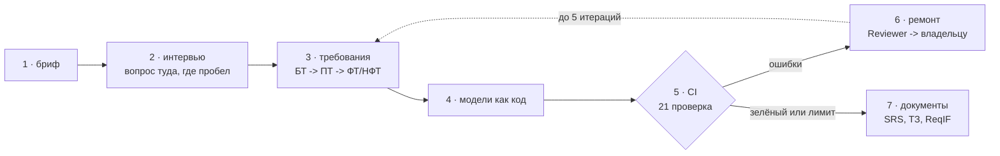
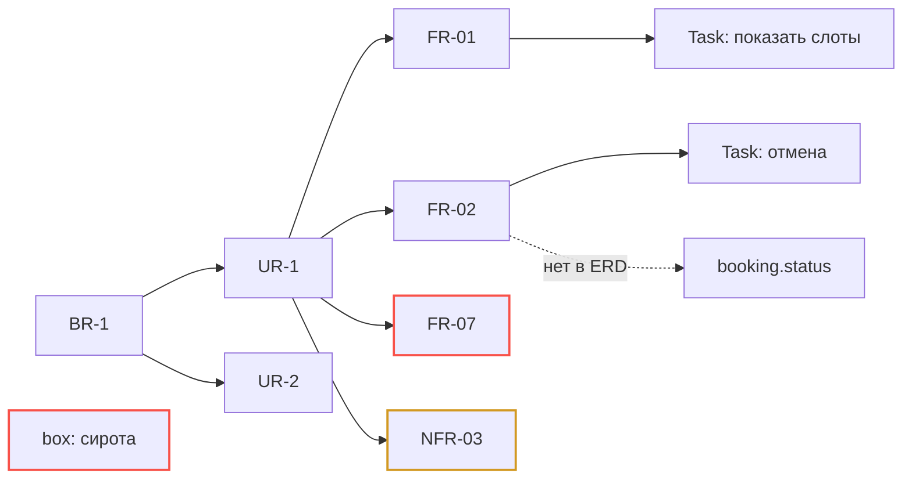

<sub>reqgraph · tech design v1.0 · [README](README.md) · [01_why](01_why.md) · [02_arch](02_arch.md) · [03_agents](03_agents.md) · [04_data](04_data.md) · [05_ci](05_ci.md) · [06_models](06_models.md) · [07_deploy](07_deploy.md) · [08_plan](08_plan.md) · [09_eval](09_eval.md) · [10_claude](10_claude.md)</sub>

# 01 Overview

*как система работает от брифа до документа, кто её использует, чего она не делает*

Пользователь даёт короткий бриф. Агент-интервьюер задаёт вопросы туда, где покрытие тем меньше всего. Аналитик превращает ответы в требования, моделировщик — в модели, агент стандартов — в разделы документов. Затем CI проверяет граф; ошибки получает Reviewer и раздаёт задачи владельцам. Когда отчёт зелёный или исчерпан лимит итераций, система выгружает документы вместе с отчётом проверок.



*рис.1 - сквозной поток: семь шагов и цикл ремонта*

## Пользователи

| Кто | Цель | Как использует |
|---|---|---|
| Junior-аналитик, студент | быстро получить первичную документацию и не забыть важное | веб-демо на Streamlit: интервью, просмотр графа, выгрузка DOCX |
| Опытный аналитик | черновик за час вместо дня, проверка своего ТЗ | CLI + git: импорт своих требований, reqgraph check |
| Научный руководитель, комиссия | увидеть измеримый результат | страница результатов в демо, отчёты CI |
| Исследователь (ты) | сравнить методы на сценариях | evals/harness: матрица сценарий x персона x метод |

## Сквозной пример: автосервис «Гараж 61»

**`interview · garage61`**

```text
client> Хотим онлайн-запись в автосервис, сейчас всё по телефону.
  [coverage] цели 1/2 · роли 0/2 · сценарии 0/4 · НФТ 0/4 ...
agent> Кто будет записываться: только частные клиенты или и корпоративные?
client> И те и другие. У корпоративных договор и отсрочка оплаты.
  [coverage] роли 2/2 · бизнес-правила 1/3 -> BR-2, UR-3 созданы
agent> Что происходит, если клиент не приехал? Нужна ли предоплата?
client> Пока ничего. Но неявки — это 15% слотов, хотим напоминания.
  [coverage] исключения 1/3 · НФТ 0/4 -> следующий вопрос: надёжность
```

`bash — reqgraph check garage61/`

```console
$ reqgraph check garage61/
[sound]    FAIL SND-001  PRC-01.G01 ветка 'нет' не достигает конца
[trace]    FAIL TRC-002  FR-007 'напоминание за 24 ч' не реализовано
[trace]    WARN TRC-003  ENT-04 'box' не связан ни с одним требованием
[iso29148] FAIL ISO-003  NFR-003 'быстро загружается': нет метрики
---------- 3 failed, 1 warning, 37 passed   iteration 1/5 -> reviewer
```


FR-07 не реализовано в моделях; `box` — элемент модели без требований; NFR-03 без измеримого критерия; `booking.status` нет в ERD.

*рис.2 - граф трассировки после первой итерации: красное чинит Modeler, жёлтое — Analyst*

## Чего система не делает (non-goals v1)

- не генерирует код приложения и не оценивает трудоёмкость;

- не заменяет аналитика: каждое требование можно поправить или заблокировать (status=approved агенты не трогают);

- не хранит тексты ISO и ГОСТ — только свои чек-листы и структуры разделов;

- не является полноценным редактором BPMN: в UI просмотр, правка — через DSL или граф;

- нет организаций, ролей и совместной работы в реальном времени; нет голоса — это v1.x.

## Версии продукта

| Версия | Веха | Что умеет |
|---|---|---|
| `v0.1` | M2 · 29.11 | CLI: бриф -> требования -> процессы и ERD -> CI -> ремонт; FileStore |
| `v0.5` | M4 · 27.12 | интервью с покрытием, симулятор, SRS и ТЗ в DOCX, ReqIF, evals v1 |
| `v1.0` | M7 · 21.02 | веб-демо на Streamlit с лимитами, UML и C4, страница результатов, статья-отчёт |
| `v1.x` | после диплома | IDEF0, экспорт в Jira / Confluence через MCP, импорт документов, голос, EN-интерфейс |
