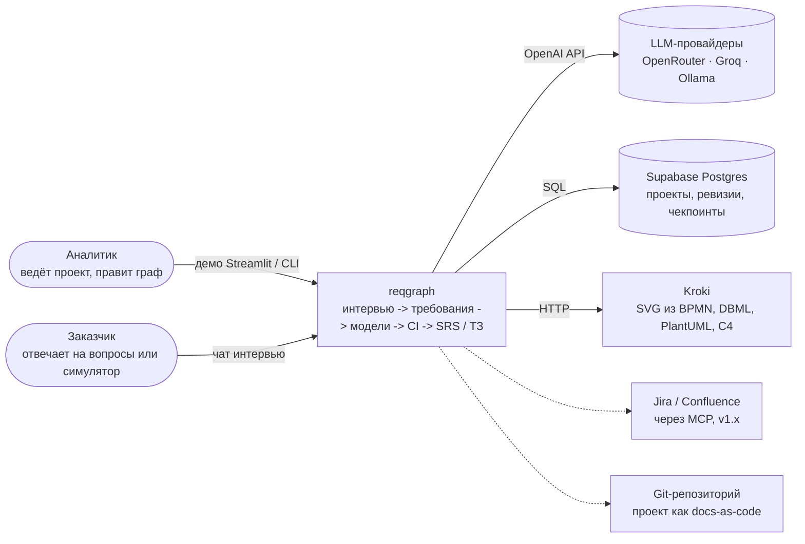
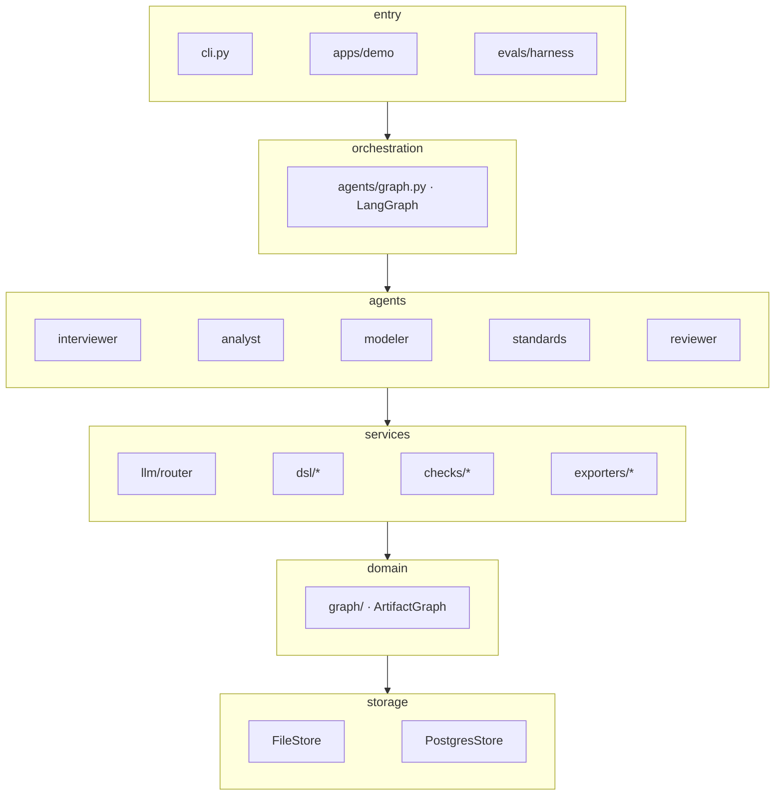

<sub>reqgraph · tech design v1.0 · [README](README.md) · [01_why](01_why.md) · [02_arch](02_arch.md) · [03_agents](03_agents.md) · [04_data](04_data.md) · [05_ci](05_ci.md) · [06_models](06_models.md) · [07_deploy](07_deploy.md) · [08_plan](08_plan.md) · [09_eval](09_eval.md) · [10_claude](10_claude.md)</sub>

# 02 Architecture

*контекст, слои, стек, структура каталогов*

## Контекст системы (C4, уровень 1)



*рис.3 - C4 System Context: люди, система и внешние сервисы*

## Слои ядра

Ядро — Python-пакет `reqgraph`. Его используют CLI, демо на Streamlit и харнес экспериментов, поэтому вся логика живёт в пакете, а приложения остаются тонкими. Детерминированная часть (граф, DSL, проверки, экспорт) не знает про LLM и тестируется без сети.


Зависимости идут только вниз: `domain` не импортирует `agents`, `checks` не вызывают LLM.

*рис.4 - слои пакета reqgraph и направление зависимостей*

## Принципы

- **LLM только на краях.** Модель предлагает патч, код решает, применять ли его. Идентификаторы, связи, BPMN XML и документы генерирует код.

- **Всё типизировано.** Любой вход и выход агента — Pydantic-модель; JSON Schema экспортируется в schemas/ и используется фронтендом.

- **Воспроизводимость.** В runs пишутся модель, температура, seed, хэш промпта и версия пакета; прогон можно повторить.

- **Идемпотентность.** Повторный запуск узла с тем же чекпоинтом даёт тот же патч или явный конфликт.

- **Человек главнее агента.** Утверждённые требования заблокированы; ручная правка создаёт ревизию author=user.

## Стек

<p align="right"><sub>Таблица 3 - версии закрепляются в uv.lock в S0 (проверены 21.10.2026, см. docs/research/2026-10-versions.md); готовые средства — ADR-013…016; ниже — минимальные требования</sub></p>

| Слой | Технологии | Зачем |
|---|---|---|
| `Язык и сборка` | Python 3.12, uv, ruff, mypy (strict для core) | быстрые установки, единый линтер |
| `Домен` | Pydantic v2, networkx | модели графа, алгоритмы на графах (достижимость, сироты) |
| `Агенты` | langgraph, langgraph-checkpoint-postgres / -sqlite, psycopg 3 | граф состояний, interrupt, чекпоинты (Postgres в облаке, SQLite локально) |
| `LLM` | pydantic-ai-slim[openai], genai-prices | структурный вывод в Pydantic, ретраи, FallbackModel, лимиты, цена вызова (ADR-013) |
| `Модели как код` | lxml (BPMN XSD), pm4py (soundness, ленивый импорт, ADR-014), pydbml, httpx -> Kroki | компиляция, валидация, soundness, SVG (BPMN — bpmn-js, остальное — Kroki) |
| `Текст и правила` | pymorphy3, rapidfuzz, PyYAML | лемматизация для ISO-правил, нечёткое сопоставление сущностей |
| `Экспорт` | Jinja2, pypandoc-binary (pandoc), reqif | Markdown → DOCX по reference.docx (ADR-016), ReqIF 1.2 |
| `CLI` | typer, rich | reqgraph init / interview / run / check / export / probe |
| `Демо` | Streamlit (chat, graphviz_chart, download_button), bpmn-js с CDN в components.html | интервью, граф, BPMN, отчёт CI, выгрузка (ADR-015) |
| `Данные` | Supabase Postgres (облако), SQLite + FileStore (локально и офлайн); Supabase CLI только в CI | ревизии графа, прогоны, чекпоинты |
| `Тесты` | pytest, pytest-recording (VCR), pytest-socket, hypothesis | LLM-ответы записаны в кассеты, сеть в юнит-тестах закрыта |
| `Эксперименты` | pydantic-evals, scipy, statsmodels | probe, харнес, метрики, LLM-судья, статистика |
| `Инфра` | GitHub Actions, Streamlit Community Cloud, Kroki | CI, деплой; офлайн-стенд без Docker (ADR-015) |
| `Наблюдаемость` | run_events (Postgres или JSONL); опционально Logfire / OpenTelemetry из pydantic-ai | стоимость и трейсы каждого вызова |

## Структура репозитория

**`tree -L 3 reqgraph/   (1/2)`**

```text
reqgraph/
├── CLAUDE.md                  # правила для Claude Code (см. 10_claude)
├── README.md  LICENSE  CHANGELOG.md  .env.example
├── pyproject.toml             # uv workspace: packages/core, apps/demo
├── packages/core/src/reqgraph/
│   ├── graph/                 # models.py nodes.py edges.py patch.py ids.py
│   │   └── store/             # base.py file_store.py postgres_store.py
│   ├── dsl/                   # process.py bpmn_compile.py layout.py soundness.py
│   │                          # dbml.py plantuml.py c4.py kroki.py idef0.py
│   ├── checks/                # base.py registry.py schema.py sound.py
│   │                          # iso29148.py trace.py template.py report.py
│   ├── agents/                # state.py graph.py runtime.py
│   │   ├── interviewer.py analyst.py modeler.py standards.py reviewer.py
│   │   ├── coverage.py        # трекер покрытия интервью
│   │   └── prompts/           # *.md, по одному на агента и задачу
│   ├── llm/                   # router.py (pydantic-ai) roles.yaml
│   ├── exporters/             # srs.py tz_gost.py reqif.py markdown.py
│   │   └── templates/         # srs.md.j2 tz_gost34.md.j2 reference.docx
│   ├── sim/                   # stakeholder.py judge.py
│   ├── standards/             # iso29148_srs.yaml gost34_602.yaml
│   │                          # iso25010.yaml vague_terms_ru_en.yaml
│   └── cli.py
├── packages/core/tests/       # unit/ golden/ fixtures/{good,bad}/ cassettes/
└── schemas/                   # *.schema.json, генерируются из Pydantic
```

**`tree -L 3 reqgraph/   (2/2)`**

```text
├── apps/demo/                 # Streamlit (ADR-015)
│   ├── app.py                 # проекты, интервью-чат, граф, BPMN, отчёт CI, выгрузка
│   ├── components/            # bpmn_viewer.html (bpmn-js с CDN)
│   └── pyproject.toml
├── supabase/
│   ├── migrations/            # 0001_init.sql (таблицы + RLS без политик для anon)
│   └── config.toml
├── evals/
│   ├── scenarios/<id>/        # brief.md hidden.yaml persona.yaml gold/
│   ├── harness/  baselines/  metrics/  probe/
│   └── reports/               # results.csv, графики, отчёт для диплома
├── examples/garage61/         # эталонный проект docs-as-code
├── docs/                      # tech-design.pdf adr/ architecture.md thesis/
└── .github/workflows/         # ci.yml evals.yml migrate.yml keepalive.yml
```
