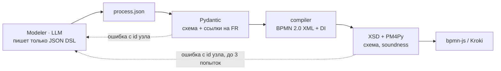
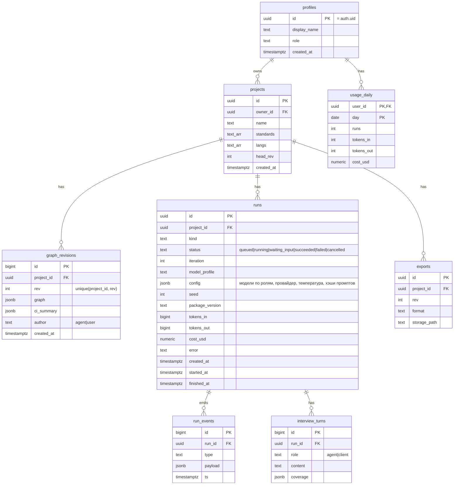

<sub>reqgraph · tech design v1.0 · [README](README.md) · [01_why](01_why.md) · [02_arch](02_arch.md) · [03_agents](03_agents.md) · [04_data](04_data.md) · [05_ci](05_ci.md) · [06_models](06_models.md) · [07_deploy](07_deploy.md) · [08_plan](08_plan.md) · [09_eval](09_eval.md) · [10_claude](10_claude.md)</sub>

# 04 Data

*граф артефактов, форматы файлов, DSL процессов, схема Supabase*

## Узлы графа

| Префикс | Тип | Ключевые поля | Создаёт |
|---|---|---|---|
| `BR-001` | business requirement | statement, goal_metric, priority | Analyst |
| `UR-001` | user requirement | actor, statement, scenario | Analyst |
| `FR-001` | functional | statement (EARS), acceptance[], priority | Analyst |
| `NFR-001` | nonfunctional | iso25010, metric{name, unit, threshold, method} | Analyst |
| `CON-001` | constraint | type: legal\|budget\|time\|tech, statement | Analyst |
| `ACT-01` | actor | name, description | Analyst |
| `PRC-01` | process | dsl (JSON), bpmn_path; задачи PRC-01.T03, шлюзы PRC-01.G01 | Modeler |
| `ENT-01` | entity | attributes[], атрибут как ENT-01.status | Modeler |
| `UC-01` | use case | actor, goal, puml | Modeler |
| `C4-SYS / C4-CNT-01 / C4-EXT-01` | c4 element | kind, technology, dsl | Modeler |
| `TURN-0001` | interview turn | role, text, area_tags[] | система |
| `SEC-SRS-3.2` | document section | template, text, refs[] | Standards |

## Рёбра

| Ребро | Откуда -> куда | Смысл | Проверка |
|---|---|---|---|
| `refines` | UR->BR, FR/NFR->UR | уточняет | TRC-001 |
| `realized_by` | FR -> задача процесса, UC, ENT, C4 | реализуется элементом модели | TRC-002, TRC-003 |
| `derived_from` | требование -> TURN | откуда взялось | TRC-006 |
| `rendered_in` | узел -> SEC | где описано в документе | TPL-001/002 |
| `conflicts_with` | требование <-> требование | найденное противоречие | вопрос интервьюера |
| `depends_on` | FR -> FR | порядок и зависимость | — |

## Форматы: требования и процесс

**`garage61/requirements/functional.yaml`**

```yaml
- id: FR-007
  title: "Напоминание о записи"
  statement: "За 24 ч до визита система должна отправить клиенту SMS с датой и адресом"
  priority: must                       # MoSCoW
  status: draft                        # draft | reviewed | approved
  acceptance:
    - "SMS уходит в интервале 24 ч +/- 15 мин до начала слота"
    - "при отмене записи напоминание не отправляется"
  refines: [UR-003]
  derived_from: [TURN-0007]
  realized_by: [PRC-01.T05]            # заполняет Modeler
```

**`garage61/models/processes/PRC-01_booking.process.json`**

```json
{ "id": "PRC-01", "name": "Запись на обслуживание", "lanes": ["Клиент", "Система"],
  "nodes": [
    {"id": "S",   "type": "start",  "lane": "Клиент"},
    {"id": "T01", "type": "task",   "name": "Выбрать услугу", "lane": "Клиент", "realizes": ["FR-001"]},
    {"id": "T02", "type": "task",   "name": "Показать слоты", "lane": "Система", "realizes": ["FR-002"]},
    {"id": "G01", "type": "xor",    "name": "Слот свободен?"},
    {"id": "T03", "type": "task",   "name": "Создать запись", "lane": "Система", "realizes": ["FR-003"]},
    {"id": "T05", "type": "timer",  "name": "За 24 ч: SMS", "realizes": ["FR-007"]},
    {"id": "E",   "type": "end"} ],
  "flows": [["S","T01"], ["T01","T02"], ["T02","G01"],
            ["G01","T03","да"], ["G01","T02","нет"], ["T03","T05"], ["T05","E"]] }
```

> Пример иллюстративный и упрощён. Источник правды — эталон [examples/garage61](../../examples/garage61/models/processes/).

<sub>Типы узлов DSL v1: start, end, task, user_task, service_task, timer, message, xor, and, event_based. Компилятор строит BPMN 2.0 XML с дорожками и DI-раскладкой (слои по топологической сортировке, дорожки по lane), затем XSD и PM4Py-проверку soundness.</sub>

**Формат DSL v1** (публичная схема `schemas/process-dsl.schema.json`, модель `reqgraph.dsl.process.ProcessDSL`, T-103)

| Поле | Что | Правило |
|---|---|---|
| `dsl_version` | версия формата | `1` |
| `id`, `name` | `PRC-01`, название | обязательны |
| `refines` | UR, которые процесс уточняет | метаданные DSL, не связь графа (сверка — T-107) |
| `lanes` | дорожки сверху вниз | названия не повторяются |
| `nodes[]` | `id` (`S`, `T01`, `G01`: латиница, с заглавной), `type`, `name`, `lane`, `realizes` (FR), `event` (`timer`/`message`, только у `start`), `timer` (когда срабатывает; обязателен у `timer` и у старта-таймера) | id не повторяются; `lane` — из `lanes` |
| `flows[]` | `["S","T01"]` или `["G01","T04","да"]` — подпись ветки | концы — существующие шаги |

Проверяется только форма; логика процесса (всё достижимо, процесс sound) — проверки SND-* (T-106). Шаг без `lane` ставится в дорожку предыдущего шага.

**Id в BPMN = ссылки графа.** Шаг `T05` процесса `PRC-01` в BPMN имеет id `PRC-01.T05` — ровно как в `realized_by`; стрелки — `PRC-01.F01…` по порядку `flows`. Компилятор: `reqgraph.dsl.bpmn_compile.compile_bpmn()`, проверка по официальным XSD OMG — `reqgraph.dsl.bpmn_xsd.validate_bpmn()`, из командной строки — `uv run reqgraph bpmn <процесс.json> -o <файл.bpmn>`.



*рис.6 - от JSON DSL до диаграммы: LLM никогда не пишет BPMN XML*

## Патч графа — единственный способ изменить граф

**`GraphPatch (вывод любого агента)`**

```json
{ "ops": [
   {"op": "add",    "kind": "NFR", "tmp_id": "n1", "fields": {"title": "Время ответа",
     "iso25010": "performance_efficiency", "metric": {"name": "p95 latency",
     "unit": "ms", "threshold": "<= 800", "method": "нагрузочный тест 50 rps"}}},
   {"op": "link",   "from": "n1", "rel": "refines", "to": "UR-002"},
   {"op": "update", "id": "NFR-003", "fields": {"status": "draft"}},
   {"op": "unlink", "from": "FR-004", "rel": "realized_by", "to": "PRC-01.T03"},
   {"op": "remove", "id": "ENT-04", "reason": "TRC-003 orphan, task RT-12"} ],
  "schema_version": 1,
  "rationale": "уточнил НФТ по задаче RT-11" }
```

Пять операций: `add`, `link`, `unlink`, `update`, `remove`. Схема публичная и версионируется (`schema_version`, сейчас 1; файлы [schemas/](../../schemas/) создаёт `uv run reqgraph schemas`).

- `add` — id выдаёт код (`IdAllocator`), поле `id` в `fields` запрещено; исключение — раздел `SEC-…`: его id приходит из шаблона документа. `tmp_id` называет узел внутри патча, на него можно ссылаться в `link` и в полях-ссылках (`UR.actor`), в том числе раньше самой операции `add`.
- `link` / `unlink` — `from` и `to`: настоящий id, `tmp_id` или подэлемент (`PRC-01.T05`). Допустимость пары видов — таблица в `graph/edges.py`; повторный `link` ничего не меняет, `unlink` несуществующей связи — ошибка. `conflicts_with` симметрична и хранится один раз.
- `update` — меняет перечисленные поля; `id` и `kind` менять нельзя.
- `remove` — убирает узел и все его связи (в том числе на подэлементы); причина обязательна. Узел, на который ещё ссылается поле другого узла (`UR.actor`), удалить нельзя.

`ArtifactGraph.apply(patch, ids=None, actor="agent")` применяет патч целиком или не применяет вовсе (граф и счётчики id остаются прежними) и возвращает `ApplyResult(graph, id_map, diff)`: настоящие id новых узлов и список изменений. `actor="agent"` не может ставить `status=approved` и менять, удалять, связывать или отвязывать утверждённые узлы (в том числе убирать их связи каскадом); `actor="user"` — может всё. Номера удалённых узлов не выдаются повторно: «высшие отметки» счётчиков хранятся в графе (`high_water`).

## Проект как docs-as-code

**`examples/garage61/`**

```text
garage61/
├── reqgraph.yaml              # стандарты, языки, профиль моделей
├── requirements/              # business.yaml user.yaml functional.yaml
│                              # nonfunctional.yaml constraints.yaml actors.yaml
├── models/processes/          # PRC-01_booking.process.json + .bpmn
├── models/data/erd.dbml
├── models/uml/                # use_cases.puml seq_booking.puml
├── models/c4/workspace.dsl
├── trace/edges.yaml           # все рёбра графа
├── interview/                 # transcript.jsonl coverage.json
├── reports/                   # ci-report.json ci-report.md
└── exports/                   # SRS_ISO29148.docx TZ_GOST34_602.docx req.reqif
```

<sub>FileStore (`reqgraph.graph.store`, T-102) читает и пишет эту папку (CLI, тесты, git). SupabaseStore хранит тот же граф целиком в `graph_revisions.graph` (jsonb) — проект 100-300 требований занимает сотни килобайт, поэтому 500 МБ бесплатной базы хватает на тысячи ревизий; старые ревизии и чекпоинты чистит ежедневная задача.</sub>

**Что читает и пишет FileStore**

| Файл | Что в графе | Запись |
|---|---|---|
| `reqgraph.yaml` | настройки проекта (`ProjectConfig`, схема `schemas/project-config.schema.json`, версия 1) | без изменений — как был |
| `requirements/*.yaml` | BR, UR, FR, NFR, CON, ACT и связи `refines`, `derived_from`, `realized_by`, `depends_on`, `conflicts_with` в узле-источнике | без изменений — как был; изменился — канонический вид (узлы по id, порядок полей как в эталоне) |
| `interview/transcript.jsonl` | TURN | так же |
| `models/processes/*.process.json` | PRC (весь DSL в узле) | так же; новый процесс — `PRC-xx.process.json`; удалённый — файл удаляется |
| `models/**/*.dbml`, `*.puml`, `*.dsl` | ENT, UC, C4 — временный сканер по соглашениям эталона (до T-104) | байт в байт; изменения ENT/UC/C4 в графе пока отклоняются |
| `trace/edges.yaml` | не читается в граф, сверяется (расхождение — предупреждение) | пересоздаётся |
| `trace/ids.yaml` | «высшие отметки» счётчиков id | только если удалённые номера выше существующих |

Не пишутся: разделы документа (SEC) и связи `rendered_in` — их пересоздаёт экспорт (S4). Не трогаются: `README.md`, `REVIEW.md`, `reports/`, `exports/`, `interview/coverage.json`.

## Схема Supabase


Служебная схема `lg` (checkpoints, checkpoint_blobs, checkpoint_writes) создаётся `PostgresSaver.setup()`; `thread_id = run_id`. RLS: всё через `projects.owner_id = auth.uid()`. У `runs` счётчики и фильтры — колонки, остальные параметры воспроизводимости — в `config` (решение автора 23.10, T-004). Бакет Storage `exports` и его политики — в T-501. Миграции: `supabase/migrations/`, тест RLS: `supabase/tests/rls_test.sql`.

*рис.7 - таблицы public и служебная схема lg для чекпоинтов LangGraph*

**`supabase/migrations/0002_rls.sql (фрагмент)`**

```sql
alter table projects enable row level security;
create policy owner_all on projects for all to authenticated
  using (owner_id = auth.uid()) with check (owner_id = auth.uid());

alter table runs enable row level security;
create policy via_project on runs for select to authenticated
  using (exists (select 1 from projects p
                 where p.id = runs.project_id and p.owner_id = auth.uid()));
-- запись в runs, run_events, graph_revisions делает только backend (service_role)
alter publication supabase_realtime add table run_events;
```

<sub>Правила версий: каждый применённый патч -> новая ревизия; ручная правка в UI -> ревизия author=user; diff ревизий показывается в UI; удаление проекта каскадно удаляет ревизии, прогоны и файлы в Storage.</sub>
