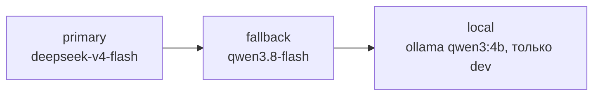

<sub>reqgraph · tech design v1.0 · [README](README.md) · [01_why](01_why.md) · [02_arch](02_arch.md) · [03_agents](03_agents.md) · [04_data](04_data.md) · [05_ci](05_ci.md) · [06_models](06_models.md) · [07_deploy](07_deploy.md) · [08_plan](08_plan.md) · [09_eval](09_eval.md) · [10_claude](10_claude.md)</sub>

# 06 Models

*какие LLM брать для каждой роли, сколько это стоит и как выбрать объективно*

## Принципы выбора

- **Сравниваем методы, а не модели.** В основном эксперименте все методы (B1, B2, M1, M2) работают на одной и той же модели; влияние модели — отдельный малый эксперимент.

- **Open-weight в приоритете.** DeepSeek, Qwen, GLM, Kimi, gpt-oss дёшевы, доступны у нескольких провайдеров и воспроизводимы.

- **Симулятор и судья — другой семьи.** Иначе модель «узнаёт себя» и завышает оценки.

- **Только OpenAI-совместимые API.** Смена провайдера — строка в roles.yaml, а не код.

- **Решает свой бенчмарк, а не лидерборды.** Для каждой роли берём самую дешёвую модель, которая отстаёт от лучшей не более чем на 5 п.п. в probe.

## Роли и кандидаты

<p align="right"><sub>Таблица 6 - кандидаты, проверенные вживую 21.10.2026 (docs/research/2026-10-models.md); финальный выбор — по probe в S0 и S6</sub></p>

| Роль | Что важно | $0 (разработка) | Дёшево (основной) | Качество (контроль) |
|---|---|---|---|---|
| `Interviewer` | диалог на RU, короткие ответы, 30-40 вызовов | `groq/openai/gpt-oss-120b` -> `gpt-oss-20b` | `openrouter/deepseek/deepseek-v4-flash` | `openrouter/deepseek/deepseek-v4-pro` |
| `Analyst` | читает всё интервью (до ~30 тыс. токенов), JSON по схеме | `gemini/gemini-3.5-flash-lite` -> `openrouter/nvidia/nemotron-3.5-super-vl:free` | `openrouter/deepseek/deepseek-v4-flash` | `openrouter/deepseek/deepseek-v4-pro` |
| `Modeler` | логика процессов, валидный DSL | `groq/openai/gpt-oss-120b` -> `gpt-oss-20b` | `openrouter/deepseek/deepseek-v4-flash` | `openrouter/moonshotai/kimi-k2.7-code` |
| `Standards` | связный деловой текст, стиль ГОСТ | `groq/openai/gpt-oss-120b` -> `gpt-oss-20b` | `openrouter/deepseek/deepseek-v4-flash` | `openrouter/deepseek/deepseek-v4-pro` |
| `Reviewer` | рассуждение по отчёту CI | `groq/openai/gpt-oss-120b` -> `gpt-oss-20b` | `openrouter/deepseek/deepseek-v4-flash` | `openrouter/deepseek/deepseek-v4-pro` |
| `Stakeholder sim` | другая семья, чем все агенты, живой стиль | `groq/qwen/qwen3.8-27b` | `openrouter/meta-llama/llama-3.3-70b-instruct` | — |
| `Judge (ISO-002, recall)` | другая семья, чем все агенты, стабильность | `groq/qwen/qwen3.8-27b` | `openrouter/z-ai/glm-5.3-flash` | + ручная проверка 20% |
| `Локально (CPU)` | офлайн-разработка, smoke | `ollama/qwen3:4b`, `ollama/qwen3:1.7b` | — | — |

Лестницы запасных моделей у агентов: бесплатно — `gpt-oss-120b` -> `gpt-oss-20b` -> `nemotron-3.5-super-vl:free` -> `gemini-3.5-flash-lite`; платно — `deepseek-v4-flash` -> `gemini-3.5-flash-lite`. Одна модель для всех агентов с запасом, симулятор и судья — другая семья (ADR-017).

<sub>Groq даёт 8000 токенов в минуту на модель, поэтому длинный транскрипт на Groq не помещается: роутер пропускает Groq для промпта длиннее ~6000 токенов, а Analyst начинает с Gemini. Бесплатные модели OpenRouter меняются и бывают недоступны (404/429): лестница фолбэков обязательна.</sub>

## Цены дешёвых моделей

| Модель | $ / 1M вход | $ / 1M выход | Контекст | Заметки |
|---|---|---|---|---|
| `DeepSeek V4 Flash` | 0.091 | 0.182 | 1M | основной кандидат; tools и structured output |
| `DeepSeek V4 Pro` | 0.955 | 1.911 | 1M | сильный в коде и рассуждении; 21.10 было 0.419 / 0.838, 23.10 цена выросла |
| `Qwen 3.8 Flash` / `3.7 Flash` | 0.15 / 0.03 | 0.47 / 0.13 | 1M | у 3.7 нет structured output, только JSON mode |
| `GLM-5.3 Flash` | 0.15 | 0.50 | 1M | tools и structured output |
| `MiniMax M3` | 0.30 | 1.20 | 1M | tools и structured output |
| `Kimi K2.7 Code` | 0.671 | 3.35 | 262K | силён в коде; дороже |
| `Claude Opus 5 / GPT-5.6 Sol` | 5.00 | 25-30 | — | только как верхняя граница на 1-2 сценариях, если хватит бюджета |

<sub>Источник цен — `GET openrouter.ai/api/v1/models`, 21.10.2026 (V4 Pro — 23.10); у разных провайдеров одной модели цены отличаются, для экспериментов провайдер закрепляется (T-601).</sub>

## Сколько стоит эксперимент

Оценка одного прогона с интервью: ~80-100 вызовов LLM, ~0.5 млн входных и ~0.07 млн выходных токенов (интервью 30-40 ходов, извлечение, моделирование, 2-3 итерации ремонта). Основная матрица: 12 test-сценариев x 3 персоны x 8 методов (B1, B2, B3, M1, M2, A1-A3) = 288 прогонов + повторы для оценки разброса (09_eval).

| Профиль | $ за прогон | ~300 прогонов |
|---|---|---|
| free-only (Groq + Gemini + :free) | $0, но 50 запросов/день у OpenRouter и 8000 токенов/мин у Groq — не больше нескольких прогонов в день | $0 |
| DeepSeek V4 Flash везде | ~$0.06 | ~$18 |
| Qwen 3.8 Flash везде | ~$0.11 | ~$33 |
| DeepSeek V4 Pro везде | ~$0.61 | ~$183 (23.10; было ~$81) |

Бюджет — до $20 в месяц.

*рис.8 - стоимость основной матрицы при разных профилях моделей; пунктир — месячный бюджет*

> [!TIP]
> Рабочий план (решение автора 21.10): разработка до января — только бесплатно (Groq, Gemini Flash-Lite, OpenRouter :free) и кассеты; основная матрица — на «DeepSeek V4 Flash везде» (~$18-25, январь–февраль); малый эксперимент чувствительности — 1 персона x 12 сценариев x 3 модели (~$5-10). Покупка кредитов OpenRouter поднимает дневной лимит :free (50 запросов без кредитов) — порог по документации OpenRouter.

## Бесплатные тарифы

| Провайдер | Лимит | Условия | Роль в проекте |
|---|---|---|---|
| `OpenRouter :free` | 50 RPD без кредитов (проверено `GET /api/v1/key`, 21.10.2026); RPM и порог повышения — в документации | без карты; модели исчезают без предупреждения | запасной в разработке, smoke |
| `Groq` | 1000 RPD, 8000 TPM на модель (заголовки ответа, 21.10.2026) | без карты | Interviewer, Reviewer в разработке |
| `Google AI Studio` | смотреть в AI Studio → Rate limits; `gemini-3.5-flash-lite` работает | вне ЕС промпты могут идти в обучение | симулятор и судья (не для личных данных); эмбеддинги для recall |
| `GitHub Models` | 15 RPM, 150-1000 RPD | аккаунт GitHub | запасной |
| `Mistral Experiment` | ~1 млрд токенов в месяц | согласие на обучение на данных | запасной |
| `Ollama локально` | без лимита | CPU: только 1-4B, медленно | офлайн и smoke-тесты |

## Роутер моделей

**`packages/core/src/reqgraph/llm/roles.yaml`**

```yaml
# Читает llm/router.py и собирает pydantic-ai FallbackModel для роли (ADR-013).
providers:
  openrouter: {base_url: "https://openrouter.ai/api/v1", key_env: OPENROUTER_API_KEY}
  groq:       {base_url: "https://api.groq.com/openai/v1", key_env: GROQ_API_KEY, free: true, max_input_tokens: 6000}
  gemini:     {base_url: "https://generativelanguage.googleapis.com/v1beta/openai/", key_env: GEMINI_API_KEY, free: true, supports_seed: false}
  ollama:     {base_url: "http://localhost:11434/v1", key_env: null, free: true}
profiles:
  free:                                    # разработка до января (решение автора)
    "*":         [groq/openai/gpt-oss-120b, groq/openai/gpt-oss-20b, openrouter/nvidia/nemotron-3.5-super-vl:free, gemini/gemini-3.5-flash-lite]
    analyst:     [gemini/gemini-3.5-flash-lite, openrouter/nvidia/nemotron-3.5-super-vl:free, groq/openai/gpt-oss-20b]
    stakeholder: [groq/qwen/qwen3.8-27b]       # другая семья, чем все агенты
    judge:       [groq/qwen/qwen3.8-27b]
  cheap:                                   # эксперименты (январь–февраль)
    "*":         [openrouter/deepseek/deepseek-v4-flash, gemini/gemini-3.5-flash-lite]
    stakeholder: [openrouter/meta-llama/llama-3.3-70b-instruct]
    judge:       [openrouter/z-ai/glm-5.3-flash]
  local: {"*": [ollama/qwen3:4b]}
defaults: {temperature: 0.2, timeout_s: 60, retries: 2, seed: 42}
budget:   {run_usd: 0.50, run_tokens: 800000}   # -> pydantic-ai UsageLimits
```

<sub>Рабочая копия — `packages/core/src/reqgraph/llm/roles.yaml` (T-005, T-006); при расхождении главнее она. 23.10.2026: `minimax-m3.1-flash:free` снят с бесплатного тарифа 22.10, `nemotron-3-super-120b-a12b:free` отвечает 404 — заменены; профиль free построен по probe и проверке длинного интервью (ниже), правило «симулятор и судья — другая семья» проверяется тестом. `max_input_tokens` у Groq: промпт длиннее ~6000 токенов сразу уходит на следующую модель (лимит 8000 токенов в минуту); `supports_seed: false` у Gemini: его OpenAI-совместимый API не принимает seed. `output_mode: native` у Groq: структурированный ответ через JSON Schema, а не вызов инструмента (Groq отклоняет неточный вызов инструмента с 400 без возможности повтора). Модели `:free` у OpenRouter бесплатны по id; для провайдеров с `free: true` стоимость считается как 0, для остальных — `response.cost()` (genai-prices). Файл обновляется после probe.</sub>


Переход вправо делает `FallbackModel`: 429 / 5xx / таймаут; ошибка схемы сначала повторяется (`retries=2`) с текстом ошибки. `UsageLimits` останавливает прогон при превышении бюджета. Каждый вызов пишет в `run_events`: роль, модель, провайдер, токены, стоимость, латентность, исход.

*рис.9 - лестница фолбэков для одной роли*

## Мини-бенчмарк моделей (probe)

Целевая версия — таблица ниже. Первый отчёт (T-006, 23.10.2026) использует временные детерминированные оценки вместо настоящих проверок: размытые слова вместо ISO-001, структура графа вместо SCH/SND; настоящие проверки подключаются в T-601 после S1.

| Блок | Задач | Что меряем |
|---|---|---|
| Извлечение ФТ/НФТ из фрагмента интервью | 5 | валидный GraphPatch, F1 по эталону, нарушения ISO-001..004 |
| Процесс в DSL по описанию | 5 | SCH-002, SND-001/002 с первой попытки и после 2 ремонтов |
| Переписать требование по ISO 29148 | 5 | нарушения до/после, сохранение смысла (судья + выборочно вручную) |
| Вопрос интервьюера по покрытию | 5 | попадание в нужную область, длина, отсутствие подсказок ответа |
| Итог | 20 | качество, $ на задачу, p50/p95 латентность, доля невалидного JSON; датасет и оценщики — pydantic-evals |

Результаты первого отчёта (`evals/reports/probe-2026-10-23-*.md`, 200 ответов, средняя оценка 0–1): `gpt-oss-20b` 0.94, `gpt-oss-120b` 0.93, `gemini-3.5-flash-lite` 0.92 — разница меньше разброса между повторами (0.02–0.04); бесплатная `nemotron-3.5-super-vl:free` 0.84 при 90% валидных ответов и p95 73 с. Блоки «переписать» и «вопрос» почти не различают модели (0.98–1.00), к T-601 их нужно усложнить.

**Длинное интервью** (23.10.2026, ~360 реплик, ~27 тыс. токенов, три факта в начале, середине и конце): Gemini 3.5 Flash-Lite и `nemotron-3.5-super-vl:free` нашли все три; `gpt-oss-20b` на Groq — отказ 413 (8000 токенов в минуту на модель; так же у `gpt-oss-120b` и `qwen3.8-27b`); `nemotron-3-ultra:free` не выдала ответ в нужной форме; `dots-3-note:free` — ошибка у провайдера; `gemma-4-31b:free` — 429; `inkling:free` — только для «агентных» сервисов. Поэтому аналитик начинает с Gemini, а длинные промпты обходят Groq (ADR-017).

`bash`

```console
$ uv run reqgraph-evals probe --models groq/openai/gpt-oss-120b,gemini/gemini-3.5-flash-lite --repeat 3
  -> evals/reports/probe-YYYY-MM-DD.csv + .md; выбор по ролям в roles.yaml (первый отчёт: 2026-10-23, T-006)
```

> [!IMPORTANT]
> Подписка Claude Code — инструмент разработки: писать код, тесты, документацию. В рантайме reqgraph (демо, эксперименты) используются только API-ключи провайдеров. Подключать подписку к публичному сервису нельзя по условиям использования.
