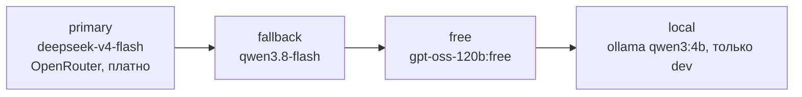

<sub>reqgraph · tech design v1.0 · [README](README.md) · [01_why](01_why.md) · [02_arch](02_arch.md) · [03_agents](03_agents.md) · [04_data](04_data.md) · [05_ci](05_ci.md) · [06_models](06_models.md) · [07_deploy](07_deploy.md) · [08_plan](08_plan.md) · [09_eval](09_eval.md) · [10_claude](10_claude.md)</sub>

# 06 Models

*какие LLM брать для каждой роли, сколько это стоит и как выбрать объективно*

## Принципы выбора

- **Сравниваем методы, а не модели.** В основном эксперименте все методы (B1, B2, M1, M2) работают на одной и той же модели; влияние модели — отдельный малый эксперимент.

- **Open-weight в приоритете.** DeepSeek, Qwen, GLM, Kimi, gpt-oss дёшевы, доступны у нескольких провайдеров и воспроизводимы.

- **Симулятор и судья — другой семьи.** Иначе модель «узнаёт себя» и завышает оценки.

- **Только OpenAI-совместимые API.** Смена провайдера — строка в roles.yaml, а не код.

- **Решает свой бенчмарк, а не лидерборды.** Для каждой роли берём самую дешёвую модель, которая отстаёт от лучшей не более чем на 5 п.п. в probe.

## Роли и кандидаты

<p align="right"><sub>Таблица 6 - кандидаты на октябрь 2026; финальный выбор — по probe в S0 и S6</sub></p>

| Роль | Что важно | $0 | Дёшево (основной) | Качество (контроль) |
|---|---|---|---|---|
| `Interviewer` | диалог на RU, короткие ответы, 30-40 вызовов | gpt-oss-120b:free, Llama 3.3 70B (Groq) | DeepSeek V4 Flash, Qwen Flash | DeepSeek V4 Pro, Kimi K2.x |
| `Analyst` | извлечение структуры, JSON по схеме, длинный контекст | Qwen3-Coder:free, Nemotron:free | DeepSeek V4 Flash | DeepSeek V4 Pro, GLM-5.x |
| `Modeler` | логика процессов, валидный DSL | gpt-oss-120b:free | DeepSeek V4 Flash | DeepSeek V4 Pro, Kimi K2.7 |
| `Standards` | связный деловой текст, стиль ГОСТ | Gemma 4 31B:free | Qwen Flash, GLM Flash | DeepSeek V4 Pro |
| `Reviewer` | рассуждение по отчёту CI | gpt-oss-120b:free | DeepSeek V4 Flash (thinking) | DeepSeek V4 Pro |
| `Stakeholder sim` | другая семья, живой стиль | Gemini Flash (AI Studio), Llama 3.3 70B (Cerebras) | Qwen Flash | — |
| `Judge (ISO-002, recall)` | другая семья, стабильность | Gemini Flash (AI Studio) | GLM Flash | + ручная проверка 20% |
| `Локально (CPU)` | офлайн-разработка, smoke | Ollama: qwen3 1.7B / 4B | — | — |

## Цены дешёвых моделей

| Модель | $ / 1M вход | $ / 1M выход | Контекст | Заметки |
|---|---|---|---|---|
| `DeepSeek V4 Flash` | 0.14-0.30 | 0.28-1.20 | 1M | дёшево для агентных циклов; ночная скидка у провайдера |
| `DeepSeek V4 Pro` | 0.435 | 0.87 | — | MIT-веса, сильный в коде и рассуждении |
| `Qwen 3.7 / 3.8 Flash` | 0.03-0.15 | 0.13-0.47 | 1M | самый дешёвый; проверить tool calling |
| `GLM-5.3 Flash` | 0.15 | 0.50 | — | справляется с вызовами инструментов |
| `MiniMax M3` | 0.30 | 1.20 | до 512K | документирован tool use |
| `Kimi K2.7 Code` | 0.95 | 4.00 | — | силён в MCP-задачах; дороже |
| `Claude Opus 5 / GPT-5.6 Sol` | 5.00 | 25-30 | — | только как верхняя граница на 1-2 сценариях, если хватит бюджета |

<sub>Источники цен — сравнения Codersera (август 2026) и BetterClaw (проверено в октябре 2026); у разных провайдеров одной модели цены отличаются, поэтому даны диапазоны.</sub>

## Сколько стоит эксперимент

Оценка одного прогона с интервью: ~80-100 вызовов LLM, ~0.5 млн входных и ~0.07 млн выходных токенов (интервью 30-40 ходов, извлечение, моделирование, 2-3 итерации ремонта). Основная матрица: 15 сценариев x 3 персоны x 6 конфигураций = 270 прогонов.

| Профиль | $ за прогон | 270 прогонов |
|---|---|---|
| free-only (:free + Groq) | $0 (~10 прогонов в день по лимитам) | $0 |
| Flash везде | $0.09–0.23 | ~$24 |
| Flash + Pro (Modeler, Reviewer) | ~$0.15 | ~$40 |
| Pro везде | ~$0.27 | ~$73 |
| Frontier (Claude / GPT) | $2.5–4 | ~$675+ |

Бюджет — до $20 в месяц.

*рис.8 - стоимость основной матрицы при разных профилях моделей; пунктир — месячный бюджет*

> [!TIP]
> Рабочий план: разработка — на :free и Groq; основная матрица — на «Flash везде» (~$20-25, разнести на январь и февраль); малый эксперимент чувствительности — 1 персона x 15 сценариев x 3 модели (~$5-10). Разовое пополнение OpenRouter на $10 поднимает лимит бесплатных моделей с 50 до 1000 запросов в день — это первая трата, которую стоит сделать.

## Бесплатные тарифы

| Провайдер | Лимит | Условия | Роль в проекте |
|---|---|---|---|
| `OpenRouter :free` | 20 RPM, 50 RPD (1000 RPD после $10) | без карты; модели исчезают без предупреждения | разработка, бейзлайны |
| `Groq` | 30 RPM, ~1000 RPD | без карты, данные не обучают | Interviewer / симулятор в dev |
| `Cerebras` | 30 RPM, ~1M токенов в день | без карты | симулятор, пакетные прогоны |
| `Google AI Studio` | 5-15 RPM, 20-1500 RPD | вне ЕС промпты могут идти в обучение | судья, симулятор (не для личных данных) |
| `GitHub Models` | 15 RPM, 150-1000 RPD | аккаунт GitHub | запасной |
| `Mistral Experiment` | ~1 млрд токенов в месяц | согласие на обучение на данных | запасной |
| `Ollama локально` | без лимита | CPU: только 1-4B, медленно | офлайн и smoke-тесты |

## Роутер моделей

**`packages/core/src/reqgraph/llm/roles.yaml`**

```yaml
providers:
  openrouter: {base_url: "https://openrouter.ai/api/v1", key_env: OPENROUTER_API_KEY}
  groq:       {base_url: "https://api.groq.com/openai/v1", key_env: GROQ_API_KEY}
  ollama:     {base_url: "http://localhost:11434/v1", key_env: null}
profiles:
  cheap:                                   # профиль по умолчанию
    analyst:  [openrouter/deepseek/deepseek-v4-flash, openrouter/qwen/qwen3.8-flash,
               openrouter/openai/gpt-oss-120b:free]
    modeler:  [openrouter/deepseek/deepseek-v4-flash, openrouter/z-ai/glm-5.3-flash]
    stakeholder: [groq/llama-3.3-70b-versatile]   # другая семья
  free:  {"*": [openrouter/openai/gpt-oss-120b:free, groq/llama-3.3-70b-versatile]}
  local: {"*": [ollama/qwen3:4b]}
defaults: {temperature: 0.2, timeout_s: 60, max_retries: 2, seed: 42}
budget:   {run_usd: 0.50, run_tokens: 800000}
```

<sub>Точные идентификаторы моделей у провайдеров меняются; файл обновляется после probe. Цены для учёта стоимости берутся из ответа провайдера (usage) или из таблицы prices.yaml.</sub>


Переход вправо: 429 / 5xx / таймаут 60 с / невалидный JSON после 2 ретраев / превышен бюджет прогона. Каждый вызов пишет в `run_events`: роль, модель, токены, стоимость, латентность, исход.

*рис.9 - лестница фолбэков для одной роли*

## Мини-бенчмарк моделей (probe)

| Блок | Задач | Что меряем |
|---|---|---|
| Извлечение ФТ/НФТ из фрагмента интервью | 5 | валидный GraphPatch, F1 по эталону, нарушения ISO-001..004 |
| Процесс в DSL по описанию | 5 | SCH-002, SND-001/002 с первой попытки и после 2 ремонтов |
| Переписать требование по ISO 29148 | 5 | нарушения до/после, сохранение смысла (судья + выборочно вручную) |
| Вопрос интервьюера по покрытию | 5 | попадание в нужную область, длина, отсутствие подсказок ответа |
| Итог | 20 | качество, $ на задачу, p50/p95 латентность, доля невалидного JSON |

`bash`

```console
$ reqgraph probe --models deepseek-v4-flash,qwen3.8-flash,glm-5.3-flash,gpt-oss-120b:free --repeat 3
  -> evals/reports/probe-2026-10-30.csv + выбор по ролям в roles.yaml
```

> [!IMPORTANT]
> Подписка Claude Code — инструмент разработки: писать код, тесты, документацию. В рантайме reqgraph (демо, эксперименты) используются только API-ключи провайдеров. Подключать подписку к публичному сервису нельзя по условиям использования.
