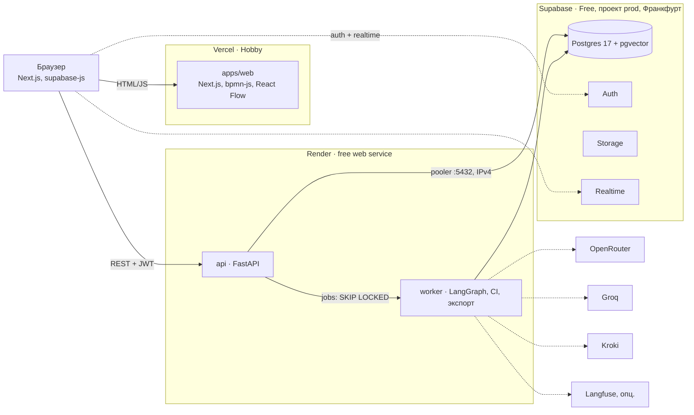

reqgraph · tech design v1.0 · [README](README.md) · [01_why](01_why.md) · [02_arch](02_arch.md) · [03_agents](03_agents.md) · [04_data](04_data.md) · [05_ci](05_ci.md) · [06_models](06_models.md) · [07_deploy](07_deploy.md) · [08_plan](08_plan.md) · [09_eval](09_eval.md) · [10_claude](10_claude.md)

# 07 Deploy

*Supabase для данных, Vercel и Render для кода, офлайн-стенд для защиты*

> [!NOTE]
> **Короткий ответ.** Да, Supabase подходит для хранения: Postgres (граф, прогоны, чекпоинты LangGraph), Auth, Storage для выгрузок и Realtime для живого прогресса. Python-бэкенд в Supabase не запускается (Edge Functions — Deno/TypeScript с лимитом времени), поэтому деплой: фронтенд на Vercel, API и воркер на Render, всё бесплатно. Для защиты в РФ — локальный стенд через docker compose.

Локально и на защите: `docker compose` (web, api, Supabase CLI, Ollama) без интернета.

*рис.10 - целевая топология: $0 в месяц*

## Что берём у Supabase

| Возможность | Для чего | Лимит Free | Риск и решение |
|---|---|---|---|
| `Postgres + pgvector` | проекты, ревизии jsonb, прогоны, события, чекпоинты | 500 МБ | ежедневная чистка (T-506): чекпоинты прогонов, завершённых > 14 дней назад, события > 30 дней; ревизии не чистятся, пока база мала (решение 21.11) |
| `Auth` | GitHub OAuth, magic link, JWT для API | 50 000 MAU | — |
| `Storage` | DOCX, SVG, ReqIF выгрузки | 1 ГБ | очистка выгрузок старше 30 дней — исполнитель раз в сутки (T-506), повторная генерация по запросу |
| `Realtime` | поток run_events в браузер | ~200 одновременных подключений | фолбэк: опрос GET /runs/{id}/events |
| `Трафик` | API и Storage | 5 ГБ egress | SVG рендерить на клиенте (bpmn-js) |
| `Пауза` | проект засыпает после 7 дней без активности | — | dev — локально (Supabase CLI); prod — `keepalive.yml`, GET /health раз в 3 дня |

Подключение из Render: прямое подключение Supabase идёт по IPv6, а Render, Vercel и GitHub Actions работают по IPv4. Поэтому `DATABASE_URL` — строка Supavisor в session-режиме (порт 5432 на хосте pooler). Для psycopg и PostgresSaver: `autocommit=True, prepare_threshold=None`, пул на 3-5 соединений.

## Где запускать Python-бэкенд

Таблица 7 - сравнение на октябрь 2026

| Платформа | Цена | Ресурсы | Минусы | Вердикт |
|---|---|---|---|---|
| `Render Free` | $0 | 512 МБ, 0.1 CPU, 750 ч/мес | засыпает через 15 мин, холодный старт до минуты | основной выбор |
| `Railway` | триал $5, далее от $1-5/мес | по использованию | бесплатного почти нет | запасной при нехватке памяти |
| `Fly.io` | ~$3-6/мес | 512 МБ-1 ГБ | нет бесплатного тарифа | запасной |
| `Koyeb` | — | — | бесплатного compute больше нет | нет |
| `Google Cloud Run` | щедрая квота | по запросам | нужна карта, оплата из РФ невозможна | нет |
| `HF Spaces (Docker)` | PRO | — | Docker-спейсы требуют подписку | нет |
| `Amvera (РФ)` | от 170 ₽; реально 490-1450 ₽/мес | 0.1-1 ГБ RAM | нет бесплатного тарифа | зеркало в РФ |
| `Yandex Cloud` | по использованию, грант новым | Serverless Containers | сложнее настройка | зеркало в РФ |
| `Свой ноутбук` | $0 | docker compose | только офлайн | защита диплома |

> [!WARNING]
> Render Free: 512 МБ на всё — FastAPI, LangGraph, pm4py. Память процесса API видна в `/health` (`memory_mb`, `peak_memory_mb`) и в журнале исполнителя после каждой задачи (T-506). Первый замер 21.11 в окружении образа: пик 250 МБ после всех проверок garage61 (с pm4py) и выгрузки документов; pandoc идёт отдельным процессом и сюда не входит. На Render 22.11: пик процесса API 315 МБ после настоящего интервью (15 реплик, 2 круга ремонта); пик всего контейнера по метрикам Render — 403 МБ из 512, на выгрузке документов (pandoc и Kroki). Запас ~110 МБ: если выгрузка начнёт падать по памяти, первый кандидат — сборка DOCX отдельной задачей исполнителя, а не в запросе API. Если не влезает: вынести SND-002 (pm4py) в фоновый шаг с ленивым импортом или перейти на Railway / Fly (~$5). Пока пользователь смотрит прогон, фронтенд опрашивает API и не даёт сервису уснуть; прогоны без наблюдателя запускать только локально или в GitHub Actions.

## Доступ из РФ

- **Vercel** недоступен у части российских мобильных операторов; Supabase и OpenRouter из РФ работают нестабильно и могут требовать VPN; оплата зарубежных сервисов с российских карт невозможна (OpenRouter принимает USDC с комиссией 5%). Gemini API официально недоступен из России (бесплатный ключ из облачной сессии работает, с ноутбука в РФ может не пройти).

- **Платные модели из РФ — российские агрегаторы** с оплатой рублями (карта «Мир», СБП): Polza.ai, AITUNNEL, VseGPT, ProxyAPI; OpenAI-совместимый API, провайдер подключается строкой в `roles.yaml`. Наценка 5–15% по обзорам; DeepSeek V4 Flash у Polza.ai ~16.6 ₽ за 1M входных и ~33 ₽ за 1M выходных токенов (23.10.2026) — примерно вдвое дороже OpenRouter, матрица экспериментов выйдет ~3000 ₽ при лимите S6 $25; решение (меньше повторов, другой агрегатор или лимит) — в январе. Yandex AI Studio (DeepSeek V4.1 Flash) — ~300/500 ₽ за 1M, для матрицы слишком дорого. Цены и условия проверять на сайтах сервисов: обзоры написаны самими агрегаторами. Тексты интервью проходят через посредника — дисклеймер про персональные данные остаётся.

- **Защита диплома:** только локальный стенд — `docker compose up` поднимает web, api, Supabase CLI и Ollama; демонстрационные прогоны заранее записаны (replay из run_events), живой прогон — на дешёвой модели при наличии сети.

- **Публичное демо** для зарубежных программ и работодателей — Vercel + Render + Supabase.

- **Зеркало в РФ (опционально, до 1500 ₽/мес):** Amvera или Yandex Cloud для api и web + собственный Postgres; у Amvera есть встроенный прокси к зарубежным LLM API.

## Окружения и переменные

| Окружение | Где | База | Модели |
|---|---|---|---|
| `local` | ноутбук, docker compose | Supabase CLI (Postgres в Docker) | profile=free или local |
| `ci` | GitHub Actions | `supabase start` (задачи `db`, `e2e`) | кассеты и заглушки, без сети |
| `prod` | Render + Vercel, Франкфурт | Supabase `reqgraph-prod`, eu-central-1 | cheap, лимиты демо |

Staging нет (решение автора 21.11): превью-сервисы Render платные, а миграции и сайт проверяются на каждом PR в CI на `supabase start`. Пошаговая настройка prod — [docs/setup/deploy.md](../setup/deploy.md).

| Переменная | Где | Назначение |
|---|---|---|
| `NEXT_PUBLIC_SUPABASE_URL, NEXT_PUBLIC_SUPABASE_ANON_KEY` | web | клиент supabase-js (вход, Realtime, чтение реплик под RLS); только anon-ключ (T-504) |
| `SUPABASE_URL` | api | адрес проекта Supabase для Storage: API кладёт файлы выгрузок в бакет `exports` (T-505) |
| `SUPABASE_SERVICE_ROLE_KEY` | api | запись файлов выгрузок в Storage; никогда не попадает в браузер. Без этих двух выгрузка отвечает 503 |
| `EXPORT_OFFLINE` | api | `1` — выгрузка без Kroki: документы без картинок схем (CI, офлайн-стенд); по умолчанию выключено (T-505) |
| `DATABASE_URL` | api | Supavisor session pooler :5432 |
| `SUPABASE_JWKS_URL` | api | проверка JWT пользователя |
| `SUPABASE_JWT_AUD` | api | ожидаемая аудитория токена, по умолчанию `authenticated` |
| `SUPABASE_JWT_SECRET` | api (local) | только локальный Supabase CLI с подписью HS256; в проде не задаётся |
| `CORS_ORIGINS` | api | домены сайта через запятую (Vercel, `http://localhost:3000`) |
| `WORKER_ENABLED` | api | исполнитель задач в процессе API (по умолчанию да, ADR-009); `reqgraph-api worker` — отдельно |
| `WORKER_POLL_SECONDS, JOB_STALE_SECONDS` | api | пауза при пустой очереди (2 с) и срок, после которого задача без продления считается брошенной (120 с) |
| `OPENROUTER_API_KEY, GROQ_API_KEY, GEMINI_API_KEY` | api, evals | провайдеры моделей |
| `REQGRAPH_PROFILE, REQGRAPH_RUN_BUDGET_USD` | api, cli | профиль моделей и бюджет прогона |
| `OLLAMA_BASE_URL` | api, cli (local) | офлайн-профиль `local` (Ollama) |
| `PYDANTIC_AI_NO_BANNER` | api, cli, evals | отключает баннер pydantic-ai в консоли |
| `KROKI_URL` | api | https://kroki.io или свой контейнер |
| `DEMO_RUNS_PER_DAY, DEMO_DAILY_USD_CAP` | api | лимиты публичного демо: 3 прогона в день, $0.20 в день на всех (T-503; потолок снижен с $0.50 решением автора 21.11) |
| `DEMO_TIMEZONE` | api | когда начинается новый день лимитов; `Europe/Moscow` (решение автора 19.11) |
| `PROJECT_PROFILE` | api | модели новых проектов: `free` в разработке, `cheap` в публичном демо |
| `NEXT_PUBLIC_API_URL` | web | адрес API на Render |
| `REQGRAPH_STUB_MODELS` | api (e2e) | `1` — исполнитель на моделях-заглушках для e2e сайта; только с базой на `127.0.0.1` или `localhost`, иначе исполнитель не запускается; в проде не задаётся (T-504) |

## CI/CD

| Workflow | Когда | Что делает |
|---|---|---|
| `ci.yml` | push, PR | ruff, mypy, pytest без сети (кассеты), сборка web, проверка миграций и тесты API на локальном Supabase; e2e сайта: `supabase start`, API с исполнителем на заглушках, Playwright — вход, проект, 3 ответа интервью (T-504); прогон по брифу, граф, проверки и скачивание выгрузки (T-505) |
| `ci.yml`, задача `docker` | push, PR | сборка образа API, pandoc и pm4py внутри, старт без базы (T-506) |
| `migrate.yml` | push в main с изменениями `supabase/migrations/`, вручную | `supabase db push` в prod после подтверждения автора (окружение `production`) |
| `smoke.yml` | после `migrate`, вручную | Playwright `smoke.spec.ts` против опубликованного сайта: вход, /health со страницы (CORS), 401 без входа, кнопка GitHub; память API — в сводку |
| `keepalive.yml` | cron раз в 3 дня | GET /health (select 1) — Render и Supabase не засыпают |
| `Render, Vercel` | push в main | автодеплой из GitHub; превью на PR (Vercel). Render собирает образ, только если менялись `apps/api`, `packages/core`, `uv.lock` и другие входы образа (`buildFilter`): на бесплатном плане мало минут сборки |

**Эксперименты** (матрица `reqgraph-evals matrix`, мини-экзамен `reqgraph-evals probe`) идут в облачной сессии Claude Code, а не в GitHub Actions: ключи моделей хранятся в настройках облачной среды, в GitHub их нет (решение автора 03.11, T-406). У запуска матрицы — лимит $ на весь запуск (`--max-usd`, по умолчанию $1, больше $5 — только с `--allow-over-5`); отчёты, диалоги и пары судьи коммитятся в `evals/reports/` через PR.

## Публичное демо: лимиты и безопасность

| Мера | Значение |
|---|---|
| `Прогонов на пользователя` | 3 в день (usage_daily), день — по Москве; 4-й — ответ 429 с текстом и `Retry-After`; 40 ходов интервью, 800k токенов на прогон; пользователь с ролью `admin` — без лимитов; свой расход — `GET /usage` (T-503) |
| `Общий потолок` | $0.20 в день на всех (до ~$6 в месяц, решение автора 21.11); после него новые прогоны идут на профиле free (не отклоняются) или на своём ключе |
| `Свой ключ (BYOK)` | ключ OpenRouter хранится только в памяти браузера и передаётся в заголовке `X-OpenRouter-Key` при запуске и с каждым ответом; сервер держит его в памяти процесса для исполнителя (2 часа), в базу, события и логи не пишет; прогон — на профиле `byok` (только OpenRouter), вне лимитов «3 в день» и общего потолка; после перезапуска сервера без ключа прогон не переходит на наши модели (T-503) |
| `Доступ к данным` | RLS по owner_id; service_role только на сервере; CORS только домен Vercel |
| `Prompt injection` | ответы как данные, у агентов нет сетевых и файловых инструментов, вывод — только по схеме |
| `Персональные данные` | дисклеймер: не вводить ПДн; бесплатные модели могут обучаться на запросах; удаление проекта — каскадно |
| `Логи` | run_events хранятся 30 дней (очистка — исполнитель раз в сутки, T-506); ключи и токены в логи не пишутся |

## Бюджет

| Статья | План $0 | План до $20/мес |
|---|---|---|
| `Frontend` | Vercel Hobby | Vercel Hobby |
| `Backend` | Render Free | Render Free или Railway / Fly ~$5 |
| `Данные` | Supabase Free, проект prod (staging нет, решение 21.11) | Supabase Free |
| `Модели` | :free + Groq + AI Studio | + $10 разово в OpenRouter, ~$5-10/мес на DeepSeek / Qwen в январе-феврале; демо на `cheap` — не больше $0.20 в день (~$6/мес) |
| `Диаграммы` | kroki.io | kroki.io или контейнер |
| `Итого` | $0 | $10-20 в месяц только в период экспериментов |
