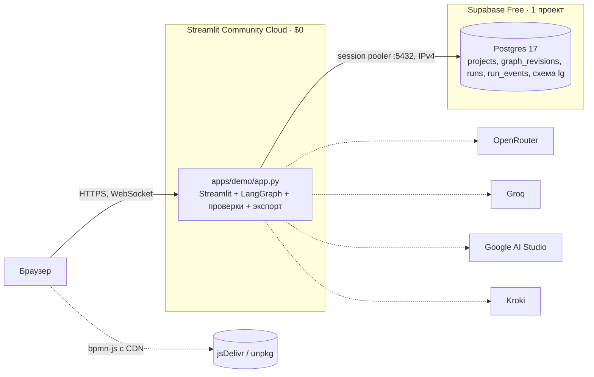

reqgraph · tech design v1.0 · [README](README.md) · [01_why](01_why.md) · [02_arch](02_arch.md) · [03_agents](03_agents.md) · [04_data](04_data.md) · [05_ci](05_ci.md) · [06_models](06_models.md) · [07_deploy](07_deploy.md) · [08_plan](08_plan.md) · [09_eval](09_eval.md) · [10_claude](10_claude.md)

# 07 Deploy

*одно Streamlit-приложение, Supabase только как Postgres, офлайн-стенд без Docker*

> [!NOTE]
> **Редакция 2026-10-21 (ADR-015).** Было: Next.js на Vercel + FastAPI и воркер на Render Free (512 МБ) + Supabase Auth, Storage, Realtime. Стало: одно Python-приложение на Streamlit Community Cloud ($0) и Supabase Postgres для ревизий и чекпоинтов. Для защиты в РФ — тот же код локально (`streamlit run` + Ollama + SQLite), без Docker. Прежние ADR-008 и ADR-009 заменены.

Локально и на защите: `uv run streamlit run apps/demo/app.py` + Ollama + SQLite, без интернета.

*рис.10 - целевая топология: $0 в месяц*

## Что берём у Supabase

| Возможность | Для чего | Лимит Free (supabase.com/pricing, 21.10.2026) | Риск и решение |
|---|---|---|---|
| `Postgres` | проекты, ревизии jsonb, прогоны, события, чекпоинты LangGraph | 500 МБ на проект | ежедневная чистка: чекпоинты > 14 дней, ревизии > 50 на проект |
| `Пауза` | проект засыпает после 1 недели без активности | — | `keepalive.yml`: cron раз в 3 дня делает `select 1` |
| `Проекты` | prod (staging не нужен: разработка на SQLite и FileStore) | 2 активных | — |

Auth, Storage и Realtime не используем: входа в демо нет, файлы отдаёт само приложение (`st.download_button`), прогресс прогона показывает `st.status`.

Подключение: прямое подключение Supabase идёт по IPv6, а Streamlit Cloud и GitHub Actions — по IPv4. Поэтому `DATABASE_URL` — строка Supavisor в session-режиме (порт 5432 на хосте pooler). Для psycopg и PostgresSaver: `autocommit=True, prepare_threshold=None`, пул на 2-3 соединения, `search_path to lg` для чекпоинтера.

## Где запускать демо

Таблица 7 - сравнение на 21.10.2026

| Платформа | Цена | Ресурсы | Минусы | Вердикт |
|---|---|---|---|---|
| `Streamlit Community Cloud` | $0 | до ~2.7 ГБ RAM, до 2 CPU (docs на 2024 год; перепроверить в T-504) | только публичный репозиторий; сон после 12 ч без трафика; доступность из РФ не проверена | основной выбор |
| `Render Free` | $0 | 512 МБ, засыпает через 15 мин | импорты runtime 132-250 МБ до первого запроса; нужен отдельный фронтенд | запасной |
| `Hugging Face Spaces` | PRO для Gradio/Docker | 16 ГБ, 2 vCPU | бесплатное создание Spaces требует подписку | нет |
| `Свой ноутбук` | $0 | `streamlit run` | только офлайн | защита диплома |

> [!WARNING]
> Streamlit перезапускает скрипт при каждом действии пользователя. Всё долгоживущее — граф LangGraph, чекпоинтер, пул соединений — создаётся один раз через `st.cache_resource`, состояние сессии — в `st.session_state`. Прогон идёт, пока открыта вкладка; прогоны без наблюдателя (матрица экспериментов) запускаются локально или в GitHub Actions, не в демо.

## Доступ из РФ

- Supabase и OpenRouter из РФ работают нестабильно и могут требовать VPN. Доступность `*.streamlit.app` не проверена. Оплата зарубежных сервисов с российских карт невозможна (OpenRouter принимает USDC с комиссией 5%).
- **Защита диплома:** только локальный стенд — `uv run streamlit run apps/demo/app.py` с Ollama и SQLite. Демонстрационные прогоны записаны заранее (replay из run_events); живой прогон — на бесплатной модели при наличии сети.
- **Публичное демо** для зарубежных программ и работодателей — Streamlit Community Cloud + Supabase.
- **Зеркало в РФ (опционально):** тот же контейнер на Amvera или Yandex Cloud с собственным Postgres; решается только при необходимости.

## Окружения и переменные

| Окружение | Где | Хранилище | Модели |
|---|---|---|---|
| `local` | ноутбук, `streamlit run` / CLI | FileStore + SQLite | profile=free или local |
| `ci` | GitHub Actions | FileStore; миграции — `supabase db push` | кассеты, без сети |
| `prod` | Streamlit Community Cloud | Supabase Postgres | free (до января), cheap — по решению автора; лимиты демо |

| Переменная | Где | Назначение |
|---|---|---|
| `OPENROUTER_API_KEY, GROQ_API_KEY, GEMINI_API_KEY` | demo, cli, evals | провайдеры моделей |
| `OLLAMA_BASE_URL` | local | офлайн-профиль |
| `DATABASE_URL` | demo (prod) | Supavisor session pooler :5432; пусто — SQLite |
| `REQGRAPH_PROFILE, REQGRAPH_RUN_BUDGET_USD` | demo, cli | профиль моделей и бюджет прогона |
| `KROKI_URL` | demo, cli | https://kroki.io или свой контейнер |
| `DEMO_RUNS_PER_SESSION, DEMO_DAILY_USD_CAP` | demo | лимиты публичного демо |

Секреты в Streamlit Cloud задаются в настройках приложения (Secrets, формат TOML) и читаются как переменные окружения; в облачных сессиях Claude Code — network secrets; на ноутбуке — `.env`.

## CI/CD

| Workflow | Когда | Что делает |
|---|---|---|
| `ci.yml` | push, PR | ruff, mypy, pytest без сети (кассеты) |
| `evals.yml` | вручную | матрица сценариев с выбором профиля и лимитом $; результаты — артефакт и коммит в evals/reports |
| `probe.yml` | вручную | мини-бенчмарк моделей |
| `migrate.yml` | push в main с изменениями supabase/ | `supabase db push` в prod (Supabase CLI через `supabase/setup-cli`) |
| `keepalive.yml` | cron раз в 3 дня | `select 1` — проект Supabase не засыпает |
| Streamlit Cloud | push в main | автодеплой из GitHub |

Для публичного репозитория минуты GitHub Actions бесплатны, поэтому эксперименты можно гонять там, а не на ноутбуке. GitHub отключает cron-workflow в публичном репозитории после 60 дней без активности — следить за keepalive.yml после релиза.

## Публичное демо: лимиты и безопасность

| Мера | Значение |
|---|---|
| `Прогонов на сессию` | 3 (`DEMO_RUNS_PER_SESSION`), 40 ходов интервью, 800k токенов на прогон |
| `Общий потолок` | $0.50 в день (`DEMO_DAILY_USD_CAP`, считается по `runs.cost_usd`); после него — только профиль free или свой ключ |
| `Свой ключ (BYOK)` | ключ OpenRouter хранится только в `st.session_state` и не пишется в базу и логи |
| `Доступ к данным` | RLS включён на всех таблицах без политик для anon; пишет и читает только сервер демо |
| `Prompt injection` | ответы как данные, у агентов нет сетевых и файловых инструментов, вывод — только по схеме |
| `Персональные данные` | дисклеймер: не вводить ПДн (152-ФЗ); бесплатные модели могут обучаться на запросах; удаление проекта — каскадно |
| `Логи` | run_events хранятся 30 дней; ключи и токены в логи не пишутся |

## Бюджет

| Статья | План $0 | План до $20/мес |
|---|---|---|
| `Демо` | Streamlit Community Cloud | Streamlit Community Cloud |
| `Данные` | Supabase Free (1 проект) | Supabase Free |
| `Модели` | Groq + Google AI Studio + OpenRouter :free | ~$5-10/мес на DeepSeek / Qwen в январе-феврале |
| `Диаграммы` | kroki.io | kroki.io или контейнер |
| `Итого` | $0 | $10-20 в месяц только в период экспериментов |
