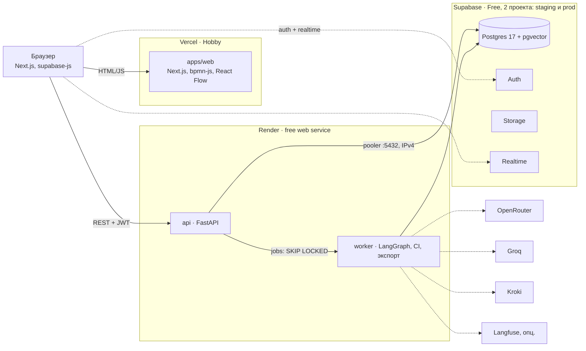

reqgraph · tech design v1.0 · [README](README.md) · [01_why](01_why.md) · [02_arch](02_arch.md) · [03_agents](03_agents.md) · [04_data](04_data.md) · [05_ci](05_ci.md) · [06_models](06_models.md) · [07_deploy](07_deploy.md) · [08_plan](08_plan.md) · [09_eval](09_eval.md) · [10_claude](10_claude.md)

# 07 Deploy

*Supabase для данных, Vercel и Render для кода, офлайн-стенд для защиты*

> [!NOTE]
> **Короткий ответ.** Да, Supabase подходит для хранения: Postgres (граф, прогоны, чекпоинты LangGraph), Auth, Storage для выгрузок и Realtime для живого прогресса. Python-бэкенд в Supabase не запускается (Edge Functions — Deno/TypeScript с лимитом времени), поэтому деплой: фронтенд на Vercel, API и воркер на Render, всё бесплатно. Для защиты в РФ — локальный стенд через docker compose.

Локально и на защите: `docker compose` (web, api, Supabase CLI, Ollama) без интернета.

*рис.10 - целевая топология: $0 в месяц*

## Что берём у Supabase

| Возможность | Для чего | Лимит Free | Риск и решение |
|---|---|---|---|
| `Postgres + pgvector` | проекты, ревизии jsonb, прогоны, события, чекпоинты | 500 МБ | ежедневная чистка: чекпоинты > 14 дней, ревизии > 50 на проект |
| `Auth` | GitHub OAuth, magic link, JWT для API | 50 000 MAU | — |
| `Storage` | DOCX, SVG, ZIP выгрузки | 1 ГБ | TTL 30 дней, повторная генерация по запросу |
| `Realtime` | поток run_events в браузер | ~200 одновременных подключений | фолбэк: опрос GET /runs/{id}/events |
| `Трафик` | API и Storage | 5 ГБ egress | SVG рендерить на клиенте (bpmn-js) |
| `Пауза` | проект засыпает после 7 дней без активности | — | dev — локально (Supabase CLI); prod — cron-пинг /health раз в 3 дня |

Подключение из Render: прямое подключение Supabase идёт по IPv6, а Render, Vercel и GitHub Actions работают по IPv4. Поэтому `DATABASE_URL` — строка Supavisor в session-режиме (порт 5432 на хосте pooler). Для psycopg и PostgresSaver: `autocommit=True, prepare_threshold=None`, пул на 3-5 соединений.

## Где запускать Python-бэкенд

Таблица 7 - сравнение на октябрь 2026

| Платформа | Цена | Ресурсы | Минусы | Вердикт |
|---|---|---|---|---|
| `Render Free` | $0 | 512 МБ, 0.1 CPU, 750 ч/мес | засыпает через 15 мин, холодный старт до минуты | основной выбор |
| `Railway` | триал $5, далее от $1-5/мес | по использованию | бесплатного почти нет | запасной при нехватке памяти |
| `Fly.io` | ~$3-6/мес | 512 МБ-1 ГБ | нет бесплатного тарифа | запасной |
| `Koyeb` | — | — | бесплатного compute больше нет | нет |
| `Google Cloud Run` | щедрая квота | по запросам | нужна карта, оплата из РФ невозможна | нет |
| `HF Spaces (Docker)` | PRO | — | Docker-спейсы требуют подписку | нет |
| `Amvera (РФ)` | от 170 ₽; реально 490-1450 ₽/мес | 0.1-1 ГБ RAM | нет бесплатного тарифа | зеркало в РФ |
| `Yandex Cloud` | по использованию, грант новым | Serverless Containers | сложнее настройка | зеркало в РФ |
| `Свой ноутбук` | $0 | docker compose | только офлайн | защита диплома |

> [!WARNING]
> Render Free: 512 МБ на всё — FastAPI, LangGraph, pm4py. Проверить потребление памяти в S5 первым делом (T-506). Если не влезает: вынести SND-002 (pm4py) в фоновый шаг с ленивым импортом или перейти на Railway / Fly (~$5). Пока пользователь смотрит прогон, фронтенд опрашивает API и не даёт сервису уснуть; прогоны без наблюдателя запускать только локально или в GitHub Actions.

## Доступ из РФ

- **Vercel** недоступен у части российских мобильных операторов; Supabase и OpenRouter из РФ работают нестабильно и могут требовать VPN; оплата зарубежных сервисов с российских карт невозможна (OpenRouter принимает USDC с комиссией 5%).

- **Защита диплома:** только локальный стенд — `docker compose up` поднимает web, api, Supabase CLI и Ollama; демонстрационные прогоны заранее записаны (replay из run_events), живой прогон — на дешёвой модели при наличии сети.

- **Публичное демо** для зарубежных программ и работодателей — Vercel + Render + Supabase.

- **Зеркало в РФ (опционально, до 1500 ₽/мес):** Amvera или Yandex Cloud для api и web + собственный Postgres; у Amvera есть встроенный прокси к зарубежным LLM API.

## Окружения и переменные

| Окружение | Где | База | Модели |
|---|---|---|---|
| `local` | ноутбук, docker compose | Supabase CLI (Postgres в Docker) | profile=free или local |
| `ci` | GitHub Actions | без базы (FileStore) или сервис postgres | кассеты, без сети |
| `staging` | Render preview + Vercel preview | Supabase проект #1 | free |
| `prod` | Render + Vercel | Supabase проект #2 | cheap, лимиты демо |

| Переменная | Где | Назначение |
|---|---|---|
| `SUPABASE_URL, SUPABASE_ANON_KEY` | web | клиент supabase-js (Auth, Realtime) |
| `SUPABASE_SERVICE_ROLE_KEY` | api | запись прогонов и ревизий; никогда не попадает в браузер |
| `DATABASE_URL` | api | Supavisor session pooler :5432 |
| `SUPABASE_JWKS_URL` | api | проверка JWT пользователя |
| `OPENROUTER_API_KEY, GROQ_API_KEY, GEMINI_API_KEY` | api, evals | провайдеры моделей |
| `REQGRAPH_PROFILE, REQGRAPH_RUN_BUDGET_USD` | api, cli | профиль моделей и бюджет прогона |
| `OLLAMA_BASE_URL` | api, cli (local) | офлайн-профиль `local` (Ollama) |
| `PYDANTIC_AI_NO_BANNER` | api, cli, evals | отключает баннер pydantic-ai в консоли |
| `KROKI_URL` | api | https://kroki.io или свой контейнер |
| `DEMO_RUNS_PER_DAY, DEMO_DAILY_USD_CAP` | api | лимиты публичного демо |
| `NEXT_PUBLIC_API_URL` | web | адрес API на Render |

## CI/CD

| Workflow | Когда | Что делает |
|---|---|---|
| `ci.yml` | push, PR | ruff, mypy, pytest без сети (кассеты), сборка web, проверка миграций на локальном Supabase |
| `evals.yml` | вручную | матрица сценариев с выбором профиля и лимитом $; результаты — артефакт и коммит в evals/reports |
| `probe.yml` | вручную | мини-бенчмарк моделей |
| `migrate.yml` | push в main с изменениями supabase/ | supabase db push в staging, затем в prod по ручному подтверждению |
| `keepalive.yml` | cron раз в 3 дня | GET /health (select 1) — проект Supabase не засыпает |
| `Render, Vercel` | push в main | автодеплой из GitHub; превью на PR |

Для публичного репозитория минуты GitHub Actions бесплатны, поэтому эксперименты можно гонять там, а не на ноутбуке.

## Публичное демо: лимиты и безопасность

| Мера | Значение |
|---|---|
| `Прогонов на пользователя` | 3 в день (usage_daily), 40 ходов интервью, 800k токенов на прогон |
| `Общий потолок` | $0.50 в день; после него — только профиль free или свой ключ |
| `Свой ключ (BYOK)` | ключ OpenRouter хранится только в памяти браузера и передаётся в заголовке; на сервере не сохраняется |
| `Доступ к данным` | RLS по owner_id; service_role только на сервере; CORS только домен Vercel |
| `Prompt injection` | ответы как данные, у агентов нет сетевых и файловых инструментов, вывод — только по схеме |
| `Персональные данные` | дисклеймер: не вводить ПДн; бесплатные модели могут обучаться на запросах; удаление проекта — каскадно |
| `Логи` | run_events хранятся 30 дней; ключи и токены в логи не пишутся |

## Бюджет

| Статья | План $0 | План до $20/мес |
|---|---|---|
| `Frontend` | Vercel Hobby | Vercel Hobby |
| `Backend` | Render Free | Render Free или Railway / Fly ~$5 |
| `Данные` | Supabase Free x2 (staging, prod) | Supabase Free x2 |
| `Модели` | :free + Groq + AI Studio | + $10 разово в OpenRouter, ~$5-10/мес на DeepSeek / Qwen в январе-феврале |
| `Диаграммы` | kroki.io | kroki.io или контейнер |
| `Итого` | $0 | $10-20 в месяц только в период экспериментов |
