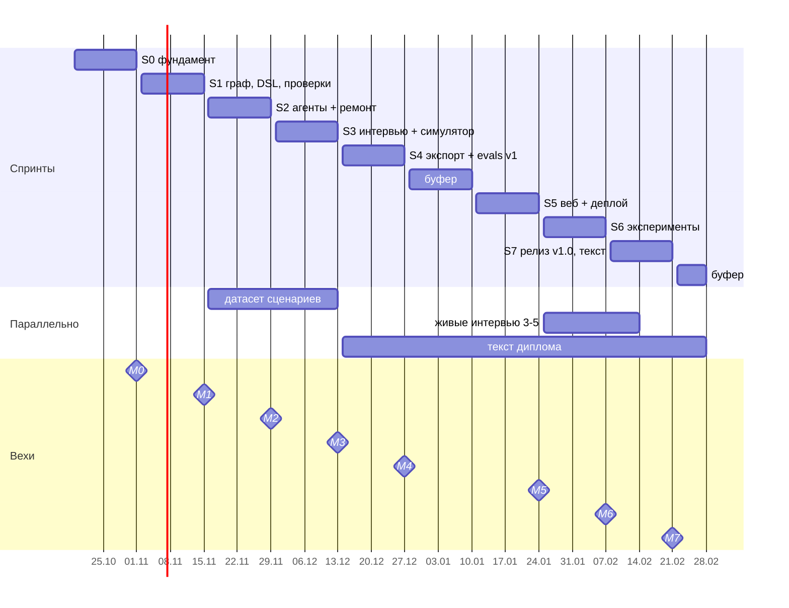

reqgraph · tech design v1.0 · [README](README.md) · [01_why](01_why.md) · [02_arch](02_arch.md) · [03_agents](03_agents.md) · [04_data](04_data.md) · [05_ci](05_ci.md) · [06_models](06_models.md) · [07_deploy](07_deploy.md) · [08_plan](08_plan.md) · [09_eval](09_eval.md) · [10_claude](10_claude.md)

# 08 Roadmap

*8 спринтов по 2 недели до 21.02 + буферы; вехи M0-M7*

> Чек-листы Definition of Done ниже — копия для чтения. Отмечать выполнение нужно в [docs/backlog.md](../backlog.md).

*рис.11 - диаграмма Ганта: спринты, параллельные потоки и вехи*

> [!TIP]
> Ускоренный трек: с Claude Code ядро (S0-S2) реально сделать за 3-4 недели вместо 6. Освободившееся время лучше отдать в S3 (сценарии и симулятор) и S6 (эксперименты) — от них зависит оценка диплома, а не от количества нотаций.

## Оценка трудоёмкости

| Спринт | Часов | Где риск |
|---|---|---|
| `S0` | 12-16 | настройка Supabase CLI и ключей провайдеров, бесплатные лимиты, запись кассет |
| `S1` | 25-35 | раскладка BPMN DI, pm4py на нестандартных шлюзах |
| `S2` | 25-35 | качество JSON у дешёвых моделей на русском |
| `S3` | 30-40 | ручная разметка 15 сценариев — самая трудоёмкая часть |
| `S4` | 20-25 | структура ТЗ по ГОСТ; DOCX через pandoc (ADR-016) |
| `S5` | 30-40 | Realtime, JWT, память на Render |
| `S6` | 25-35 | поиск экспертов и живых интервью |
| `S7` | 20-30 | текст, видео |
| `Итого` | ~185-255 | при 15-18 ч в неделю укладывается с запасом в 2 буфера |

## S0 · Фундамент  `19.10 - 01.11 -> M0`

**Цель:** репозиторий, правила, база, LLM-слой, первый probe. **Задачи:** `T-001, T-002, T-003, T-004, T-005, T-006`.

`Definition of Done`

- [ ] **uv run pytest и pnpm build зелёные в GitHub Actions** — ci.yml на каждый push
- [ ] **supabase db reset поднимает все таблицы и RLS** — миграции 0001-0002
- [ ] **LLM-слой вызывает OpenRouter, Groq и Gemini одной функцией** — usage и $ пишутся в лог
- [ ] **probe-отчёт по 3-4 моделям сохранён** — выбран стартовый профиль free

## S1 · Граф, DSL, проверки  `02.11 - 15.11 -> M1`

**Цель:** детерминированное ядро без LLM: граф, компиляторы, 21 проверка. **Задачи:** `T-101, T-102, T-103, T-104, T-105, T-106, T-107`.

`Definition of Done`

- [ ] **examples/garage61 читается и пишется без потерь** — round-trip тест FileStore
- [ ] **DSL -> BPMN проходит XSD и открывается в bpmn-js** — golden-тесты компилятора
- [ ] **reqgraph check выдаёт отчёт JSON и MD** — все проверки с good/bad фикстурами
- [ ] **покрытие checks/ и dsl/ >= 90%** — мутационные тесты на garage61

## S2 · Агенты и цикл ремонта  `16.11 - 29.11 -> M2`

**Цель:** v0.1: из брифа получаем граф, модели и зелёный (или объяснённый) отчёт. **Задачи:** `T-201, T-202, T-203, T-204, T-205, T-206`.

`Definition of Done`

- [ ] **reqgraph run --brief работает на 3 dev-сценариях** — без падений, бюджет <= $0.30 на прогон
- [ ] **после ремонта SCH-* проходят в 100% случаев** — SND-* >= 80% на dev
- [ ] **детектор повторов останавливает зацикливание** — тест на искусственно нерешаемой ошибке
- [ ] **кассеты агентов в CI** — тесты агентов без сети

## S3 · Интервью и симулятор  `30.11 - 13.12 -> M3`

**Цель:** интервьюер с покрытием, симулятор заказчика, 15 сценариев со скрытыми требованиями. **Задачи:** `T-301, T-302, T-303, T-304`.

`Definition of Done`

- [ ] **reqgraph interview ведёт диалог в терминале** — interrupt / resume через чекпоинтер
- [ ] **симулятор раскрывает требование только по теме вопроса** — ручная проверка 3 диалогов
- [ ] **15 сценариев: 3 dev + 12 test, по 25-60 скрытых требований** — домены согласованы с руководителем
- [ ] **метрики recall, ambiguity, validity, soundness, trace считаются скриптом** — results.csv

## S4 · Экспорт и evals v1  `14.12 - 27.12 -> M4`

**Цель:** v0.5: SRS, ТЗ, ReqIF; бейзлайны и первый прогон матрицы на dev. **Задачи:** `T-401, T-402, T-403, T-404, T-405, T-406`.

`Definition of Done`

- [ ] **SRS (MD, DOCX) и ТЗ (DOCX) собираются из одного графа** — TPL-001/002 зелёные на garage61
- [ ] **ReqIF открывается в стороннем инструменте** — например, StrictDoc или ReqIF Studio
- [ ] **B1, B2, B3 запускаются тем же харнесом** — одинаковые входы и модель
- [ ] **evals.yml гоняет матрицу с лимитом $** — отчёт с графиками

## S5 · Веб и деплой  `11.01 - 24.01 -> M5`

**Цель:** публичное демо: вход, проекты, интервью в браузере, граф, BPMN, отчёт, выгрузка. **Задачи:** `T-501, T-502, T-503, T-504, T-505, T-506, T-507`.

`Definition of Done`

- [ ] **пользователь проходит путь от входа до DOCX за один сеанс** — Playwright e2e на staging
- [ ] **прогон переживает засыпание Render** — resume из чекпоинта
- [ ] **память api + worker < 450 МБ под нагрузкой одного прогона** — иначе план Б из 07_deploy
- [ ] **docker compose up поднимает всё офлайн** — репетиция защиты без сети

## S6 · Эксперименты  `25.01 - 07.02 -> M6`

**Цель:** полная матрица, абляции, эксперты, живые интервью, статистика. **Задачи:** `T-601, T-602, T-603, T-604, T-605`.

`Definition of Done`

- [ ] **прогоны основной матрицы + абляции завершены** — расход <= $25
- [ ] **3 эксперта оценили слепые пакеты** — согласие экспертов посчитано (каппа Флейса)
- [ ] **3-5 живых интервью проведены и сопоставлены с симулятором** — согласие участников
- [ ] **H1-H4 проверены, графики и таблицы готовы** — страница /eval

## S7 · Релиз и текст  `08.02 - 21.02 -> M7`

**Цель:** v1.0, техотчёт на английском, демо-видео, главы диплома. **Задачи:** `T-701, T-702, T-703`.

`Definition of Done`

- [ ] **тег v1.0, README с результатами и GIF** — демо доступно по ссылке
- [ ] **техотчёт 6-8 страниц (EN)** — можно выложить на arXiv или в блог
- [ ] **главы: обзор, методика, реализация, эксперимент** — черновик руководителю
- [ ] **строки для CV с реальными цифрами** — EN и RU
