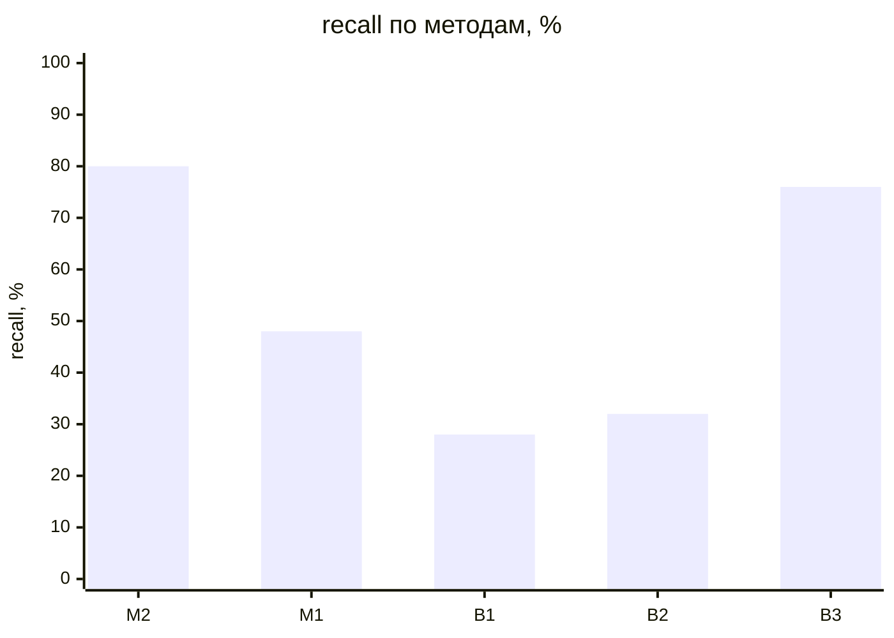
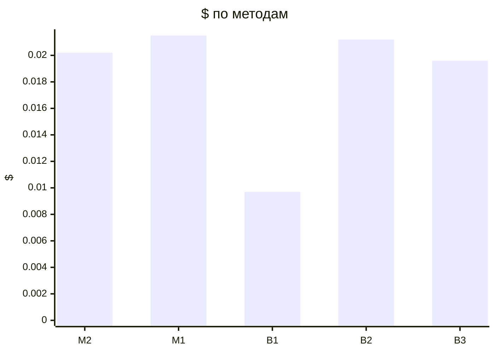

# Метрики прогонов (T-304)

recall — доля скрытых требований вне брифа, которые рассказал заказчик и система нашла полностью (сопоставление: эмбеддинги → судья); с частичными — вместе с найденными частично (тема без чисел или главного условия); recall_all — по всему эталону, с брифом и допущениями, только полные. Типовых и уникальных — recall по группам эталона (T-308, правило — evals/scenarios/README.md); «—» — эталон не размечен.

| Прогон | Вопросов | recall | с частичными | recall_all | типовых | уникальных | на 10 вопросов | Требований | Неоднозначных | Validity | Soundness | Trace | Сироты | Ошибок | Вызовов LLM | $ | Минут | Ошибка |
|---|---|---|---|---|---|---|---|---|---|---|---|---|---|---|---|---|---|---|
| dev-01-cooperative-M2-r1 | 12 | 80% (20/25) | 92% | 83% | 80% (16/20) | 80% (4/5) | 16.667 | 57 | 12% | 100% | 100% | 100% | 4% | 0 | 96 | 0.0202 | 10.67 |  |
| dev-01-cooperative-M1-r1 | 15 | 48% (12/25) | 68% | 53% | 60% (12/20) | 0% (0/5) | 8.0 | 41 | 5% | 100% | 100% | 100% | 0% | 0 | 101 | 0.0215 | 3.77 |  |
| dev-01-cooperative-B1-r1 | 15 | 28% (7/25) | 64% | 40% | 35% (7/20) | 0% (0/5) | 4.667 | 14 | 43% | 0% | 0% | 0% | 0% | 9 | 31 | 0.0097 | 0.76 |  |
| dev-01-cooperative-B2-r1 | 15 | 32% (8/25) | 56% | 50% | 30% (6/20) | 40% (2/5) | 5.333 | 41 | 15% | 100% | 100% | 100% | 0% | 5 | 95 | 0.0212 | 3.26 |  |
| dev-01-cooperative-B3-r1 | 12 | 76% (19/25) | 96% | 80% | 70% (14/20) | 100% (5/5) | 15.833 | 45 | 9% | 100% | 100% | 100% | 0% | 0 | 81 | 0.0196 | 2.78 |  |

## Сводка по методам

Средние — по прогонам без ошибки; $ и минуты — по всем прогонам метода.

| Метод | Прогонов | без ошибки | recall | с частичными | Требований | Ошибок проверок | $ | Минут |
|---|---|---|---|---|---|---|---|---|
| M2 | 1 | 1 | 80% | 92% | 57.0 | 0.0 | 0.0202 | 10.67 |
| M1 | 1 | 1 | 48% | 68% | 41.0 | 0.0 | 0.0215 | 3.77 |
| B1 | 1 | 1 | 28% | 64% | 14.0 | 9.0 | 0.0097 | 0.76 |
| B2 | 1 | 1 | 32% | 56% | 41.0 | 5.0 | 0.0212 | 3.26 |
| B3 | 1 | 1 | 76% | 96% | 45.0 | 0.0 | 0.0196 | 2.78 |

