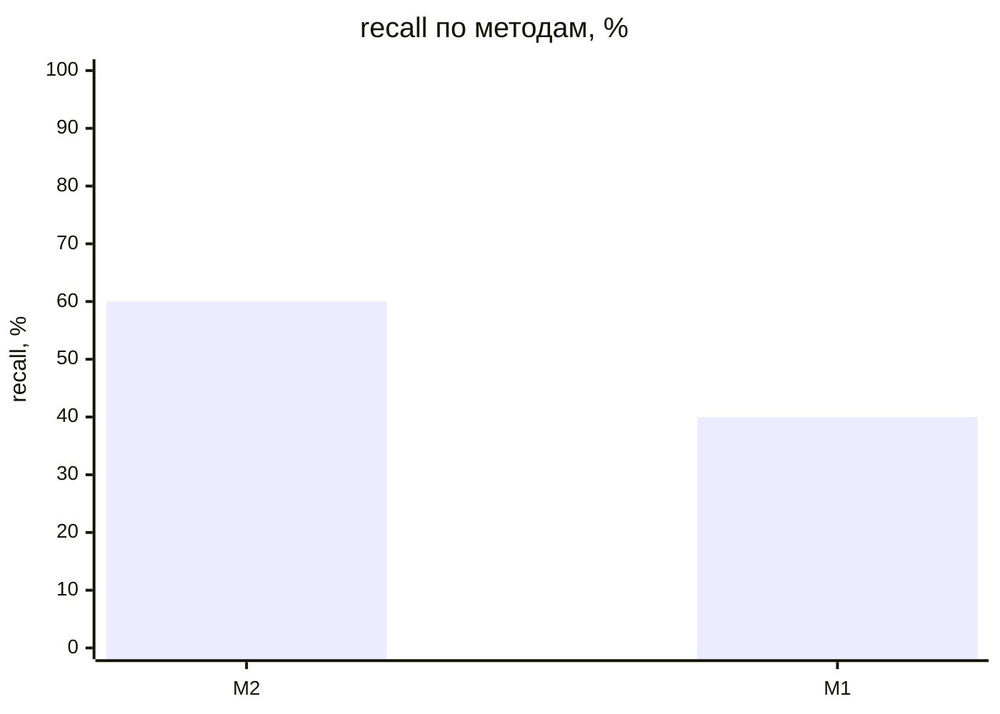
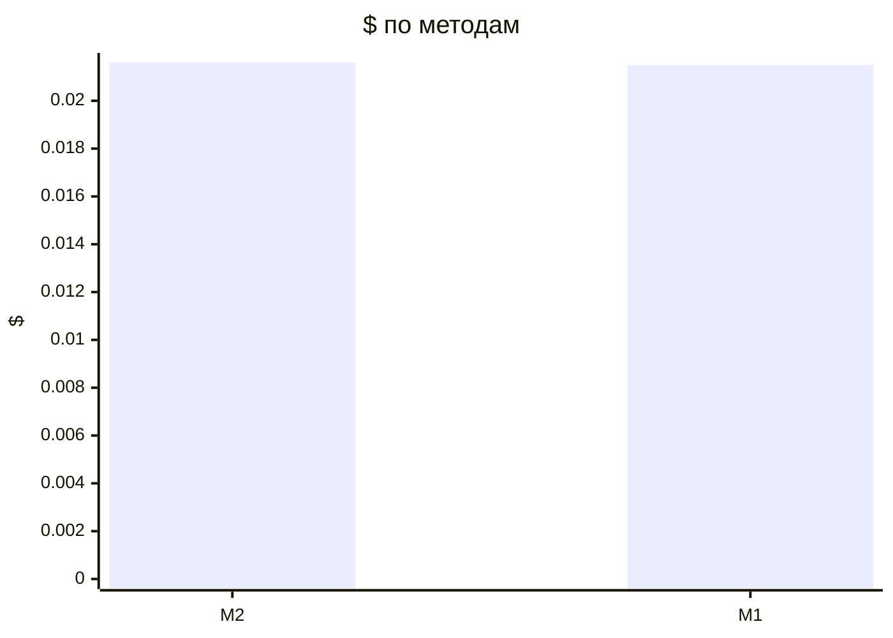

# Метрики прогонов (T-304)

recall — доля скрытых требований вне брифа, которые рассказал заказчик и система нашла полностью (сопоставление: эмбеддинги → судья); с частичными — вместе с найденными частично (тема без чисел или главного условия); recall_all — по всему эталону, с брифом и допущениями, только полные. Типовых и уникальных — recall по группам эталона (T-308, правило — evals/scenarios/README.md); «—» — эталон не размечен.

| Прогон | Вопросов | recall | с частичными | recall_all | типовых | уникальных | на 10 вопросов | Требований | Неоднозначных | Validity | Soundness | Trace | Сироты | Ошибок | Вызовов LLM | $ | Минут | Ошибка |
|---|---|---|---|---|---|---|---|---|---|---|---|---|---|---|---|---|---|---|
| dev-01-cooperative-M2-r1 | 15 | 60% (15/25) | 72% | 67% | 55% (11/20) | 80% (4/5) | 10.0 | 36 | 6% | 100% | 100% | 100% | 0% | 0 | 104 | 0.0216 | 5.2 |  |
| dev-01-cooperative-M1-r1 | 15 | 40% (10/25) | 52% | 50% | 35% (7/20) | 60% (3/5) | 6.667 | 33 | 6% | 100% | 100% | 100% | 0% | 0 | 106 | 0.0215 | 3.94 |  |

## Сводка по методам

Средние — по прогонам без ошибки; $ и минуты — по всем прогонам метода.

| Метод | Прогонов | без ошибки | recall | с частичными | Требований | Ошибок проверок | $ | Минут |
|---|---|---|---|---|---|---|---|---|
| M2 | 1 | 1 | 60% | 72% | 36.0 | 0.0 | 0.0216 | 5.2 |
| M1 | 1 | 1 | 40% | 52% | 33.0 | 0.0 | 0.0215 | 3.94 |

