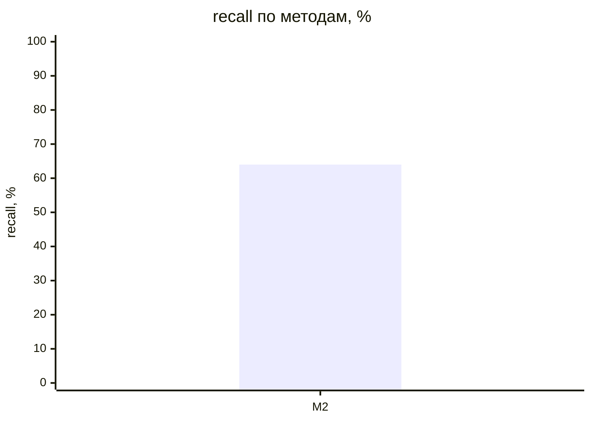
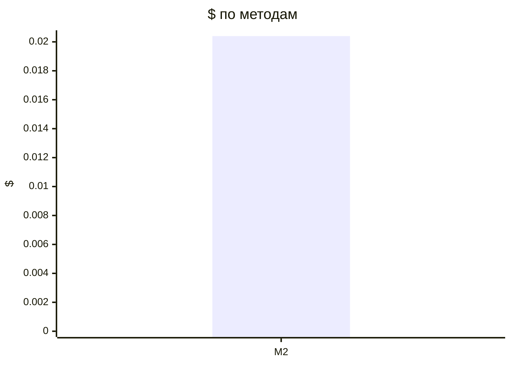

# Метрики прогонов (T-304)

recall — доля скрытых требований вне брифа, которые рассказал заказчик и система нашла полностью (сопоставление: эмбеддинги → судья); с частичными — вместе с найденными частично (тема без чисел или главного условия); recall_all — по всему эталону, с брифом и допущениями, только полные. Типовых и уникальных — recall по группам эталона (T-308, правило — evals/scenarios/README.md); «—» — эталон не размечен.

| Прогон | Вопросов | recall | с частичными | recall_all | типовых | уникальных | на 10 вопросов | Требований | Неоднозначных | Validity | Soundness | Trace | Сироты | Ошибок | Вызовов LLM | $ | Минут | Ошибка |
|---|---|---|---|---|---|---|---|---|---|---|---|---|---|---|---|---|---|---|
| dev-01-cooperative-M2-r1 | 13 | 64% (16/25) | 88% | 70% | 65% (13/20) | 60% (3/5) | 12.308 | 47 | 11% | 100% | 100% | 100% | 0% | 0 | 98 | 0.0204 | 5.38 |  |
| dev-01-cooperative-M1-r1 | 0 | 0% (0/0) | 0% | 0% | — | — | 0.0 | 0 | 0% | 0% | 0% | 0% | 0% | 0 | 0 | 0.0000 | 0.0 | лимит $ запуска исчерпан: потрачено $0.0204 из $0.0100 |

## Сводка по методам

Средние — по прогонам без ошибки; $ и минуты — по всем прогонам метода.

| Метод | Прогонов | без ошибки | recall | с частичными | Требований | Ошибок проверок | $ | Минут |
|---|---|---|---|---|---|---|---|---|
| M2 | 1 | 1 | 64% | 88% | 47.0 | 0.0 | 0.0204 | 5.38 |
| M1 | 1 | 0 | — | — | — | — | 0.0000 | 0.0 |

