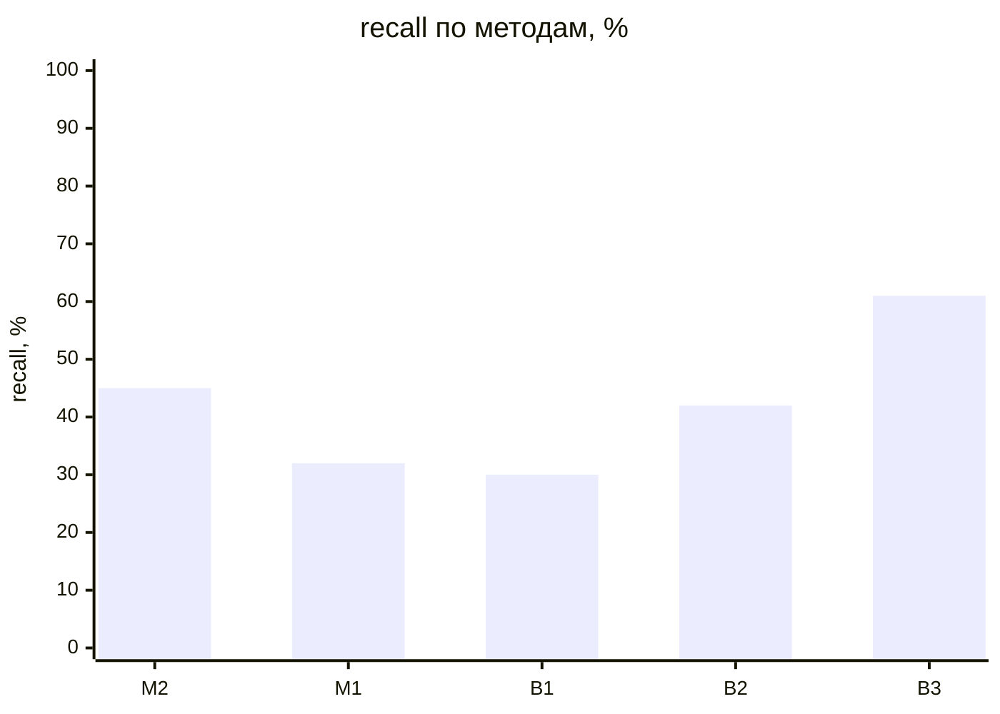
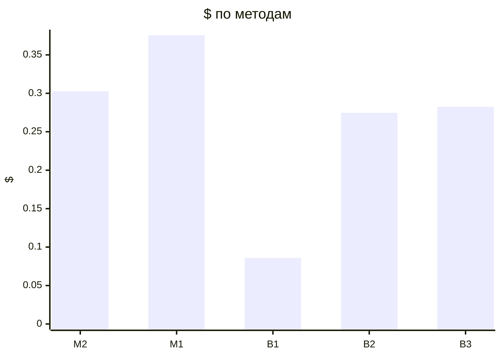

# Метрики прогонов (T-304)

recall — доля скрытых требований вне брифа, которые рассказал заказчик и система нашла полностью (сопоставление: эмбеддинги → судья); с частичными — вместе с найденными частично (тема без чисел или главного условия); recall_all — по всему эталону, с брифом и допущениями, только полные. Типовых и уникальных — recall по группам эталона (T-308, правило — evals/scenarios/README.md); «—» — эталон не размечен.

| Прогон | Вопросов | recall | с частичными | recall_all | типовых | уникальных | на 10 вопросов | Требований | Неоднозначных | Validity | Soundness | Trace | Сироты | Ошибок | Вызовов LLM | $ | Минут | Ошибка |
|---|---|---|---|---|---|---|---|---|---|---|---|---|---|---|---|---|---|---|
| dev-01-cooperative-M2-r1 | 14 | 80% (20/25) | 84% | 83% | 80% (16/20) | 80% (4/5) | 14.286 | 51 | 8% | 100% | 100% | 100% | 0% | 0 | 98 | 0.0441 | 11.05 |  |
| dev-01-vague-M2-r1 | 17 | 12% (3/25) | 60% | 30% | 5% (1/20) | 40% (2/5) | 1.765 | 59 | 8% | 100% | 100% | 100% | 0% | 0 | 112 | 0.0494 | 9.88 |  |
| dev-01-contradictory-M2-r1 | 15 | 72% (18/25) | 84% | 77% | 70% (14/20) | 80% (4/5) | 12.0 | 53 | 6% | 100% | 100% | 100% | 0% | 0 | 101 | 0.0463 | 12.16 |  |
| dev-02-cooperative-M2-r1 | 4 | 21% (7/33) | 30% | 40% | 24% (6/25) | 12% (1/8) | 17.5 | 45 | 2% | 100% | 100% | 100% | 8% | 0 | 71 | 0.0357 | 8.23 |  |
| dev-02-vague-M2-r1 | 15 | 24% (8/33) | 39% | 42% | 24% (6/25) | 25% (2/8) | 5.333 | 72 | 3% | 100% | 100% | 100% | 0% | 0 | 118 | 0.0650 | 12.97 |  |
| dev-02-contradictory-M2-r1 | 13 | 58% (19/33) | 79% | 64% | 52% (13/25) | 75% (6/8) | 14.615 | 70 | 9% | 100% | 100% | 100% | 2% | 0 | 113 | 0.0623 | 15.3 |  |
| dev-01-cooperative-M1-r1 | 19 | 92% (23/25) | 100% | 93% | 90% (18/20) | 100% (5/5) | 12.105 | 67 | 4% | 100% | 100% | 100% | 0% | 0 | 120 | 0.0582 | 12.61 |  |
| dev-01-vague-M1-r1 | 19 | 4% (1/25) | 48% | 23% | 5% (1/20) | 0% (0/5) | 0.526 | 39 | 5% | 100% | 100% | 100% | 0% | 0 | 120 | 0.0508 | 10.83 |  |
| dev-01-contradictory-M1-r1 | 17 | 52% (13/25) | 68% | 63% | 45% (9/20) | 80% (4/5) | 7.647 | 48 | 8% | 100% | 100% | 100% | 14% | 0 | 115 | 0.0564 | 18.75 |  |
| dev-02-cooperative-M1-r1 | 19 | 21% (7/33) | 42% | 38% | 28% (7/25) | 0% (0/8) | 3.684 | 57 | 4% | 100% | 100% | 100% | 1% | 0 | 135 | 0.0634 | 11.1 |  |
| dev-02-vague-M1-r1 | 19 | 18% (6/33) | 30% | 38% | 20% (5/25) | 12% (1/8) | 3.158 | 59 | 8% | 100% | 100% | 100% | 2% | 0 | 137 | 0.0699 | 9.86 |  |
| dev-02-contradictory-M1-r1 | 19 | 6% (2/33) | 27% | 27% | 8% (2/25) | 0% (0/8) | 1.053 | 50 | 4% | 100% | 100% | 100% | 8% | 0 | 140 | 0.0768 | 15.07 |  |
| dev-01-cooperative-B1-r1 | 19 | 84% (21/25) | 100% | 83% | 80% (16/20) | 100% (5/5) | 11.053 | 34 | 59% | 100% | 100% | 95% | 21% | 22 | 31 | 0.0118 | 3.69 |  |
| dev-01-vague-B1-r1 | 19 | 16% (4/25) | 48% | 30% | 20% (4/20) | 0% (0/5) | 2.105 | 20 | 55% | 100% | 100% | 100% | 0% | 13 | 31 | 0.0110 | 2.82 |  |
| dev-01-contradictory-B1-r1 | 17 | 52% (13/25) | 64% | 60% | 45% (9/20) | 80% (4/5) | 7.647 | 24 | 67% | 100% | 100% | 88% | 0% | 18 | 31 | 0.0114 | 2.68 |  |
| dev-02-cooperative-B1-r1 | 19 | 9% (3/33) | 30% | 33% | 12% (3/25) | 0% (0/8) | 1.579 | 27 | 11% | 100% | 100% | 100% | 22% | 4 | 46 | 0.0161 | 2.61 |  |
| dev-02-vague-B1-r1 | 19 | 12% (4/33) | 36% | 31% | 16% (4/25) | 0% (0/8) | 2.105 | 29 | 10% | 100% | 100% | 94% | 13% | 4 | 46 | 0.0194 | 3.22 |  |
| dev-02-contradictory-B1-r1 | 19 | 9% (3/33) | 27% | 29% | 12% (3/25) | 0% (0/8) | 1.579 | 31 | 10% | 100% | 100% | 88% | 25% | 5 | 46 | 0.0161 | 1.64 |  |
| dev-01-cooperative-B2-r1 | 9 | 56% (14/25) | 64% | 63% | 45% (9/20) | 100% (5/5) | 15.556 | 37 | 8% | 100% | 100% | 100% | 3% | 1 | 72 | 0.0274 | 7.99 |  |
| dev-01-vague-B2-r1 | 19 | 24% (6/25) | 32% | 37% | 25% (5/20) | 20% (1/5) | 3.158 | 27 | 11% | 100% | 100% | 100% | 0% | 0 | 111 | 0.0398 | 6.53 |  |
| dev-01-contradictory-B2-r1 | 19 | 72% (18/25) | 92% | 80% | 70% (14/20) | 80% (4/5) | 9.474 | 57 | 12% | 100% | 100% | 97% | 0% | 3 | 111 | 0.0448 | 9.53 |  |
| dev-02-cooperative-B2-r1 | 20 | 48% (16/33) | 67% | 58% | 48% (12/25) | 50% (4/8) | 8.0 | 62 | 16% | 100% | 100% | 100% | 0% | 5 | 128 | 0.0553 | 7.47 |  |
| dev-02-vague-B2-r1 | 20 | 21% (7/33) | 36% | 44% | 28% (7/25) | 0% (0/8) | 3.5 | 66 | 17% | 100% | 100% | 100% | 3% | 2 | 129 | 0.0559 | 7.92 |  |
| dev-02-contradictory-B2-r1 | 19 | 30% (10/33) | 42% | 47% | 36% (9/25) | 12% (1/8) | 5.263 | 48 | 17% | 100% | 92% | 100% | 4% | 4 | 126 | 0.0516 | 8.19 |  |
| dev-01-cooperative-B3-r1 | 12 | 96% (24/25) | 100% | 97% | 95% (19/20) | 100% (5/5) | 20.0 | 69 | 14% | 100% | 100% | 100% | 0% | 1 | 83 | 0.0452 | 16.96 |  |
| dev-01-vague-B3-r1 | 12 | 8% (2/25) | 36% | 23% | 5% (1/20) | 20% (1/5) | 1.667 | 71 | 1% | 100% | 100% | 100% | 0% | 0 | 83 | 0.0442 | 18.84 |  |
| dev-01-contradictory-B3-r1 | 12 | 64% (16/25) | 80% | 77% | 65% (13/20) | 60% (3/5) | 13.333 | 51 | 4% | 100% | 100% | 100% | 3% | 0 | 79 | 0.0382 | 5.59 |  |
| dev-02-cooperative-B3-r1 | 12 | 76% (25/33) | 82% | 80% | 68% (17/25) | 100% (8/8) | 20.833 | 83 | 8% | 100% | 100% | 100% | 3% | 2 | 103 | 0.0667 | 14.81 |  |
| dev-02-vague-B3-r1 | 12 | 0% (0/33) | 0% | 0% | 0% (0/25) | 0% (0/8) | 0.0 | 0 | 0% | 0% | 0% | 0% | 0% | 0 | 46 | 0.0373 | 8.44 | UnexpectedModelBehavior: Exceeded maximum output retries (2) |
| dev-02-contradictory-B3-r1 | 12 | 0% (0/33) | 0% | 0% | 0% (0/25) | 0% (0/8) | 0.0 | 0 | 0% | 0% | 0% | 0% | 0% | 0 | 55 | 0.0508 | 13.73 | UnexpectedModelBehavior: Exceeded maximum output retries (2) |

## Сводка по методам

Средние — по прогонам без ошибки; $ и минуты — по всем прогонам метода.

| Метод | Прогонов | без ошибки | recall | с частичными | Требований | Ошибок проверок | $ | Минут |
|---|---|---|---|---|---|---|---|---|
| M2 | 6 | 6 | 45% | 63% | 58.3 | 0.0 | 0.3028 | 69.59 |
| M1 | 6 | 6 | 32% | 53% | 53.3 | 0.0 | 0.3755 | 78.22 |
| B1 | 6 | 6 | 30% | 51% | 27.5 | 11.0 | 0.0859 | 16.66 |
| B2 | 6 | 6 | 42% | 56% | 49.5 | 2.5 | 0.2747 | 47.63 |
| B3 | 6 | 4 | 61% | 74% | 68.5 | 0.8 | 0.2824 | 78.37 |

