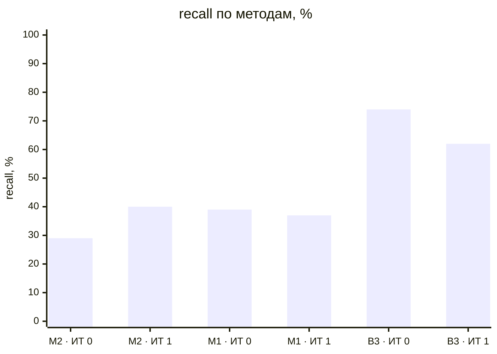
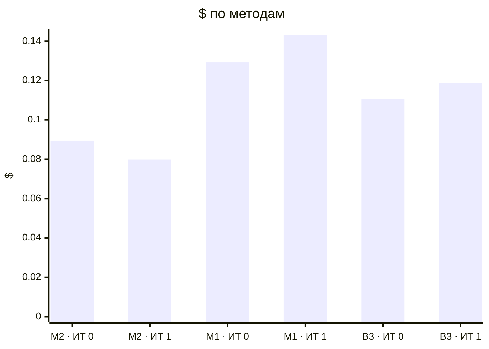

# Метрики прогонов (T-304)

recall — доля скрытых требований вне брифа, которые рассказал заказчик и система нашла полностью (сопоставление: эмбеддинги → судья); с частичными — вместе с найденными частично (тема без чисел или главного условия); recall_all — по всему эталону, с брифом и допущениями, только полные. Типовых и уникальных — recall по группам эталона (T-308, правило — evals/scenarios/README.md); «—» — эталон не размечен.

| Прогон | Вопросов | recall | с частичными | recall_all | типовых | уникальных | на 10 вопросов | Требований | Неоднозначных | Validity | Soundness | Trace | Сироты | Ошибок | Вызовов LLM | $ | Минут | Ошибка |
|---|---|---|---|---|---|---|---|---|---|---|---|---|---|---|---|---|---|---|
| dev-01-cooperative-it0-M2-r1 | 10 | 36% (9/25) | 56% | 47% | 35% (7/20) | 40% (2/5) | 9.0 | 44 | 5% | 100% | 100% | 100% | 2% | 0 | 82 | 0.0403 | 6.57 |  |
| dev-01-cooperative-it1-M2-r1 | 11 | 40% (10/25) | 48% | 50% | 35% (7/20) | 60% (3/5) | 9.091 | 40 | 5% | 100% | 100% | 100% | 0% | 0 | 82 | 0.0376 | 5.43 |  |
| dev-02-cooperative-it0-M2-r1 | 10 | 21% (7/33) | 36% | 40% | 28% (7/25) | 0% (0/8) | 7.0 | 56 | 4% | 100% | 100% | 100% | 0% | 0 | 96 | 0.0492 | 7.87 |  |
| dev-02-cooperative-it1-M2-r1 | 9 | 0% (0/0) | 0% | 0% | — | — | 0.0 | 67 | 4% | 100% | 100% | 100% | 9% | 0 | 52 | 0.0422 | 10.26 | ModelRateLimitError: status_code: 429, model_name: gemini-embedding-001, body: {'code': 429, 'message': 'You exceeded your current quota, please check |
| dev-01-cooperative-it0-M1-r1 | 20 | 60% (15/25) | 76% | 73% | 60% (12/20) | 60% (3/5) | 7.5 | 66 | 6% | 100% | 100% | 100% | 0% | 0 | 125 | 0.0614 | 8.99 |  |
| dev-01-cooperative-it1-M1-r1 | 19 | 40% (10/25) | 80% | 53% | 30% (6/20) | 80% (4/5) | 5.263 | 71 | 6% | 100% | 100% | 100% | 0% | 0 | 123 | 0.0672 | 13.18 |  |
| dev-02-cooperative-it0-M1-r1 | 19 | 18% (6/33) | 33% | 40% | 24% (6/25) | 0% (0/8) | 3.158 | 45 | 0% | 100% | 100% | 100% | 3% | 0 | 139 | 0.0679 | 8.18 |  |
| dev-02-cooperative-it1-M1-r1 | 19 | 33% (11/33) | 48% | 49% | 28% (7/25) | 50% (4/8) | 5.789 | 64 | 3% | 100% | 100% | 100% | 1% | 0 | 140 | 0.0763 | 10.23 |  |
| dev-01-cooperative-it0-B3-r1 | 12 | 84% (21/25) | 96% | 87% | 80% (16/20) | 100% (5/5) | 17.5 | 67 | 10% | 100% | 100% | 100% | 0% | 0 | 80 | 0.0457 | 7.36 |  |
| dev-01-cooperative-it1-B3-r1 | 12 | 60% (15/25) | 76% | 67% | 55% (11/20) | 80% (4/5) | 12.5 | 45 | 2% | 100% | 100% | 100% | 0% | 0 | 86 | 0.0540 | 9.38 |  |
| dev-02-cooperative-it0-B3-r1 | 12 | 64% (21/33) | 79% | 69% | 68% (17/25) | 50% (4/8) | 17.5 | 84 | 5% | 100% | 100% | 100% | 2% | 0 | 97 | 0.0649 | 10.06 |  |
| dev-02-cooperative-it1-B3-r1 | 12 | 64% (21/33) | 73% | 73% | 56% (14/25) | 88% (7/8) | 17.5 | 93 | 9% | 100% | 100% | 100% | 7% | 0 | 98 | 0.0646 | 11.5 |  |

## Сводка по методам

Средние — по прогонам без ошибки; $ и минуты — по всем прогонам метода.

| Метод | Прогонов | без ошибки | recall | с частичными | Требований | Ошибок проверок | $ | Минут |
|---|---|---|---|---|---|---|---|---|
| M2 · ИТ 0 | 2 | 2 | 29% | 46% | 50.0 | 0.0 | 0.0895 | 14.44 |
| M2 · ИТ 1 | 2 | 1 | 40% | 48% | 40.0 | 0.0 | 0.0798 | 15.69 |
| M1 · ИТ 0 | 2 | 2 | 39% | 55% | 55.5 | 0.0 | 0.1292 | 17.17 |
| M1 · ИТ 1 | 2 | 2 | 37% | 64% | 67.5 | 0.0 | 0.1434 | 23.41 |
| B3 · ИТ 0 | 2 | 2 | 74% | 87% | 75.5 | 0.0 | 0.1106 | 17.42 |
| B3 · ИТ 1 | 2 | 2 | 62% | 74% | 69.0 | 0.0 | 0.1186 | 20.88 |

