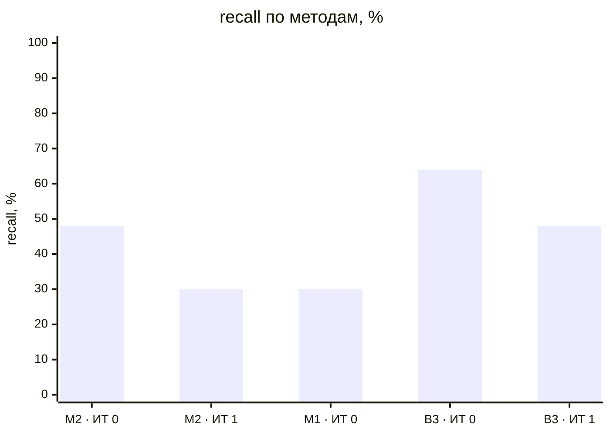
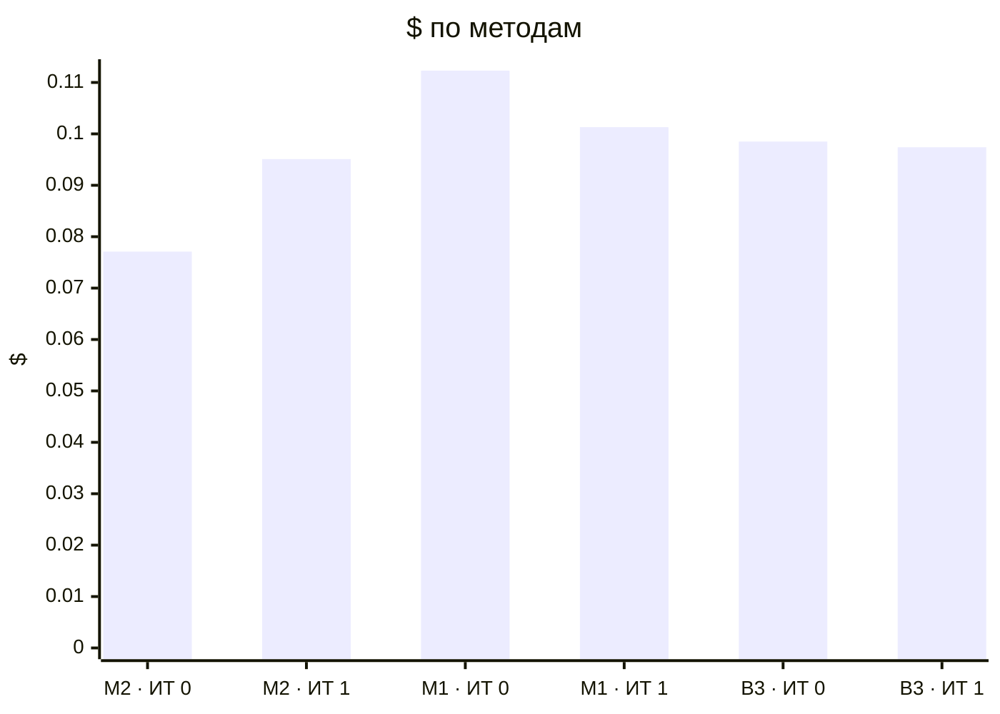

# Метрики прогонов (T-304)

recall — доля скрытых требований вне брифа, которые рассказал заказчик и система нашла полностью (сопоставление: эмбеддинги → судья); с частичными — вместе с найденными частично (тема без чисел или главного условия); recall_all — по всему эталону, с брифом и допущениями, только полные. Типовых и уникальных — recall по группам эталона (T-308, правило — evals/scenarios/README.md); «—» — эталон не размечен.

| Прогон | Вопросов | recall | с частичными | recall_all | типовых | уникальных | на 10 вопросов | Требований | Неоднозначных | Validity | Soundness | Trace | Сироты | Ошибок | Вызовов LLM | $ | Минут | Ошибка |
|---|---|---|---|---|---|---|---|---|---|---|---|---|---|---|---|---|---|---|
| dev-01-cooperative-it0-M2-r1 | 10 | 48% (12/25) | 56% | 57% | 40% (8/20) | 80% (4/5) | 12.0 | 47 | 9% | 100% | 100% | 100% | 0% | 0 | 84 | 0.0441 | 6.41 |  |
| dev-01-cooperative-it1-M2-r1 | 11 | 36% (9/25) | 60% | 50% | 35% (7/20) | 40% (2/5) | 8.182 | 41 | 10% | 100% | 100% | 100% | 0% | 0 | 88 | 0.0447 | 7.61 |  |
| dev-02-cooperative-it0-M2-r1 | 12 | 0% (0/33) | 0% | 0% | 0% (0/25) | 0% (0/8) | 0.0 | 0 | 0% | 0% | 0% | 0% | 0% | 0 | 54 | 0.0330 | 6.19 | UnexpectedModelBehavior: Exceeded maximum output retries (2) |
| dev-02-cooperative-it1-M2-r1 | 9 | 24% (8/33) | 52% | 44% | 32% (8/25) | 0% (0/8) | 8.889 | 66 | 5% | 100% | 100% | 100% | 8% | 0 | 94 | 0.0504 | 9.34 |  |
| dev-01-cooperative-it0-M1-r1 | 19 | 0% (0/25) | 0% | 0% | 0% (0/20) | 0% (0/5) | 0.0 | 0 | 0% | 0% | 0% | 0% | 0% | 0 | 85 | 0.0379 | 4.69 | TimeoutError:  |
| dev-01-cooperative-it1-M1-r1 | 18 | 0% (0/0) | 0% | 0% | — | — | 0.0 | 58 | 7% | 100% | 100% | 100% | 0% | 0 | 86 | 0.0453 | 8.97 | ModelRateLimitError: status_code: 429, model_name: gemini-embedding-001, body: {'code': 429, 'message': 'You exceeded your current quota, please check |
| dev-02-cooperative-it0-M1-r1 | 20 | 30% (10/33) | 39% | 51% | 24% (6/25) | 50% (4/8) | 5.0 | 54 | 6% | 100% | 100% | 100% | 0% | 0 | 143 | 0.0744 | 9.41 |  |
| dev-02-cooperative-it1-M1-r1 | 20 | 0% (0/0) | 0% | 0% | — | — | 0.0 | 62 | 6% | 100% | 100% | 100% | 8% | 0 | 97 | 0.0560 | 8.36 | ModelRateLimitError: status_code: 429, model_name: gemini-embedding-001, body: {'code': 429, 'message': 'You exceeded your current quota, please check |
| dev-01-cooperative-it0-B3-r1 | 12 | 76% (19/25) | 92% | 80% | 70% (14/20) | 100% (5/5) | 15.833 | 65 | 8% | 100% | 100% | 100% | 0% | 0 | 79 | 0.0429 | 6.68 |  |
| dev-01-cooperative-it1-B3-r1 | 12 | 60% (15/25) | 80% | 70% | 50% (10/20) | 100% (5/5) | 12.5 | 62 | 5% | 100% | 100% | 100% | 0% | 0 | 73 | 0.0400 | 6.96 |  |
| dev-02-cooperative-it0-B3-r1 | 12 | 52% (17/33) | 73% | 64% | 44% (11/25) | 75% (6/8) | 14.167 | 78 | 6% | 100% | 100% | 100% | 4% | 0 | 94 | 0.0556 | 9.54 |  |
| dev-02-cooperative-it1-B3-r1 | 12 | 36% (12/33) | 52% | 51% | 32% (8/25) | 50% (4/8) | 10.0 | 82 | 7% | 100% | 100% | 100% | 1% | 0 | 95 | 0.0574 | 10.67 |  |

## Сводка по методам

Средние — по прогонам без ошибки; $ и минуты — по всем прогонам метода.

| Метод | Прогонов | без ошибки | recall | с частичными | Требований | Ошибок проверок | $ | Минут |
|---|---|---|---|---|---|---|---|---|
| M2 · ИТ 0 | 2 | 1 | 48% | 56% | 47.0 | 0.0 | 0.0771 | 12.6 |
| M2 · ИТ 1 | 2 | 2 | 30% | 56% | 53.5 | 0.0 | 0.0951 | 16.95 |
| M1 · ИТ 0 | 2 | 1 | 30% | 39% | 54.0 | 0.0 | 0.1123 | 14.1 |
| M1 · ИТ 1 | 2 | 0 | — | — | — | — | 0.1013 | 17.33 |
| B3 · ИТ 0 | 2 | 2 | 64% | 82% | 71.5 | 0.0 | 0.0985 | 16.22 |
| B3 · ИТ 1 | 2 | 2 | 48% | 66% | 72.0 | 0.0 | 0.0974 | 17.63 |

