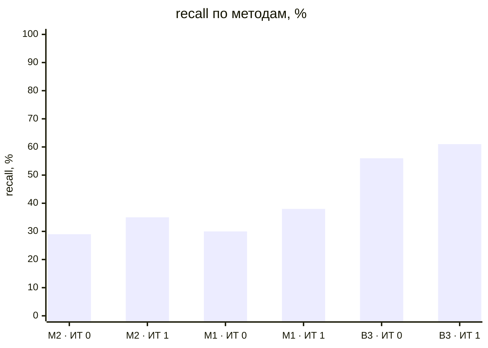
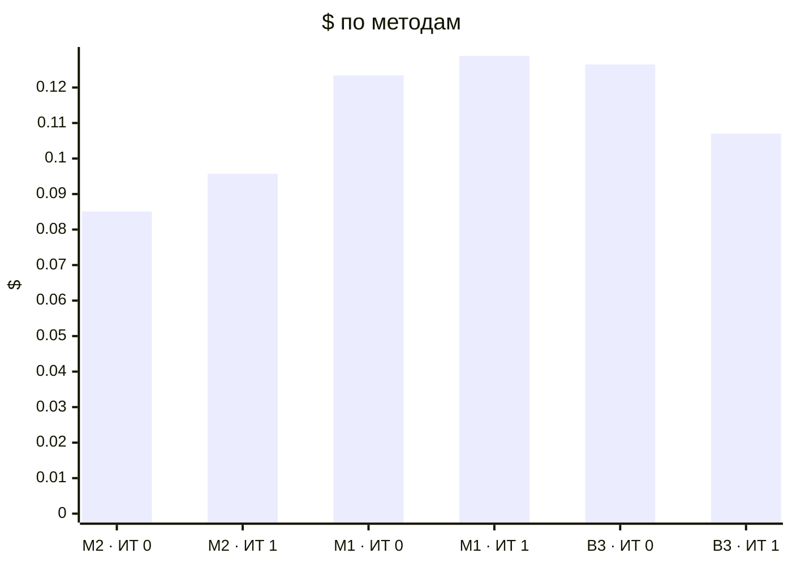

# Метрики прогонов (T-304)

recall — доля скрытых требований вне брифа, которые рассказал заказчик и система нашла полностью (сопоставление: эмбеддинги → судья); с частичными — вместе с найденными частично (тема без чисел или главного условия); recall_all — по всему эталону, с брифом и допущениями, только полные. Типовых и уникальных — recall по группам эталона (T-308, правило — evals/scenarios/README.md); «—» — эталон не размечен.

| Прогон | Вопросов | recall | с частичными | recall_all | типовых | уникальных | на 10 вопросов | Требований | Неоднозначных | Validity | Soundness | Trace | Сироты | Ошибок | Вызовов LLM | $ | Минут | Ошибка |
|---|---|---|---|---|---|---|---|---|---|---|---|---|---|---|---|---|---|---|
| dev-01-cooperative-it0-M2-r1 | 12 | 28% (7/25) | 56% | 40% | 35% (7/20) | 0% (0/5) | 5.833 | 38 | 0% | 100% | 100% | 100% | 0% | 0 | 85 | 0.0368 | 5.37 |  |
| dev-01-cooperative-it1-M2-r1 | 11 | 36% (9/25) | 68% | 47% | 35% (7/20) | 40% (2/5) | 8.182 | 50 | 4% | 100% | 100% | 100% | 0% | 0 | 85 | 0.0391 | 7.11 |  |
| dev-02-cooperative-it0-M2-r1 | 9 | 30% (10/33) | 45% | 49% | 28% (7/25) | 38% (3/8) | 11.111 | 61 | 3% | 100% | 100% | 100% | 3% | 0 | 92 | 0.0484 | 11.41 |  |
| dev-02-cooperative-it1-M2-r1 | 10 | 33% (11/33) | 52% | 49% | 32% (8/25) | 38% (3/8) | 11.0 | 65 | 2% | 100% | 100% | 100% | 0% | 1 | 104 | 0.0567 | 8.23 |  |
| dev-01-cooperative-it0-M1-r1 | 19 | 32% (8/25) | 60% | 43% | 30% (6/20) | 40% (2/5) | 4.211 | 49 | 6% | 100% | 100% | 100% | 0% | 0 | 115 | 0.0505 | 15.84 |  |
| dev-01-cooperative-it1-M1-r1 | 20 | 52% (13/25) | 76% | 63% | 50% (10/20) | 60% (3/5) | 6.5 | 65 | 6% | 100% | 100% | 100% | 3% | 0 | 128 | 0.0655 | 9.42 |  |
| dev-02-cooperative-it0-M1-r1 | 20 | 27% (9/33) | 48% | 44% | 28% (7/25) | 25% (2/8) | 4.5 | 80 | 2% | 100% | 100% | 100% | 0% | 0 | 139 | 0.0729 | 10.17 |  |
| dev-02-cooperative-it1-M1-r1 | 17 | 24% (8/33) | 36% | 40% | 32% (8/25) | 0% (0/8) | 4.706 | 67 | 3% | 100% | 100% | 100% | 0% | 0 | 125 | 0.0634 | 11.39 |  |
| dev-01-cooperative-it0-B3-r1 | 12 | 60% (15/25) | 92% | 70% | 50% (10/20) | 100% (5/5) | 12.5 | 73 | 4% | 100% | 100% | 100% | 0% | 1 | 89 | 0.0571 | 9.97 |  |
| dev-01-cooperative-it1-B3-r1 | 12 | 64% (16/25) | 84% | 67% | 55% (11/20) | 100% (5/5) | 13.333 | 106 | 8% | 100% | 100% | 100% | 0% | 0 | 80 | 0.0541 | 11.61 |  |
| dev-02-cooperative-it0-B3-r1 | 12 | 52% (17/33) | 70% | 62% | 40% (10/25) | 88% (7/8) | 14.167 | 83 | 7% | 100% | 100% | 100% | 0% | 0 | 100 | 0.0694 | 14.07 |  |
| dev-02-cooperative-it1-B3-r1 | 12 | 58% (19/33) | 64% | 71% | 48% (12/25) | 88% (7/8) | 15.833 | 76 | 5% | 100% | 100% | 100% | 0% | 0 | 93 | 0.0529 | 7.14 |  |

## Сводка по методам

Средние — по прогонам без ошибки; $ и минуты — по всем прогонам метода.

| Метод | Прогонов | без ошибки | recall | с частичными | Требований | Ошибок проверок | $ | Минут |
|---|---|---|---|---|---|---|---|---|
| M2 · ИТ 0 | 2 | 2 | 29% | 51% | 49.5 | 0.0 | 0.0851 | 16.78 |
| M2 · ИТ 1 | 2 | 2 | 35% | 60% | 57.5 | 0.5 | 0.0957 | 15.34 |
| M1 · ИТ 0 | 2 | 2 | 30% | 54% | 64.5 | 0.0 | 0.1234 | 26.01 |
| M1 · ИТ 1 | 2 | 2 | 38% | 56% | 66.0 | 0.0 | 0.1289 | 20.81 |
| B3 · ИТ 0 | 2 | 2 | 56% | 81% | 78.0 | 0.5 | 0.1265 | 24.04 |
| B3 · ИТ 1 | 2 | 2 | 61% | 74% | 91.0 | 0.0 | 0.1070 | 18.75 |

