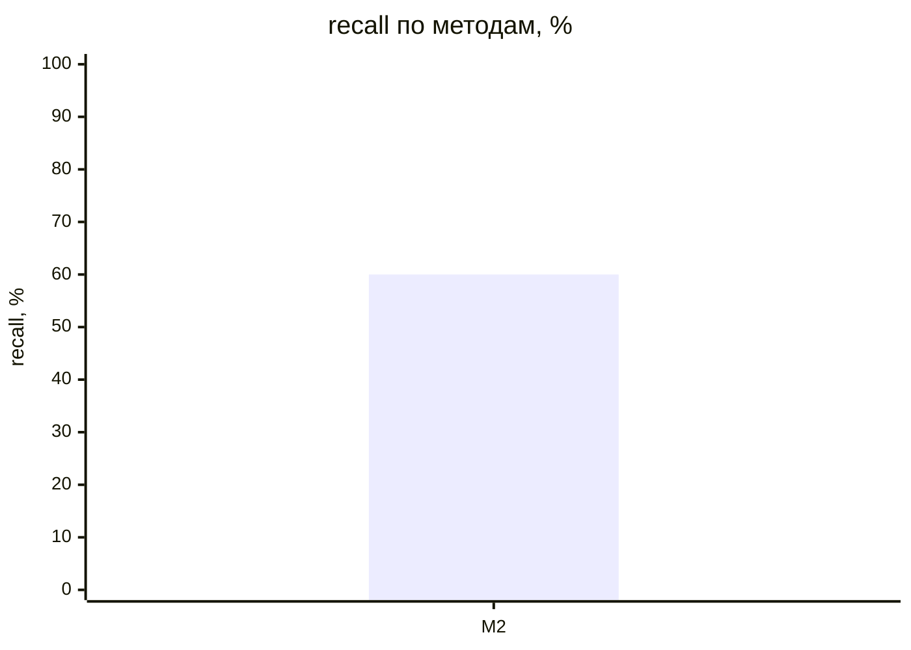
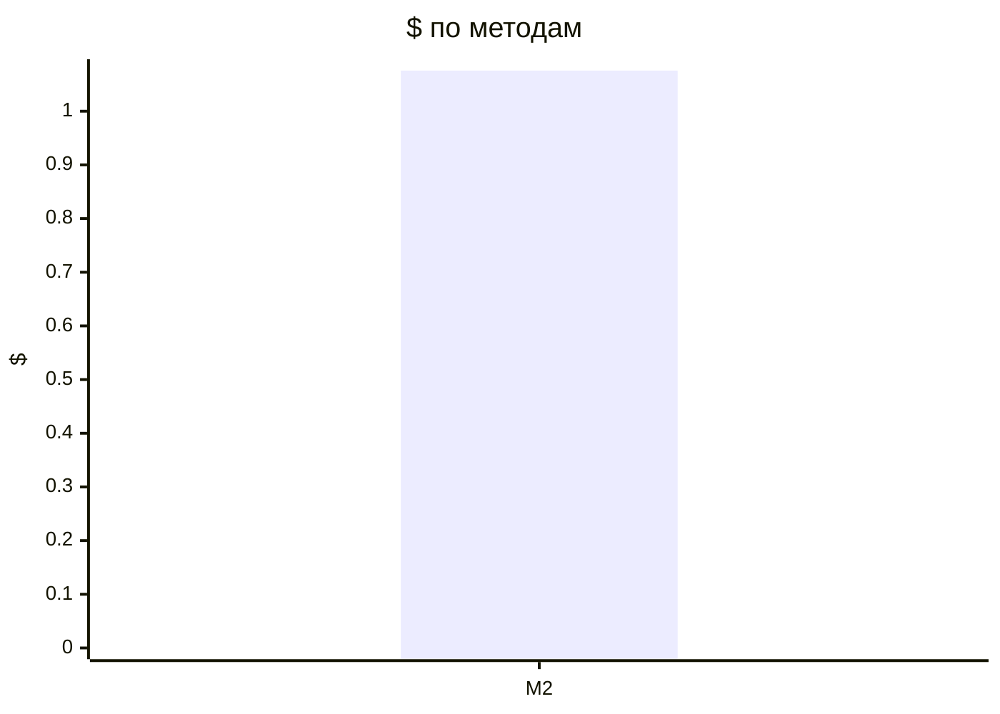

# Метрики прогонов (T-304)

recall — доля скрытых требований вне брифа, которые рассказал заказчик и система нашла полностью (сопоставление: эмбеддинги → судья); с частичными — вместе с найденными частично (тема без чисел или главного условия); recall_all — по всему эталону, с брифом и допущениями, только полные. Типовых и уникальных — recall по группам эталона (T-308, правило — evals/scenarios/README.md); «—» — эталон не размечен.

| Прогон | Вопросов | recall | с частичными | recall_all | типовых | уникальных | на 10 вопросов | Требований | Неоднозначных | Validity | Soundness | Trace | Сироты | Ошибок | Вызовов LLM | $ | Минут | Ошибка |
|---|---|---|---|---|---|---|---|---|---|---|---|---|---|---|---|---|---|---|
| dev-01-cooperative-M2-r1 | 14 | 96% (24/25) | 100% | 97% | 95% (19/20) | 100% (5/5) | 17.143 | 63 | 10% | 100% | 100% | 100% | 2% | 0 | 100 | 0.0498 | 3.68 |  |
| dev-01-cooperative-M2-r2 | 12 | 76% (19/25) | 88% | 80% | 75% (15/20) | 80% (4/5) | 15.833 | 61 | 3% | 100% | 100% | 100% | 2% | 0 | 90 | 0.0466 | 3.74 |  |
| dev-01-cooperative-M2-r3 | 11 | 76% (19/25) | 84% | 80% | 70% (14/20) | 100% (5/5) | 17.273 | 57 | 5% | 100% | 100% | 100% | 0% | 0 | 88 | 0.0452 | 3.88 |  |
| dev-01-contradictory-M2-r1 | 13 | 68% (17/25) | 88% | 73% | 60% (12/20) | 100% (5/5) | 13.077 | 51 | 10% | 100% | 100% | 100% | 1% | 0 | 93 | 0.0431 | 3.47 |  |
| dev-01-contradictory-M2-r2 | 12 | 64% (16/25) | 76% | 73% | 55% (11/20) | 100% (5/5) | 13.333 | 47 | 2% | 100% | 100% | 100% | 0% | 0 | 87 | 0.0408 | 3.94 |  |
| dev-01-contradictory-M2-r3 | 15 | 68% (17/25) | 80% | 73% | 70% (14/20) | 60% (3/5) | 11.333 | 51 | 4% | 100% | 100% | 100% | 0% | 0 | 102 | 0.0484 | 3.73 |  |
| dev-02-cooperative-M2-r1 | 12 | 79% (26/33) | 88% | 82% | 80% (20/25) | 75% (6/8) | 21.667 | 79 | 8% | 100% | 100% | 100% | 2% | 0 | 115 | 0.0649 | 5.81 |  |
| dev-02-cooperative-M2-r2 | 11 | 67% (22/33) | 67% | 76% | 64% (16/25) | 75% (6/8) | 20.0 | 75 | 5% | 100% | 100% | 100% | 0% | 0 | 104 | 0.0545 | 6.11 |  |
| dev-02-cooperative-M2-r3 | 12 | 67% (22/33) | 73% | 71% | 60% (15/25) | 88% (7/8) | 18.333 | 78 | 4% | 100% | 100% | 100% | 1% | 0 | 114 | 0.0690 | 7.11 |  |
| dev-02-contradictory-M2-r1 | 10 | 55% (18/33) | 76% | 67% | 52% (13/25) | 62% (5/8) | 18.0 | 89 | 10% | 100% | 100% | 100% | 0% | 0 | 109 | 0.0719 | 7.51 |  |
| dev-02-contradictory-M2-r2 | 9 | 52% (17/33) | 58% | 64% | 44% (11/25) | 75% (6/8) | 18.889 | 72 | 4% | 100% | 100% | 100% | 2% | 0 | 94 | 0.0489 | 4.68 |  |
| dev-02-contradictory-M2-r3 | 10 | 55% (18/33) | 70% | 60% | 52% (13/25) | 62% (5/8) | 18.0 | 81 | 5% | 100% | 100% | 100% | 0% | 0 | 109 | 0.0640 | 4.96 |  |
| dev-03-cooperative-M2-r1 | 10 | 49% (24/49) | 61% | 55% | 51% (18/35) | 43% (6/14) | 24.0 | 77 | 6% | 100% | 100% | 100% | 0% | 0 | 121 | 0.0891 | 13.96 |  |
| dev-03-cooperative-M2-r2 | 9 | 45% (22/49) | 55% | 57% | 51% (18/35) | 29% (4/14) | 24.444 | 77 | 8% | 100% | 100% | 100% | 0% | 0 | 117 | 0.0631 | 6.76 |  |
| dev-03-cooperative-M2-r3 | 10 | 43% (21/49) | 57% | 51% | 43% (15/35) | 43% (6/14) | 21.0 | 72 | 7% | 100% | 100% | 100% | 0% | 0 | 118 | 0.0570 | 4.59 |  |
| dev-03-contradictory-M2-r1 | 10 | 47% (23/49) | 59% | 57% | 46% (16/35) | 50% (7/14) | 23.0 | 77 | 4% | 100% | 100% | 100% | 0% | 0 | 123 | 0.0867 | 11.4 |  |
| dev-03-contradictory-M2-r2 | 10 | 33% (16/49) | 55% | 51% | 31% (11/35) | 36% (5/14) | 16.0 | 88 | 5% | 100% | 100% | 100% | 5% | 0 | 125 | 0.0714 | 5.86 |  |
| dev-03-contradictory-M2-r3 | 10 | 41% (20/49) | 57% | 52% | 43% (15/35) | 36% (5/14) | 20.0 | 98 | 5% | 100% | 100% | 100% | 1% | 0 | 119 | 0.0613 | 4.82 |  |

## Сводка по методам

Средние — по прогонам без ошибки; $ и минуты — по всем прогонам метода.

| Метод | Прогонов | без ошибки | recall | с частичными | Требований | Ошибок проверок | $ | Минут |
|---|---|---|---|---|---|---|---|---|
| M2 | 18 | 18 | 60% | 72% | 71.8 | 0.0 | 1.0757 | 106.01 |

