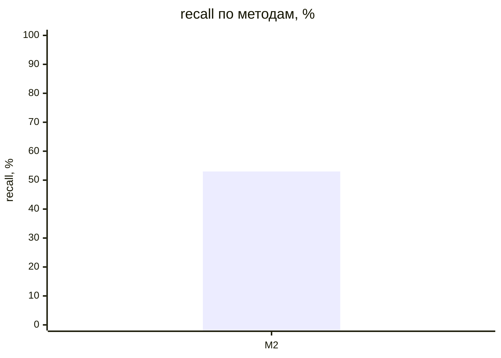
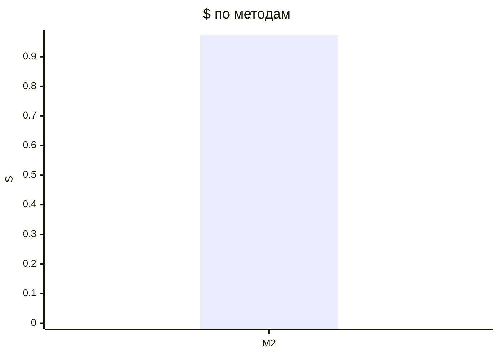

# Метрики прогонов (T-304)

recall — доля скрытых требований вне брифа, которые рассказал заказчик и система нашла полностью (сопоставление: эмбеддинги → судья); с частичными — вместе с найденными частично (тема без чисел или главного условия); recall_all — по всему эталону, с брифом и допущениями, только полные. Типовых и уникальных — recall по группам эталона (T-308, правило — evals/scenarios/README.md); «—» — эталон не размечен.

| Прогон | Вопросов | recall | с частичными | recall_all | типовых | уникальных | на 10 вопросов | Требований | Неоднозначных | Validity | Soundness | Trace | Сироты | Ошибок | Вызовов LLM | $ | Минут | Ошибка |
|---|---|---|---|---|---|---|---|---|---|---|---|---|---|---|---|---|---|---|
| dev-01-cooperative-M2-r1 | 14 | 92% (23/25) | 100% | 93% | 90% (18/20) | 100% (5/5) | 16.429 | 67 | 9% | 100% | 100% | 100% | 0% | 0 | 100 | 0.0522 | 4.62 |  |
| dev-01-cooperative-M2-r2 | 10 | 56% (14/25) | 72% | 67% | 60% (12/20) | 40% (2/5) | 14.0 | 59 | 0% | 100% | 100% | 100% | 0% | 0 | 81 | 0.0409 | 3.84 |  |
| dev-01-cooperative-M2-r3 | 11 | 56% (14/25) | 76% | 63% | 60% (12/20) | 40% (2/5) | 12.727 | 39 | 0% | 100% | 100% | 100% | 0% | 0 | 80 | 0.0342 | 2.51 |  |
| dev-01-contradictory-M2-r1 | 13 | 60% (15/25) | 64% | 70% | 65% (13/20) | 40% (2/5) | 11.538 | 50 | 8% | 100% | 100% | 100% | 0% | 0 | 97 | 0.0514 | 4.86 |  |
| dev-01-contradictory-M2-r2 | 12 | 68% (17/25) | 84% | 73% | 60% (12/20) | 100% (5/5) | 14.167 | 55 | 5% | 100% | 100% | 100% | 5% | 0 | 92 | 0.0468 | 4.09 |  |
| dev-01-contradictory-M2-r3 | 15 | 60% (15/25) | 76% | 67% | 55% (11/20) | 80% (4/5) | 10.0 | 50 | 6% | 100% | 100% | 100% | 0% | 0 | 102 | 0.0486 | 4.13 |  |
| dev-02-cooperative-M2-r1 | 12 | 70% (23/33) | 82% | 78% | 68% (17/25) | 75% (6/8) | 19.167 | 81 | 5% | 100% | 100% | 100% | 0% | 0 | 110 | 0.0602 | 5.05 |  |
| dev-02-cooperative-M2-r2 | 11 | 64% (21/33) | 73% | 73% | 68% (17/25) | 50% (4/8) | 19.091 | 80 | 5% | 100% | 100% | 100% | 3% | 0 | 105 | 0.0596 | 4.94 |  |
| dev-02-cooperative-M2-r3 | 10 | 61% (20/33) | 73% | 73% | 64% (16/25) | 50% (4/8) | 20.0 | 97 | 5% | 100% | 100% | 100% | 1% | 0 | 105 | 0.0637 | 5.14 |  |
| dev-02-contradictory-M2-r1 | 14 | 58% (19/33) | 70% | 67% | 60% (15/25) | 50% (4/8) | 13.571 | 85 | 6% | 100% | 100% | 100% | 2% | 0 | 116 | 0.0614 | 4.96 |  |
| dev-02-contradictory-M2-r2 | 10 | 73% (24/33) | 76% | 80% | 68% (17/25) | 88% (7/8) | 24.0 | 87 | 5% | 100% | 100% | 100% | 0% | 0 | 99 | 0.0546 | 4.87 |  |
| dev-02-contradictory-M2-r3 | 11 | 52% (17/33) | 61% | 67% | 52% (13/25) | 50% (4/8) | 15.455 | 76 | 5% | 100% | 100% | 100% | 8% | 0 | 103 | 0.0550 | 5.3 |  |
| dev-03-cooperative-M2-r1 | 11 | 53% (26/49) | 67% | 62% | 49% (17/35) | 64% (9/14) | 23.636 | 79 | 9% | 100% | 100% | 100% | 4% | 0 | 129 | 0.0727 | 6.59 |  |
| dev-03-cooperative-M2-r2 | 10 | 45% (22/49) | 61% | 55% | 46% (16/35) | 43% (6/14) | 22.0 | 128 | 12% | 100% | 100% | 100% | 0% | 0 | 121 | 0.0664 | 6.83 |  |
| dev-03-cooperative-M2-r3 | 4 | 24% (12/49) | 37% | 40% | 23% (8/35) | 29% (4/14) | 30.0 | 55 | 5% | 100% | 100% | 100% | 0% | 0 | 92 | 0.0647 | 11.18 |  |
| dev-03-contradictory-M2-r1 | 3 | 12% (6/49) | 31% | 29% | 11% (4/35) | 14% (2/14) | 20.0 | 46 | 4% | 100% | 100% | 100% | 7% | 0 | 86 | 0.0358 | 2.61 |  |
| dev-03-contradictory-M2-r2 | 10 | 37% (18/49) | 61% | 51% | 40% (14/35) | 29% (4/14) | 18.0 | 84 | 12% | 100% | 100% | 100% | 0% | 0 | 120 | 0.0640 | 5.46 |  |
| dev-03-contradictory-M2-r3 | 4 | 22% (11/49) | 37% | 37% | 17% (6/35) | 36% (5/14) | 27.5 | 44 | 5% | 100% | 100% | 100% | 0% | 1 | 96 | 0.0412 | 3.24 |  |

## Сводка по методам

Средние — по прогонам без ошибки; $ и минуты — по всем прогонам метода.

| Метод | Прогонов | без ошибки | recall | с частичными | Требований | Ошибок проверок | $ | Минут |
|---|---|---|---|---|---|---|---|---|
| M2 | 18 | 18 | 53% | 67% | 70.1 | 0.1 | 0.9733 | 90.22 |

