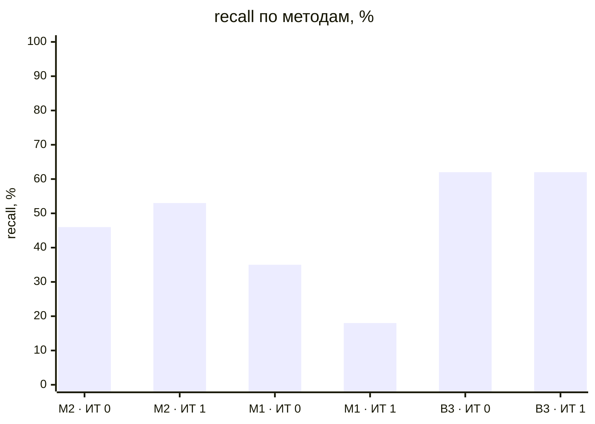
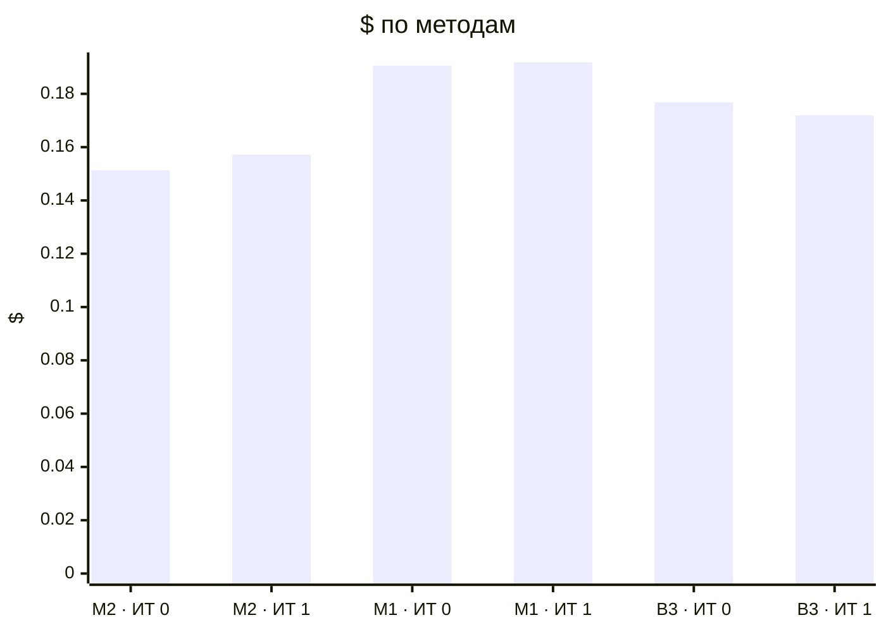

# Метрики прогонов (T-304)

recall — доля скрытых требований вне брифа, которые рассказал заказчик и система нашла полностью (сопоставление: эмбеддинги → судья); с частичными — вместе с найденными частично (тема без чисел или главного условия); recall_all — по всему эталону, с брифом и допущениями, только полные. Типовых и уникальных — recall по группам эталона (T-308, правило — evals/scenarios/README.md); «—» — эталон не размечен.

| Прогон | Вопросов | recall | с частичными | recall_all | типовых | уникальных | на 10 вопросов | Требований | Неоднозначных | Validity | Soundness | Trace | Сироты | Ошибок | Вызовов LLM | $ | Минут | Ошибка |
|---|---|---|---|---|---|---|---|---|---|---|---|---|---|---|---|---|---|---|
| dev-01-cooperative-it0-M2-r1 | 11 | 60% (15/25) | 72% | 73% | 60% (12/20) | 60% (3/5) | 13.636 | 51 | 8% | 100% | 100% | 100% | 7% | 0 | 86 | 0.0414 | 3.22 |  |
| dev-01-cooperative-it1-M2-r1 | 13 | 84% (21/25) | 88% | 87% | 80% (16/20) | 100% (5/5) | 16.154 | 63 | 6% | 100% | 100% | 100% | 0% | 0 | 97 | 0.0482 | 4.0 |  |
| dev-02-cooperative-it0-M2-r1 | 13 | 55% (18/33) | 64% | 67% | 56% (14/25) | 50% (4/8) | 13.846 | 83 | 6% | 100% | 100% | 100% | 0% | 0 | 117 | 0.0659 | 5.03 |  |
| dev-02-cooperative-it1-M2-r1 | 11 | 52% (17/33) | 61% | 62% | 52% (13/25) | 50% (4/8) | 15.455 | 72 | 11% | 100% | 100% | 100% | 3% | 3 | 113 | 0.0658 | 4.5 |  |
| dev-03-cooperative-it0-M2-r1 | 4 | 22% (11/49) | 39% | 40% | 20% (7/35) | 29% (4/14) | 27.5 | 43 | 2% | 100% | 100% | 100% | 0% | 0 | 95 | 0.0440 | 3.41 |  |
| dev-03-cooperative-it1-M2-r1 | 5 | 24% (12/49) | 37% | 40% | 20% (7/35) | 36% (5/14) | 24.0 | 52 | 4% | 100% | 100% | 100% | 3% | 0 | 98 | 0.0431 | 2.8 |  |
| dev-01-cooperative-it0-M1-r1 | 19 | 48% (12/25) | 64% | 60% | 45% (9/20) | 60% (3/5) | 6.316 | 50 | 8% | 100% | 100% | 100% | 0% | 0 | 119 | 0.0525 | 3.24 |  |
| dev-01-cooperative-it1-M1-r1 | 20 | 36% (9/25) | 52% | 50% | 30% (6/20) | 60% (3/5) | 4.5 | 50 | 8% | 100% | 100% | 100% | 3% | 0 | 120 | 0.0544 | 3.6 |  |
| dev-02-cooperative-it0-M1-r1 | 20 | 27% (9/33) | 45% | 44% | 32% (8/25) | 12% (1/8) | 4.5 | 58 | 10% | 100% | 100% | 100% | 1% | 0 | 137 | 0.0645 | 4.46 |  |
| dev-02-cooperative-it1-M1-r1 | 19 | 3% (1/33) | 18% | 29% | 4% (1/25) | 0% (0/8) | 0.526 | 31 | 3% | 100% | 100% | 100% | 0% | 0 | 131 | 0.0536 | 3.43 |  |
| dev-03-cooperative-it0-M1-r1 | 19 | 29% (14/49) | 47% | 48% | 31% (11/35) | 21% (3/14) | 7.368 | 59 | 5% | 100% | 100% | 100% | 0% | 0 | 156 | 0.0736 | 4.9 |  |
| dev-03-cooperative-it1-M1-r1 | 20 | 16% (8/49) | 41% | 37% | 14% (5/35) | 21% (3/14) | 4.0 | 64 | 5% | 100% | 100% | 100% | 2% | 0 | 159 | 0.0838 | 6.75 |  |
| dev-01-cooperative-it0-B3-r1 | 12 | 76% (19/25) | 96% | 80% | 75% (15/20) | 80% (4/5) | 15.833 | 72 | 7% | 100% | 100% | 100% | 1% | 0 | 85 | 0.0507 | 5.19 |  |
| dev-01-cooperative-it1-B3-r1 | 12 | 84% (21/25) | 96% | 87% | 80% (16/20) | 100% (5/5) | 17.5 | 74 | 5% | 100% | 100% | 100% | 3% | 0 | 82 | 0.0468 | 4.52 |  |
| dev-02-cooperative-it0-B3-r1 | 12 | 67% (22/33) | 79% | 78% | 60% (15/25) | 88% (7/8) | 18.333 | 85 | 4% | 100% | 100% | 100% | 0% | 0 | 95 | 0.0551 | 4.69 |  |
| dev-02-cooperative-it1-B3-r1 | 12 | 61% (20/33) | 73% | 69% | 56% (14/25) | 75% (6/8) | 16.667 | 81 | 7% | 100% | 100% | 100% | 0% | 2 | 105 | 0.0672 | 7.95 |  |
| dev-03-cooperative-it0-B3-r1 | 12 | 43% (21/49) | 57% | 55% | 43% (15/35) | 43% (6/14) | 17.5 | 84 | 4% | 100% | 100% | 100% | 5% | 0 | 120 | 0.0710 | 5.21 |  |
| dev-03-cooperative-it1-B3-r1 | 12 | 43% (21/49) | 53% | 54% | 43% (15/35) | 43% (6/14) | 17.5 | 73 | 5% | 100% | 100% | 100% | 0% | 0 | 115 | 0.0579 | 3.9 |  |

## Сводка по методам

Средние — по прогонам без ошибки; $ и минуты — по всем прогонам метода.

| Метод | Прогонов | без ошибки | recall | с частичными | Требований | Ошибок проверок | $ | Минут |
|---|---|---|---|---|---|---|---|---|
| M2 · ИТ 0 | 3 | 3 | 46% | 58% | 59.0 | 0.0 | 0.1513 | 11.66 |
| M2 · ИТ 1 | 3 | 3 | 53% | 62% | 62.3 | 1.0 | 0.1572 | 11.3 |
| M1 · ИТ 0 | 3 | 3 | 35% | 52% | 55.7 | 0.0 | 0.1906 | 12.6 |
| M1 · ИТ 1 | 3 | 3 | 18% | 37% | 48.3 | 0.0 | 0.1918 | 13.78 |
| B3 · ИТ 0 | 3 | 3 | 62% | 77% | 80.3 | 0.0 | 0.1768 | 15.09 |
| B3 · ИТ 1 | 3 | 3 | 62% | 74% | 76.0 | 0.7 | 0.1719 | 16.37 |

