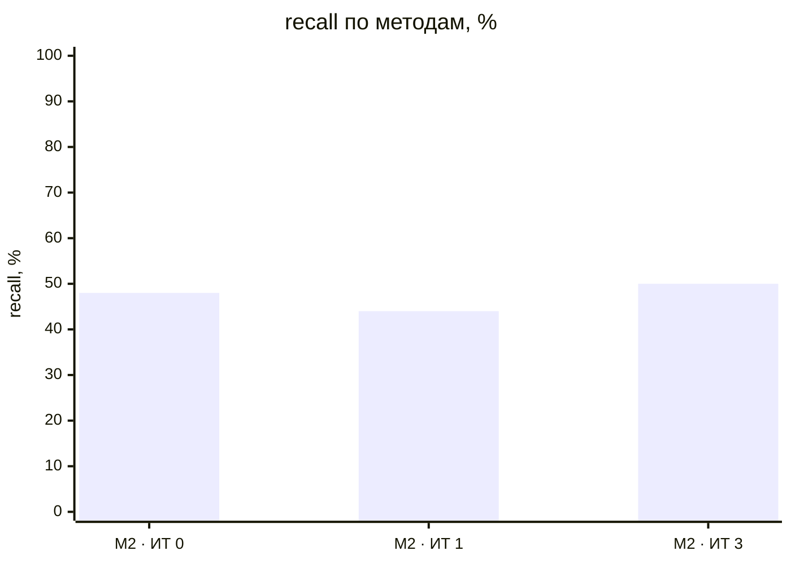
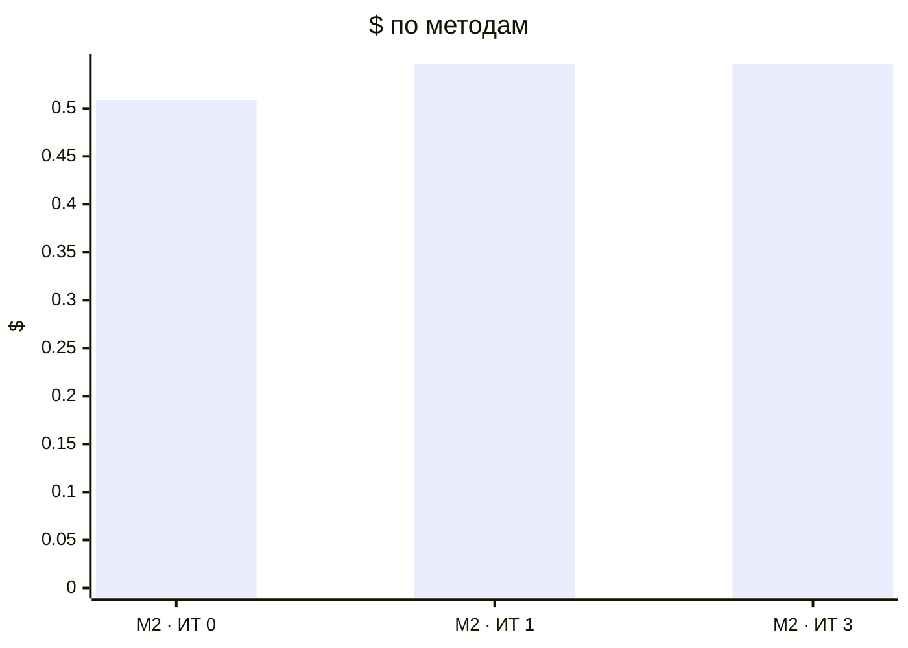

# Метрики прогонов (T-304)

recall — доля скрытых требований вне брифа, которые рассказал заказчик и система нашла полностью (сопоставление: эмбеддинги → судья); с частичными — вместе с найденными частично (тема без чисел или главного условия); recall_all — по всему эталону, с брифом и допущениями, только полные. Типовых и уникальных — recall по группам эталона (T-308, правило — evals/scenarios/README.md); «—» — эталон не размечен.

| Прогон | Вопросов | recall | с частичными | recall_all | типовых | уникальных | на 10 вопросов | Требований | Неоднозначных | Validity | Soundness | Trace | Сироты | Ошибок | Вызовов LLM | $ | Минут | Ошибка |
|---|---|---|---|---|---|---|---|---|---|---|---|---|---|---|---|---|---|---|
| dev-01-cooperative-it0-M2-r1 | 13 | 68% (17/25) | 68% | 77% | 60% (12/20) | 100% (5/5) | 13.077 | 47 | 6% | 100% | 100% | 100% | 0% | 0 | 96 | 0.0448 | 4.01 |  |
| dev-01-cooperative-it0-M2-r2 | 11 | 80% (20/25) | 84% | 83% | 75% (15/20) | 100% (5/5) | 18.182 | 54 | 4% | 100% | 100% | 100% | 0% | 0 | 89 | 0.0468 | 4.95 |  |
| dev-01-cooperative-it0-M2-r3 | 20 | 40% (10/25) | 52% | 50% | 35% (7/20) | 60% (3/5) | 5.0 | 41 | 2% | 100% | 100% | 100% | 3% | 0 | 120 | 0.0561 | 5.25 |  |
| dev-01-cooperative-it1-M2-r1 | 13 | 36% (9/25) | 68% | 47% | 35% (7/20) | 40% (2/5) | 6.923 | 52 | 4% | 100% | 100% | 100% | 1% | 0 | 91 | 0.0433 | 4.41 |  |
| dev-01-cooperative-it1-M2-r2 | 14 | 60% (15/25) | 72% | 67% | 55% (11/20) | 80% (4/5) | 10.714 | 43 | 2% | 100% | 100% | 100% | 0% | 0 | 95 | 0.0432 | 3.52 |  |
| dev-01-cooperative-it1-M2-r3 | 15 | 52% (13/25) | 72% | 60% | 45% (9/20) | 80% (4/5) | 8.667 | 50 | 0% | 100% | 100% | 100% | 0% | 0 | 100 | 0.0468 | 3.8 |  |
| dev-01-cooperative-M2-r1 | 12 | 52% (13/25) | 60% | 70% | 40% (8/20) | 100% (5/5) | 10.833 | 38 | 3% | 100% | 100% | 100% | 0% | 0 | 91 | 0.0422 | 3.87 |  |
| dev-01-cooperative-M2-r2 | 15 | 72% (18/25) | 92% | 77% | 65% (13/20) | 100% (5/5) | 12.0 | 81 | 5% | 100% | 100% | 100% | 0% | 0 | 105 | 0.0549 | 4.32 |  |
| dev-01-cooperative-M2-r3 | 13 | 68% (17/25) | 80% | 73% | 60% (12/20) | 100% (5/5) | 13.077 | 46 | 11% | 100% | 100% | 100% | 0% | 0 | 98 | 0.0492 | 5.55 |  |
| dev-02-cooperative-it0-M2-r1 | 9 | 39% (13/33) | 48% | 53% | 32% (8/25) | 62% (5/8) | 14.444 | 67 | 3% | 100% | 100% | 100% | 0% | 0 | 92 | 0.0471 | 4.33 |  |
| dev-02-cooperative-it0-M2-r2 | 9 | 48% (16/33) | 58% | 62% | 52% (13/25) | 38% (3/8) | 17.778 | 75 | 7% | 100% | 100% | 100% | 0% | 0 | 95 | 0.0531 | 5.16 |  |
| dev-02-cooperative-it0-M2-r3 | 12 | 58% (19/33) | 70% | 67% | 52% (13/25) | 75% (6/8) | 15.833 | 83 | 5% | 100% | 100% | 100% | 0% | 0 | 111 | 0.0654 | 6.06 |  |
| dev-02-cooperative-it1-M2-r1 | 14 | 55% (18/33) | 67% | 62% | 56% (14/25) | 50% (4/8) | 12.857 | 76 | 7% | 100% | 100% | 100% | 0% | 0 | 118 | 0.0654 | 5.4 |  |
| dev-02-cooperative-it1-M2-r2 | 14 | 42% (14/33) | 58% | 60% | 28% (7/25) | 88% (7/8) | 10.0 | 77 | 5% | 100% | 100% | 100% | 5% | 0 | 120 | 0.0721 | 6.08 |  |
| dev-02-cooperative-it1-M2-r3 | 9 | 36% (12/33) | 52% | 53% | 36% (9/25) | 38% (3/8) | 13.333 | 53 | 8% | 100% | 100% | 100% | 0% | 0 | 92 | 0.0455 | 4.12 |  |
| dev-02-cooperative-M2-r1 | 9 | 52% (17/33) | 67% | 62% | 56% (14/25) | 38% (3/8) | 18.889 | 73 | 8% | 100% | 100% | 100% | 0% | 2 | 103 | 0.0623 | 5.06 |  |
| dev-02-cooperative-M2-r2 | 10 | 42% (14/33) | 58% | 58% | 36% (9/25) | 62% (5/8) | 14.0 | 101 | 10% | 100% | 100% | 100% | 8% | 2 | 107 | 0.0606 | 6.19 |  |
| dev-02-cooperative-M2-r3 | 10 | 52% (17/33) | 73% | 64% | 48% (12/25) | 62% (5/8) | 17.0 | 84 | 8% | 100% | 100% | 100% | 5% | 1 | 119 | 0.0841 | 8.0 |  |
| dev-03-cooperative-it0-M2-r1 | 15 | 33% (16/49) | 59% | 48% | 34% (12/35) | 29% (4/14) | 10.667 | 87 | 7% | 100% | 100% | 100% | 0% | 0 | 137 | 0.0726 | 7.41 |  |
| dev-03-cooperative-it0-M2-r2 | 11 | 39% (19/49) | 55% | 52% | 40% (14/35) | 36% (5/14) | 17.273 | 64 | 5% | 100% | 100% | 100% | 0% | 0 | 116 | 0.0557 | 4.13 |  |
| dev-03-cooperative-it0-M2-r3 | 15 | 31% (15/49) | 43% | 43% | 26% (9/35) | 43% (6/14) | 10.0 | 62 | 5% | 100% | 100% | 100% | 4% | 0 | 138 | 0.0671 | 4.82 |  |
| dev-03-cooperative-it1-M2-r1 | 13 | 35% (17/49) | 47% | 48% | 37% (13/35) | 29% (4/14) | 13.077 | 76 | 7% | 100% | 100% | 100% | 0% | 0 | 131 | 0.0676 | 5.07 |  |
| dev-03-cooperative-it1-M2-r2 | 10 | 31% (15/49) | 43% | 45% | 29% (10/35) | 36% (5/14) | 15.0 | 51 | 8% | 100% | 100% | 100% | 0% | 1 | 128 | 0.0909 | 11.15 |  |
| dev-03-cooperative-it1-M2-r3 | 14 | 49% (24/49) | 59% | 57% | 54% (19/35) | 36% (5/14) | 17.143 | 63 | 11% | 100% | 100% | 100% | 0% | 0 | 135 | 0.0712 | 5.38 |  |
| dev-03-cooperative-M2-r1 | 12 | 41% (20/49) | 59% | 52% | 40% (14/35) | 43% (6/14) | 16.667 | 77 | 6% | 100% | 100% | 100% | 3% | 0 | 131 | 0.0712 | 6.07 |  |
| dev-03-cooperative-M2-r2 | 9 | 37% (18/49) | 59% | 48% | 34% (12/35) | 43% (6/14) | 20.0 | 68 | 10% | 100% | 100% | 100% | 0% | 0 | 117 | 0.0578 | 4.33 |  |
| dev-03-cooperative-M2-r3 | 11 | 37% (18/49) | 49% | 51% | 31% (11/35) | 50% (7/14) | 16.364 | 65 | 5% | 100% | 100% | 100% | 0% | 0 | 124 | 0.0638 | 4.95 |  |

## Сводка по методам

Средние — по прогонам без ошибки; $ и минуты — по всем прогонам метода.

| Метод | Прогонов | без ошибки | recall | с частичными | Требований | Ошибок проверок | $ | Минут |
|---|---|---|---|---|---|---|---|---|
| M2 · ИТ 0 | 9 | 9 | 48% | 60% | 64.4 | 0.0 | 0.5085 | 46.12 |
| M2 · ИТ 1 | 9 | 9 | 44% | 60% | 60.1 | 0.1 | 0.5461 | 48.93 |
| M2 · ИТ 3 | 9 | 9 | 50% | 66% | 70.3 | 0.6 | 0.5462 | 48.34 |

