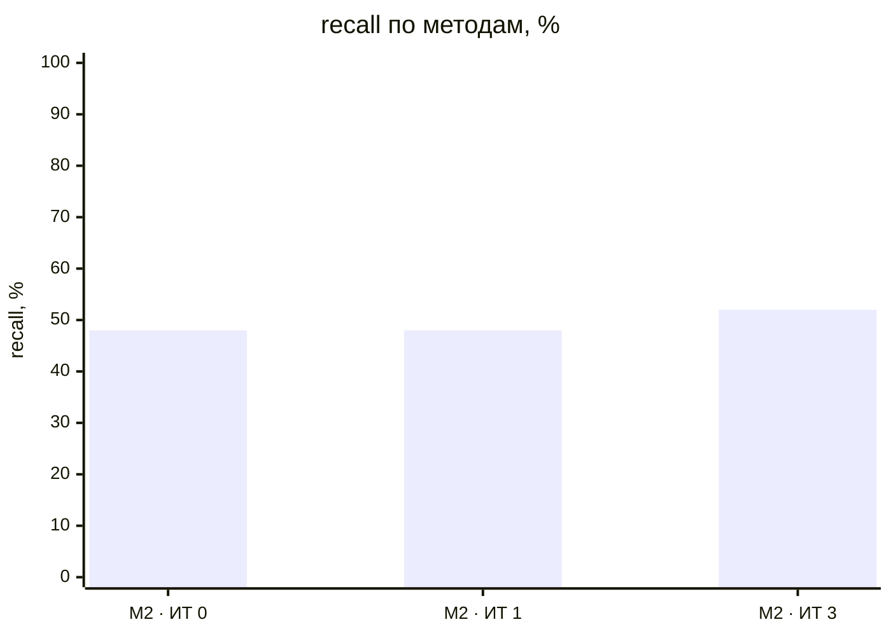
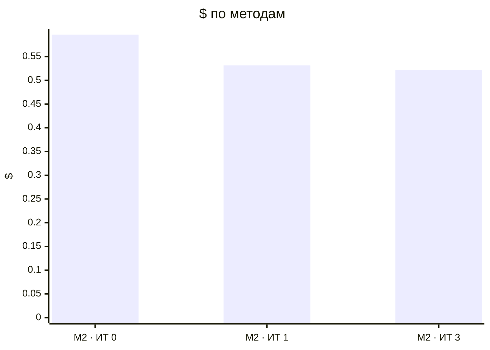

# Метрики прогонов (T-304)

recall — доля скрытых требований вне брифа, которые рассказал заказчик и система нашла полностью (сопоставление: эмбеддинги → судья); с частичными — вместе с найденными частично (тема без чисел или главного условия); recall_all — по всему эталону, с брифом и допущениями, только полные. Типовых и уникальных — recall по группам эталона (T-308, правило — evals/scenarios/README.md); «—» — эталон не размечен.

| Прогон | Вопросов | recall | с частичными | recall_all | типовых | уникальных | на 10 вопросов | Требований | Неоднозначных | Validity | Soundness | Trace | Сироты | Ошибок | Вызовов LLM | $ | Минут | Ошибка |
|---|---|---|---|---|---|---|---|---|---|---|---|---|---|---|---|---|---|---|
| dev-01-cooperative-it0-M2-r1 | 13 | 60% (15/25) | 72% | 67% | 50% (10/20) | 100% (5/5) | 11.538 | 61 | 7% | 100% | 100% | 100% | 0% | 0 | 117 | 0.0620 | 8.08 |  |
| dev-01-cooperative-it0-M2-r2 | 20 | 64% (16/25) | 84% | 70% | 55% (11/20) | 100% (5/5) | 8.0 | 60 | 3% | 100% | 100% | 100% | 0% | 0 | 139 | 0.0604 | 7.81 |  |
| dev-01-cooperative-it0-M2-r3 | 17 | 44% (11/25) | 60% | 57% | 40% (8/20) | 60% (3/5) | 6.471 | 49 | 8% | 100% | 100% | 100% | 0% | 0 | 125 | 0.0501 | 3.58 |  |
| dev-01-cooperative-it1-M2-r1 | 12 | 64% (16/25) | 64% | 77% | 65% (13/20) | 60% (3/5) | 13.333 | 50 | 4% | 100% | 100% | 100% | 9% | 0 | 101 | 0.0430 | 3.65 |  |
| dev-01-cooperative-it1-M2-r2 | 14 | 56% (14/25) | 72% | 63% | 50% (10/20) | 80% (4/5) | 10.0 | 47 | 13% | 100% | 100% | 100% | 0% | 0 | 110 | 0.0433 | 3.2 |  |
| dev-01-cooperative-it1-M2-r3 | 15 | 52% (13/25) | 80% | 60% | 45% (9/20) | 80% (4/5) | 8.667 | 67 | 4% | 100% | 100% | 100% | 1% | 0 | 122 | 0.0637 | 6.37 |  |
| dev-01-cooperative-M2-r1 | 13 | 52% (13/25) | 60% | 60% | 50% (10/20) | 60% (3/5) | 10.0 | 44 | 9% | 100% | 100% | 100% | 0% | 0 | 110 | 0.0452 | 7.66 |  |
| dev-01-cooperative-M2-r2 | 11 | 60% (15/25) | 76% | 67% | 50% (10/20) | 100% (5/5) | 13.636 | 52 | 0% | 100% | 100% | 100% | 0% | 0 | 100 | 0.0438 | 4.92 |  |
| dev-01-cooperative-M2-r3 | 14 | 76% (19/25) | 88% | 80% | 70% (14/20) | 100% (5/5) | 13.571 | 63 | 13% | 100% | 100% | 100% | 0% | 0 | 118 | 0.0552 | 6.17 |  |
| dev-02-cooperative-it0-M2-r1 | 17 | 55% (18/33) | 67% | 60% | 48% (12/25) | 75% (6/8) | 10.588 | 80 | 4% | 100% | 100% | 100% | 2% | 0 | 151 | 0.0796 | 8.54 |  |
| dev-02-cooperative-it0-M2-r2 | 16 | 55% (18/33) | 67% | 69% | 48% (12/25) | 75% (6/8) | 11.25 | 79 | 9% | 100% | 100% | 100% | 0% | 0 | 146 | 0.0740 | 8.28 |  |
| dev-02-cooperative-it0-M2-r3 | 11 | 58% (19/33) | 67% | 69% | 56% (14/25) | 62% (5/8) | 17.273 | 81 | 9% | 100% | 100% | 100% | 2% | 2 | 119 | 0.0666 | 8.52 |  |
| dev-02-cooperative-it1-M2-r1 | 15 | 58% (19/33) | 70% | 69% | 56% (14/25) | 62% (5/8) | 12.667 | 84 | 6% | 100% | 100% | 100% | 0% | 0 | 139 | 0.0725 | 5.71 |  |
| dev-02-cooperative-it1-M2-r2 | 11 | 42% (14/33) | 61% | 53% | 40% (10/25) | 50% (4/8) | 12.727 | 61 | 8% | 100% | 100% | 100% | 0% | 0 | 117 | 0.0577 | 6.68 |  |
| dev-02-cooperative-it1-M2-r3 | 11 | 45% (15/33) | 55% | 60% | 40% (10/25) | 62% (5/8) | 13.636 | 68 | 3% | 100% | 100% | 100% | 0% | 0 | 112 | 0.0509 | 5.41 |  |
| dev-02-cooperative-M2-r1 | 13 | 55% (18/33) | 58% | 69% | 60% (15/25) | 38% (3/8) | 13.846 | 71 | 6% | 100% | 100% | 100% | 4% | 0 | 128 | 0.0836 | 12.61 |  |
| dev-02-cooperative-M2-r2 | 9 | 61% (20/33) | 73% | 71% | 56% (14/25) | 75% (6/8) | 22.222 | 78 | 4% | 100% | 100% | 100% | 1% | 0 | 110 | 0.0580 | 6.71 |  |
| dev-02-cooperative-M2-r3 | 10 | 42% (14/33) | 55% | 58% | 40% (10/25) | 50% (4/8) | 14.0 | 62 | 3% | 100% | 100% | 100% | 0% | 0 | 110 | 0.0470 | 4.02 |  |
| dev-03-cooperative-it0-M2-r1 | 13 | 29% (14/49) | 55% | 43% | 26% (9/35) | 36% (5/14) | 10.769 | 66 | 12% | 100% | 100% | 100% | 0% | 0 | 141 | 0.0632 | 5.21 |  |
| dev-03-cooperative-it0-M2-r2 | 17 | 31% (15/49) | 49% | 48% | 26% (9/35) | 43% (6/14) | 8.824 | 65 | 5% | 100% | 100% | 100% | 0% | 0 | 163 | 0.0745 | 6.15 |  |
| dev-03-cooperative-it0-M2-r3 | 12 | 39% (19/49) | 61% | 52% | 37% (13/35) | 43% (6/14) | 15.833 | 73 | 12% | 100% | 100% | 100% | 1% | 0 | 137 | 0.0659 | 7.51 |  |
| dev-03-cooperative-it1-M2-r1 | 14 | 41% (20/49) | 59% | 51% | 40% (14/35) | 43% (6/14) | 14.286 | 64 | 5% | 100% | 100% | 100% | 0% | 0 | 147 | 0.0639 | 6.19 |  |
| dev-03-cooperative-it1-M2-r2 | 11 | 37% (18/49) | 51% | 46% | 31% (11/35) | 50% (7/14) | 16.364 | 58 | 5% | 100% | 100% | 100% | 1% | 0 | 137 | 0.0611 | 6.05 |  |
| dev-03-cooperative-it1-M2-r3 | 12 | 37% (18/49) | 53% | 49% | 34% (12/35) | 43% (6/14) | 15.0 | 70 | 6% | 100% | 100% | 100% | 0% | 0 | 141 | 0.0755 | 6.88 |  |
| dev-03-cooperative-M2-r1 | 11 | 41% (20/49) | 59% | 49% | 43% (15/35) | 36% (5/14) | 18.182 | 75 | 1% | 100% | 100% | 100% | 8% | 0 | 130 | 0.0588 | 5.0 |  |
| dev-03-cooperative-M2-r2 | 11 | 35% (17/49) | 53% | 51% | 40% (14/35) | 21% (3/14) | 15.455 | 69 | 6% | 100% | 100% | 100% | 2% | 0 | 134 | 0.0576 | 5.36 |  |
| dev-03-cooperative-M2-r3 | 10 | 47% (23/49) | 59% | 62% | 46% (16/35) | 50% (7/14) | 23.0 | 77 | 9% | 100% | 100% | 100% | 0% | 0 | 134 | 0.0728 | 9.21 |  |

## Сводка по методам

Средние — по прогонам без ошибки; $ и минуты — по всем прогонам метода.

| Метод | Прогонов | без ошибки | recall | с частичными | Требований | Ошибок проверок | $ | Минут |
|---|---|---|---|---|---|---|---|---|
| M2 · ИТ 0 | 9 | 9 | 48% | 65% | 68.2 | 0.2 | 0.5964 | 63.68 |
| M2 · ИТ 1 | 9 | 9 | 48% | 63% | 63.2 | 0.0 | 0.5315 | 50.14 |
| M2 · ИТ 3 | 9 | 9 | 52% | 64% | 65.7 | 0.0 | 0.5221 | 61.66 |

