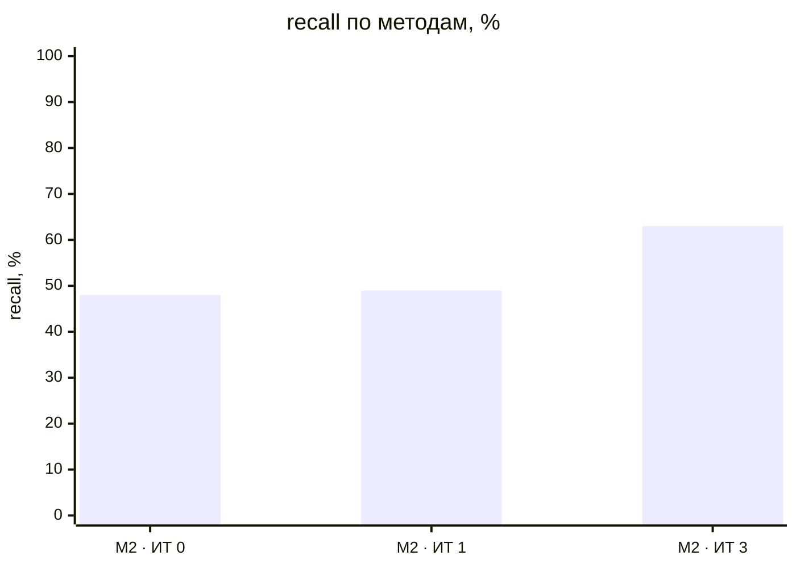
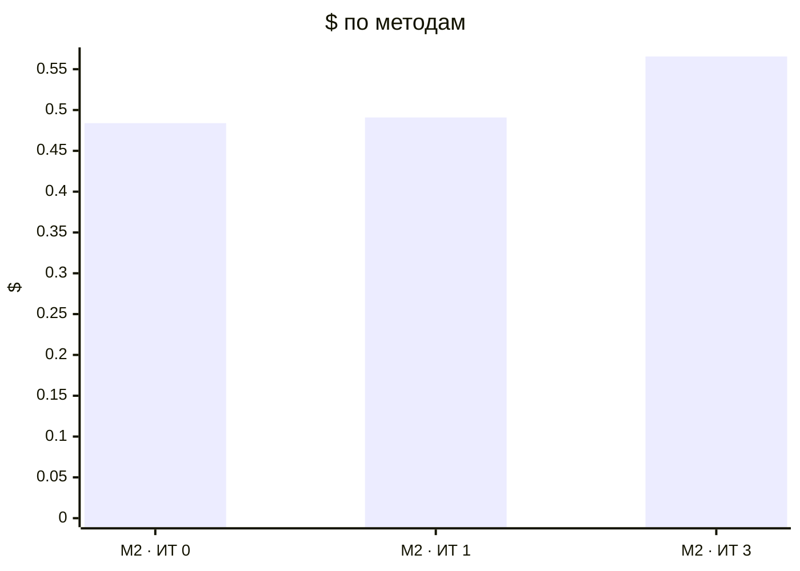

# Метрики прогонов (T-304)

recall — доля скрытых требований вне брифа, которые рассказал заказчик и система нашла полностью (сопоставление: эмбеддинги → судья); с частичными — вместе с найденными частично (тема без чисел или главного условия); recall_all — по всему эталону, с брифом и допущениями, только полные. Типовых и уникальных — recall по группам эталона (T-308, правило — evals/scenarios/README.md); «—» — эталон не размечен.

| Прогон | Вопросов | recall | с частичными | recall_all | типовых | уникальных | на 10 вопросов | Требований | Неоднозначных | Validity | Soundness | Trace | Сироты | Ошибок | Вызовов LLM | $ | Минут | Ошибка |
|---|---|---|---|---|---|---|---|---|---|---|---|---|---|---|---|---|---|---|
| dev-01-cooperative-it0-M2-r1 | 13 | 56% (14/25) | 80% | 63% | 50% (10/20) | 80% (4/5) | 10.769 | 57 | 12% | 100% | 100% | 100% | 2% | 0 | 94 | 0.0442 | 3.51 |  |
| dev-01-cooperative-it0-M2-r2 | 10 | 64% (16/25) | 72% | 70% | 55% (11/20) | 100% (5/5) | 16.0 | 52 | 6% | 100% | 100% | 100% | 0% | 0 | 78 | 0.0375 | 3.55 |  |
| dev-01-cooperative-it0-M2-r3 | 11 | 52% (13/25) | 72% | 60% | 45% (9/20) | 80% (4/5) | 11.818 | 54 | 6% | 100% | 100% | 100% | 1% | 0 | 91 | 0.0513 | 4.67 |  |
| dev-01-cooperative-it1-M2-r1 | 13 | 64% (16/25) | 80% | 70% | 60% (12/20) | 80% (4/5) | 12.308 | 54 | 4% | 100% | 100% | 100% | 0% | 0 | 95 | 0.0506 | 4.56 |  |
| dev-01-cooperative-it1-M2-r2 | 13 | 60% (15/25) | 72% | 67% | 55% (11/20) | 80% (4/5) | 11.538 | 42 | 2% | 100% | 100% | 100% | 0% | 0 | 89 | 0.0385 | 2.55 |  |
| dev-01-cooperative-it1-M2-r3 | 11 | 60% (15/25) | 76% | 67% | 65% (13/20) | 40% (2/5) | 13.636 | 45 | 2% | 100% | 100% | 100% | 0% | 0 | 83 | 0.0389 | 3.47 |  |
| dev-01-cooperative-M2-r1 | 11 | 76% (19/25) | 88% | 80% | 80% (16/20) | 60% (3/5) | 17.273 | 72 | 1% | 100% | 100% | 100% | 0% | 0 | 85 | 0.0659 | 10.94 |  |
| dev-01-cooperative-M2-r2 | 13 | 80% (20/25) | 88% | 87% | 80% (16/20) | 80% (4/5) | 15.385 | 64 | 6% | 100% | 100% | 100% | 0% | 0 | 94 | 0.0460 | 3.29 |  |
| dev-01-cooperative-M2-r3 | 17 | 72% (18/25) | 84% | 80% | 70% (14/20) | 80% (4/5) | 10.588 | 61 | 7% | 100% | 100% | 100% | 0% | 0 | 114 | 0.0587 | 4.49 |  |
| dev-02-cooperative-it0-M2-r1 | 14 | 55% (18/33) | 67% | 67% | 52% (13/25) | 62% (5/8) | 12.857 | 83 | 5% | 100% | 100% | 100% | 5% | 0 | 118 | 0.0671 | 4.92 |  |
| dev-02-cooperative-it0-M2-r2 | 10 | 64% (21/33) | 73% | 71% | 56% (14/25) | 88% (7/8) | 21.0 | 76 | 8% | 100% | 100% | 100% | 0% | 0 | 99 | 0.0533 | 5.31 |  |
| dev-02-cooperative-it0-M2-r3 | 11 | 48% (16/33) | 64% | 62% | 48% (12/25) | 50% (4/8) | 14.545 | 67 | 9% | 100% | 100% | 100% | 0% | 0 | 108 | 0.0592 | 5.61 |  |
| dev-02-cooperative-it1-M2-r1 | 12 | 58% (19/33) | 70% | 69% | 52% (13/25) | 75% (6/8) | 15.833 | 69 | 3% | 100% | 100% | 100% | 8% | 0 | 104 | 0.0571 | 5.8 |  |
| dev-02-cooperative-it1-M2-r2 | 14 | 67% (22/33) | 70% | 80% | 64% (16/25) | 75% (6/8) | 15.714 | 81 | 5% | 100% | 100% | 100% | 0% | 0 | 118 | 0.0672 | 6.34 |  |
| dev-02-cooperative-it1-M2-r3 | 13 | 39% (13/33) | 55% | 58% | 36% (9/25) | 50% (4/8) | 10.0 | 65 | 3% | 100% | 100% | 100% | 3% | 0 | 111 | 0.0567 | 4.76 |  |
| dev-02-cooperative-M2-r1 | 14 | 64% (21/33) | 76% | 73% | 60% (15/25) | 75% (6/8) | 15.0 | 91 | 7% | 100% | 100% | 100% | 1% | 0 | 121 | 0.0666 | 6.11 |  |
| dev-02-cooperative-M2-r2 | 11 | 76% (25/33) | 82% | 80% | 72% (18/25) | 88% (7/8) | 22.727 | 105 | 10% | 100% | 100% | 100% | 2% | 0 | 111 | 0.0697 | 6.86 |  |
| dev-02-cooperative-M2-r3 | 10 | 64% (21/33) | 70% | 73% | 60% (15/25) | 75% (6/8) | 21.0 | 82 | 7% | 100% | 100% | 100% | 2% | 0 | 102 | 0.0564 | 5.95 |  |
| dev-03-cooperative-it0-M2-r1 | 9 | 35% (17/49) | 57% | 49% | 34% (12/35) | 36% (5/14) | 18.889 | 76 | 12% | 100% | 100% | 100% | 5% | 0 | 114 | 0.0596 | 7.59 |  |
| dev-03-cooperative-it0-M2-r2 | 10 | 31% (15/49) | 49% | 43% | 26% (9/35) | 43% (6/14) | 15.0 | 60 | 2% | 100% | 100% | 100% | 0% | 0 | 117 | 0.0561 | 5.38 |  |
| dev-03-cooperative-it0-M2-r3 | 11 | 29% (14/49) | 37% | 46% | 26% (9/35) | 36% (5/14) | 12.727 | 59 | 7% | 100% | 100% | 100% | 2% | 0 | 119 | 0.0557 | 4.78 |  |
| dev-03-cooperative-it1-M2-r1 | 12 | 37% (18/49) | 49% | 51% | 31% (11/35) | 50% (7/14) | 15.0 | 68 | 4% | 100% | 100% | 100% | 0% | 0 | 124 | 0.0562 | 3.8 |  |
| dev-03-cooperative-it1-M2-r2 | 10 | 27% (13/49) | 53% | 43% | 23% (8/35) | 36% (5/14) | 13.0 | 59 | 7% | 100% | 100% | 100% | 1% | 0 | 119 | 0.0595 | 6.1 |  |
| dev-03-cooperative-it1-M2-r3 | 9 | 29% (14/49) | 39% | 45% | 23% (8/35) | 43% (6/14) | 15.556 | 96 | 7% | 100% | 100% | 100% | 0% | 2 | 119 | 0.0661 | 8.4 |  |
| dev-03-cooperative-M2-r1 | 9 | 37% (18/49) | 57% | 51% | 37% (13/35) | 36% (5/14) | 20.0 | 64 | 3% | 100% | 100% | 100% | 0% | 0 | 111 | 0.0503 | 3.85 |  |
| dev-03-cooperative-M2-r2 | 10 | 43% (21/49) | 59% | 52% | 40% (14/35) | 50% (7/14) | 21.0 | 70 | 7% | 100% | 100% | 100% | 0% | 5 | 121 | 0.0603 | 7.1 |  |
| dev-03-cooperative-M2-r3 | 13 | 55% (27/49) | 65% | 63% | 60% (21/35) | 43% (6/14) | 20.769 | 81 | 7% | 100% | 100% | 100% | 6% | 0 | 147 | 0.0916 | 9.81 |  |

## Сводка по методам

Средние — по прогонам без ошибки; $ и минуты — по всем прогонам метода.

| Метод | Прогонов | без ошибки | recall | с частичными | Требований | Ошибок проверок | $ | Минут |
|---|---|---|---|---|---|---|---|---|
| M2 · ИТ 0 | 9 | 9 | 48% | 63% | 64.9 | 0.0 | 0.4839 | 45.32 |
| M2 · ИТ 1 | 9 | 9 | 49% | 63% | 64.3 | 0.2 | 0.4909 | 45.78 |
| M2 · ИТ 3 | 9 | 9 | 63% | 74% | 76.7 | 0.6 | 0.5656 | 58.4 |

