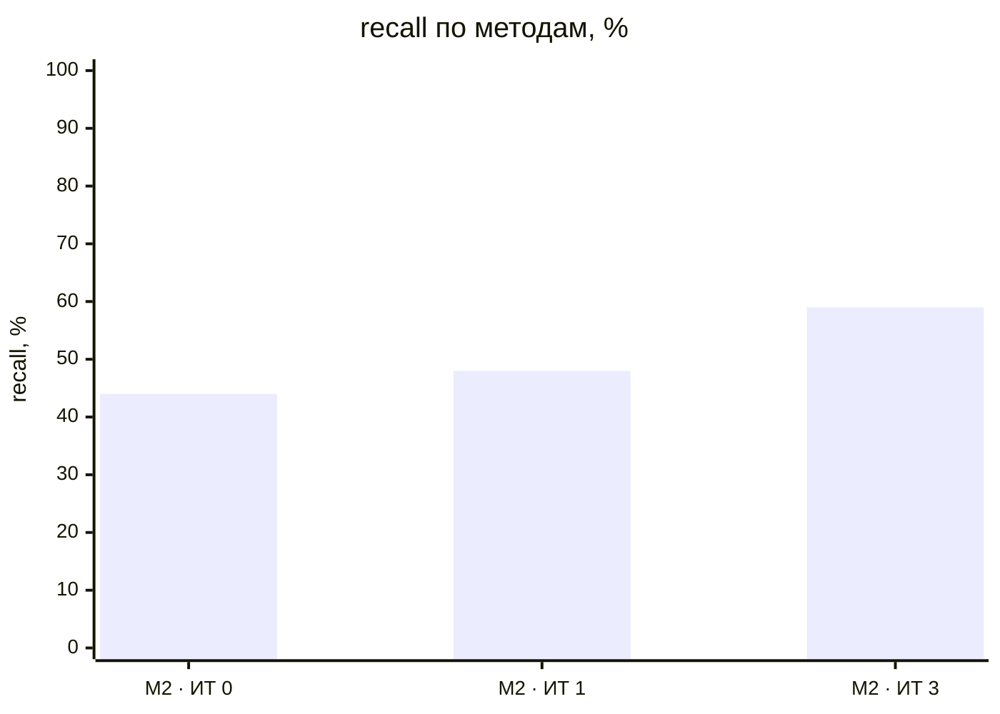
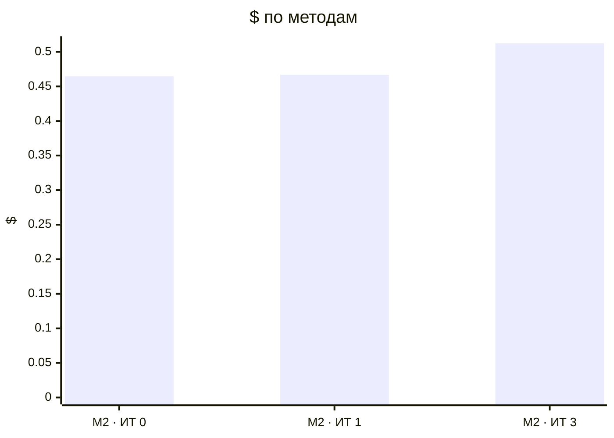

# Метрики прогонов (T-304)

recall — доля скрытых требований вне брифа, которые рассказал заказчик и система нашла полностью (сопоставление: эмбеддинги → судья); с частичными — вместе с найденными частично (тема без чисел или главного условия); recall_all — по всему эталону, с брифом и допущениями, только полные. Типовых и уникальных — recall по группам эталона (T-308, правило — evals/scenarios/README.md); «—» — эталон не размечен.

| Прогон | Вопросов | recall | с частичными | recall_all | типовых | уникальных | на 10 вопросов | Требований | Неоднозначных | Validity | Soundness | Trace | Сироты | Ошибок | Вызовов LLM | $ | Минут | Ошибка |
|---|---|---|---|---|---|---|---|---|---|---|---|---|---|---|---|---|---|---|
| dev-01-cooperative-it0-M2-r1 | 10 | 48% (12/25) | 72% | 57% | 40% (8/20) | 80% (4/5) | 12.0 | 50 | 4% | 100% | 100% | 100% | 0% | 0 | 76 | 0.0328 | 2.67 |  |
| dev-01-cooperative-it0-M2-r2 | 12 | 68% (17/25) | 84% | 73% | 60% (12/20) | 100% (5/5) | 14.167 | 45 | 4% | 100% | 100% | 100% | 0% | 0 | 87 | 0.0395 | 3.09 |  |
| dev-01-cooperative-it0-M2-r3 | 10 | 56% (14/25) | 76% | 63% | 50% (10/20) | 80% (4/5) | 14.0 | 45 | 9% | 100% | 100% | 100% | 0% | 0 | 80 | 0.0381 | 3.9 |  |
| dev-01-cooperative-it1-M2-r1 | 12 | 64% (16/25) | 88% | 70% | 55% (11/20) | 100% (5/5) | 13.333 | 57 | 11% | 100% | 100% | 100% | 8% | 0 | 90 | 0.0472 | 4.63 |  |
| dev-01-cooperative-it1-M2-r2 | 11 | 60% (15/25) | 72% | 67% | 55% (11/20) | 80% (4/5) | 13.636 | 36 | 3% | 100% | 100% | 100% | 0% | 0 | 82 | 0.0353 | 3.8 |  |
| dev-01-cooperative-it1-M2-r3 | 11 | 68% (17/25) | 72% | 73% | 65% (13/20) | 80% (4/5) | 15.455 | 50 | 6% | 100% | 100% | 100% | 0% | 0 | 86 | 0.0422 | 3.61 |  |
| dev-01-cooperative-M2-r1 | 10 | 72% (18/25) | 88% | 77% | 80% (16/20) | 40% (2/5) | 18.0 | 52 | 4% | 100% | 100% | 100% | 0% | 0 | 82 | 0.0428 | 3.94 |  |
| dev-01-cooperative-M2-r2 | 10 | 56% (14/25) | 68% | 63% | 55% (11/20) | 60% (3/5) | 14.0 | 61 | 8% | 100% | 100% | 100% | 0% | 0 | 83 | 0.0399 | 3.15 |  |
| dev-01-cooperative-M2-r3 | 11 | 64% (16/25) | 76% | 70% | 70% (14/20) | 40% (2/5) | 14.545 | 41 | 0% | 100% | 100% | 100% | 0% | 0 | 89 | 0.0424 | 4.34 |  |
| dev-02-cooperative-it0-M2-r1 | 10 | 48% (16/33) | 58% | 64% | 48% (12/25) | 50% (4/8) | 16.0 | 64 | 8% | 100% | 100% | 100% | 4% | 0 | 101 | 0.0512 | 4.68 |  |
| dev-02-cooperative-it0-M2-r2 | 9 | 45% (15/33) | 64% | 56% | 36% (9/25) | 75% (6/8) | 16.667 | 78 | 10% | 100% | 100% | 100% | 1% | 0 | 101 | 0.0594 | 7.29 |  |
| dev-02-cooperative-it0-M2-r3 | 13 | 52% (17/33) | 70% | 64% | 52% (13/25) | 50% (4/8) | 13.077 | 79 | 10% | 100% | 100% | 100% | 7% | 0 | 109 | 0.0603 | 7.86 |  |
| dev-02-cooperative-it1-M2-r1 | 11 | 42% (14/33) | 58% | 56% | 40% (10/25) | 50% (4/8) | 12.727 | 108 | 2% | 100% | 100% | 100% | 3% | 0 | 101 | 0.0560 | 6.52 |  |
| dev-02-cooperative-it1-M2-r2 | 9 | 42% (14/33) | 48% | 60% | 36% (9/25) | 62% (5/8) | 15.556 | 73 | 7% | 100% | 100% | 100% | 3% | 0 | 92 | 0.0488 | 5.38 |  |
| dev-02-cooperative-it1-M2-r3 | 11 | 45% (15/33) | 58% | 64% | 40% (10/25) | 62% (5/8) | 13.636 | 74 | 7% | 100% | 100% | 100% | 0% | 0 | 103 | 0.0539 | 5.91 |  |
| dev-02-cooperative-M2-r1 | 11 | 64% (21/33) | 73% | 69% | 60% (15/25) | 75% (6/8) | 19.091 | 67 | 9% | 100% | 100% | 100% | 0% | 0 | 106 | 0.0563 | 7.09 |  |
| dev-02-cooperative-M2-r2 | 10 | 67% (22/33) | 67% | 80% | 64% (16/25) | 75% (6/8) | 22.0 | 81 | 9% | 100% | 100% | 100% | 0% | 0 | 100 | 0.0572 | 6.19 |  |
| dev-02-cooperative-M2-r3 | 11 | 73% (24/33) | 79% | 82% | 68% (17/25) | 88% (7/8) | 21.818 | 91 | 5% | 100% | 100% | 100% | 1% | 0 | 112 | 0.0671 | 5.09 |  |
| dev-03-cooperative-it0-M2-r1 | 11 | 27% (13/49) | 45% | 38% | 26% (9/35) | 29% (4/14) | 11.818 | 58 | 9% | 100% | 100% | 100% | 0% | 0 | 121 | 0.0601 | 5.35 |  |
| dev-03-cooperative-it0-M2-r2 | 9 | 27% (13/49) | 53% | 40% | 23% (8/35) | 36% (5/14) | 14.444 | 59 | 5% | 100% | 100% | 100% | 0% | 0 | 119 | 0.0625 | 4.82 |  |
| dev-03-cooperative-it0-M2-r3 | 9 | 29% (14/49) | 47% | 43% | 31% (11/35) | 21% (3/14) | 15.556 | 64 | 6% | 100% | 100% | 100% | 1% | 0 | 115 | 0.0606 | 4.64 |  |
| dev-03-cooperative-it1-M2-r1 | 11 | 41% (20/49) | 49% | 55% | 43% (15/35) | 36% (5/14) | 18.182 | 66 | 8% | 100% | 100% | 100% | 0% | 0 | 130 | 0.0676 | 4.88 |  |
| dev-03-cooperative-it1-M2-r2 | 9 | 35% (17/49) | 53% | 49% | 34% (12/35) | 36% (5/14) | 18.889 | 69 | 9% | 100% | 100% | 100% | 0% | 1 | 116 | 0.0550 | 4.32 |  |
| dev-03-cooperative-it1-M2-r3 | 10 | 31% (15/49) | 55% | 45% | 26% (9/35) | 43% (6/14) | 15.0 | 63 | 6% | 100% | 100% | 100% | 1% | 0 | 119 | 0.0607 | 5.37 |  |
| dev-03-cooperative-M2-r1 | 9 | 47% (23/49) | 61% | 58% | 49% (17/35) | 43% (6/14) | 25.556 | 78 | 3% | 100% | 100% | 100% | 1% | 0 | 121 | 0.0647 | 5.55 |  |
| dev-03-cooperative-M2-r2 | 10 | 45% (22/49) | 63% | 55% | 46% (16/35) | 43% (6/14) | 22.0 | 71 | 1% | 100% | 100% | 100% | 0% | 0 | 123 | 0.0618 | 5.05 |  |
| dev-03-cooperative-M2-r3 | 17 | 43% (21/49) | 55% | 57% | 43% (15/35) | 43% (6/14) | 12.353 | 75 | 8% | 100% | 100% | 100% | 3% | 0 | 152 | 0.0801 | 8.78 |  |

## Сводка по методам

Средние — по прогонам без ошибки; $ и минуты — по всем прогонам метода.

| Метод | Прогонов | без ошибки | recall | с частичными | Требований | Ошибок проверок | $ | Минут |
|---|---|---|---|---|---|---|---|---|
| M2 · ИТ 0 | 9 | 9 | 44% | 63% | 60.2 | 0.0 | 0.4647 | 44.3 |
| M2 · ИТ 1 | 9 | 9 | 48% | 61% | 66.2 | 0.1 | 0.4667 | 44.42 |
| M2 · ИТ 3 | 9 | 9 | 59% | 70% | 68.6 | 0.0 | 0.5124 | 49.18 |

