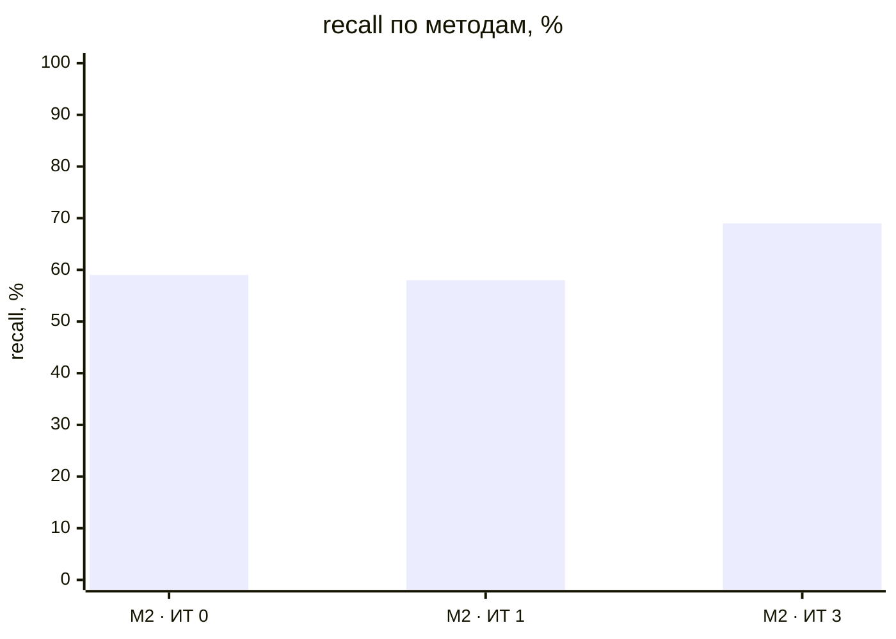
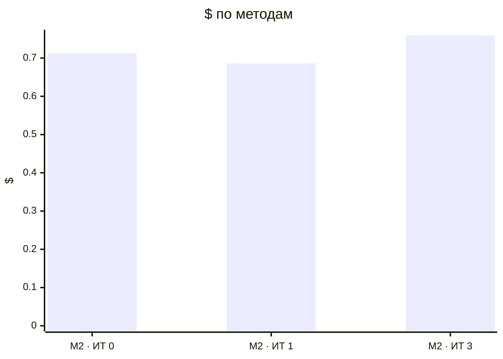

# Метрики прогонов (T-304)

recall — доля скрытых требований вне брифа, которые рассказал заказчик и система нашла полностью (сопоставление: эмбеддинги → судья); с частичными — вместе с найденными частично (тема без чисел или главного условия); recall_all — по всему эталону, с брифом и допущениями, только полные. Типовых и уникальных — recall по группам эталона (T-308, правило — evals/scenarios/README.md); «—» — эталон не размечен.

| Прогон | Вопросов | recall | с частичными | recall_all | типовых | уникальных | на 10 вопросов | Требований | Неоднозначных | Validity | Soundness | Trace | Сироты | Ошибок | Вызовов LLM | $ | Минут | Ошибка |
|---|---|---|---|---|---|---|---|---|---|---|---|---|---|---|---|---|---|---|
| dev-01-cooperative-it0-M2-r1 | 20 | 76% (19/25) | 88% | 80% | 70% (14/20) | 100% (5/5) | 9.5 | 58 | 5% | 100% | 100% | 100% | 0% | 0 | 119 | 0.0576 | 4.76 |  |
| dev-01-cooperative-it0-M2-r2 | 20 | 68% (17/25) | 92% | 73% | 65% (13/20) | 80% (4/5) | 8.5 | 71 | 7% | 100% | 100% | 100% | 7% | 0 | 123 | 0.0672 | 6.33 |  |
| dev-01-cooperative-it0-M2-r3 | 20 | 56% (14/25) | 76% | 67% | 50% (10/20) | 80% (4/5) | 7.0 | 57 | 9% | 100% | 100% | 100% | 22% | 0 | 121 | 0.0579 | 5.45 |  |
| dev-01-cooperative-it1-M2-r1 | 20 | 68% (17/25) | 76% | 73% | 60% (12/20) | 100% (5/5) | 8.5 | 62 | 5% | 100% | 100% | 100% | 0% | 0 | 123 | 0.0620 | 7.37 |  |
| dev-01-cooperative-it1-M2-r2 | 20 | 68% (17/25) | 92% | 70% | 70% (14/20) | 60% (3/5) | 8.5 | 62 | 5% | 100% | 100% | 100% | 0% | 0 | 119 | 0.0557 | 5.64 |  |
| dev-01-cooperative-it1-M2-r3 | 20 | 68% (17/25) | 80% | 73% | 65% (13/20) | 80% (4/5) | 8.5 | 56 | 7% | 100% | 100% | 100% | 0% | 0 | 124 | 0.0601 | 5.5 |  |
| dev-01-cooperative-M2-r1 | 20 | 68% (17/25) | 92% | 73% | 70% (14/20) | 60% (3/5) | 8.5 | 62 | 6% | 100% | 100% | 100% | 0% | 0 | 121 | 0.0575 | 5.54 |  |
| dev-01-cooperative-M2-r2 | 20 | 76% (19/25) | 88% | 90% | 85% (17/20) | 40% (2/5) | 9.5 | 48 | 8% | 100% | 100% | 100% | 0% | 0 | 129 | 0.0630 | 5.47 |  |
| dev-01-cooperative-M2-r3 | 20 | 76% (19/25) | 88% | 80% | 70% (14/20) | 100% (5/5) | 9.5 | 81 | 4% | 100% | 100% | 100% | 0% | 1 | 128 | 0.0677 | 6.07 |  |
| dev-02-cooperative-it0-M2-r1 | 20 | 79% (26/33) | 82% | 82% | 76% (19/25) | 88% (7/8) | 13.0 | 101 | 7% | 100% | 100% | 100% | 0% | 0 | 134 | 0.0766 | 7.89 |  |
| dev-02-cooperative-it0-M2-r2 | 20 | 61% (20/33) | 73% | 71% | 52% (13/25) | 88% (7/8) | 10.0 | 83 | 7% | 100% | 100% | 100% | 0% | 0 | 138 | 0.0733 | 6.92 |  |
| dev-02-cooperative-it0-M2-r3 | 20 | 55% (18/33) | 67% | 67% | 52% (13/25) | 62% (5/8) | 9.0 | 91 | 12% | 100% | 100% | 100% | 2% | 0 | 153 | 0.1109 | 11.18 |  |
| dev-02-cooperative-it1-M2-r1 | 20 | 61% (20/33) | 79% | 71% | 52% (13/25) | 88% (7/8) | 10.0 | 104 | 2% | 100% | 100% | 100% | 1% | 0 | 138 | 0.0796 | 9.04 |  |
| dev-02-cooperative-it1-M2-r2 | 20 | 58% (19/33) | 67% | 67% | 52% (13/25) | 75% (6/8) | 9.5 | 71 | 3% | 100% | 100% | 100% | 8% | 0 | 137 | 0.0735 | 8.84 |  |
| dev-02-cooperative-it1-M2-r3 | 20 | 58% (19/33) | 70% | 60% | 52% (13/25) | 75% (6/8) | 9.5 | 82 | 5% | 100% | 100% | 100% | 0% | 0 | 137 | 0.0744 | 6.38 |  |
| dev-02-cooperative-M2-r1 | 20 | 73% (24/33) | 85% | 78% | 72% (18/25) | 75% (6/8) | 12.0 | 83 | 2% | 100% | 100% | 100% | 0% | 0 | 146 | 0.0854 | 8.7 |  |
| dev-02-cooperative-M2-r2 | 20 | 76% (25/33) | 85% | 78% | 72% (18/25) | 88% (7/8) | 12.5 | 87 | 8% | 100% | 100% | 100% | 0% | 0 | 142 | 0.0797 | 7.97 |  |
| dev-02-cooperative-M2-r3 | 20 | 67% (22/33) | 76% | 73% | 68% (17/25) | 62% (5/8) | 11.0 | 80 | 4% | 100% | 100% | 100% | 0% | 0 | 145 | 0.0834 | 8.81 |  |
| dev-03-cooperative-it0-M2-r1 | 20 | 49% (24/49) | 67% | 57% | 49% (17/35) | 50% (7/14) | 12.0 | 92 | 4% | 100% | 100% | 100% | 0% | 0 | 157 | 0.0857 | 10.21 |  |
| dev-03-cooperative-it0-M2-r2 | 20 | 53% (26/49) | 63% | 63% | 51% (18/35) | 57% (8/14) | 13.0 | 79 | 5% | 100% | 100% | 100% | 0% | 1 | 162 | 0.0940 | 10.28 |  |
| dev-03-cooperative-it0-M2-r3 | 20 | 35% (17/49) | 53% | 48% | 29% (10/35) | 50% (7/14) | 8.5 | 80 | 9% | 100% | 100% | 100% | 1% | 0 | 161 | 0.0889 | 8.86 |  |
| dev-03-cooperative-it1-M2-r1 | 20 | 41% (20/49) | 63% | 57% | 34% (12/35) | 57% (8/14) | 10.0 | 103 | 3% | 100% | 100% | 100% | 0% | 0 | 158 | 0.0945 | 9.7 |  |
| dev-03-cooperative-it1-M2-r2 | 20 | 47% (23/49) | 67% | 58% | 46% (16/35) | 50% (7/14) | 11.5 | 81 | 9% | 100% | 100% | 100% | 0% | 0 | 166 | 0.1028 | 11.89 |  |
| dev-03-cooperative-it1-M2-r3 | 20 | 51% (25/49) | 65% | 55% | 49% (17/35) | 57% (8/14) | 12.5 | 88 | 3% | 100% | 100% | 100% | 0% | 0 | 157 | 0.0836 | 8.0 |  |
| dev-03-cooperative-M2-r1 | 20 | 65% (32/49) | 73% | 68% | 69% (24/35) | 57% (8/14) | 16.0 | 108 | 6% | 100% | 100% | 100% | 0% | 1 | 176 | 0.1227 | 12.18 |  |
| dev-03-cooperative-M2-r2 | 20 | 59% (29/49) | 71% | 66% | 60% (21/35) | 57% (8/14) | 14.5 | 84 | 8% | 100% | 100% | 100% | 0% | 0 | 168 | 0.0983 | 10.07 |  |
| dev-03-cooperative-M2-r3 | 20 | 63% (31/49) | 71% | 72% | 66% (23/35) | 57% (8/14) | 15.5 | 91 | 8% | 100% | 100% | 100% | 1% | 0 | 166 | 0.1013 | 10.7 |  |

## Сводка по методам

Средние — по прогонам без ошибки; $ и минуты — по всем прогонам метода.

| Метод | Прогонов | без ошибки | recall | с частичными | Требований | Ошибок проверок | $ | Минут |
|---|---|---|---|---|---|---|---|---|
| M2 · ИТ 0 | 9 | 9 | 59% | 73% | 79.1 | 0.1 | 0.7121 | 71.88 |
| M2 · ИТ 1 | 9 | 9 | 58% | 73% | 78.8 | 0.0 | 0.6862 | 72.36 |
| M2 · ИТ 3 | 9 | 9 | 69% | 81% | 80.4 | 0.2 | 0.7591 | 75.51 |

