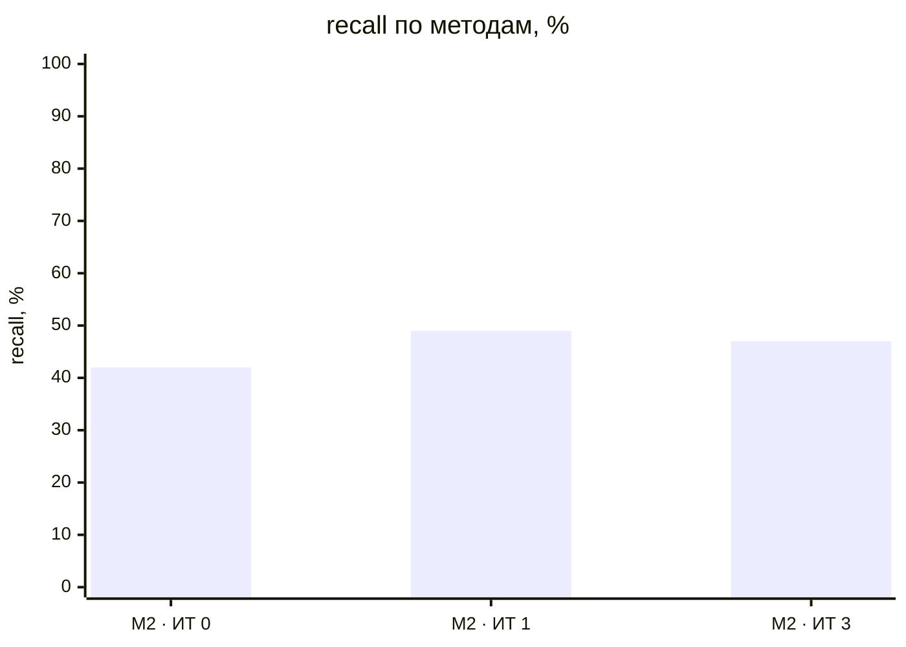
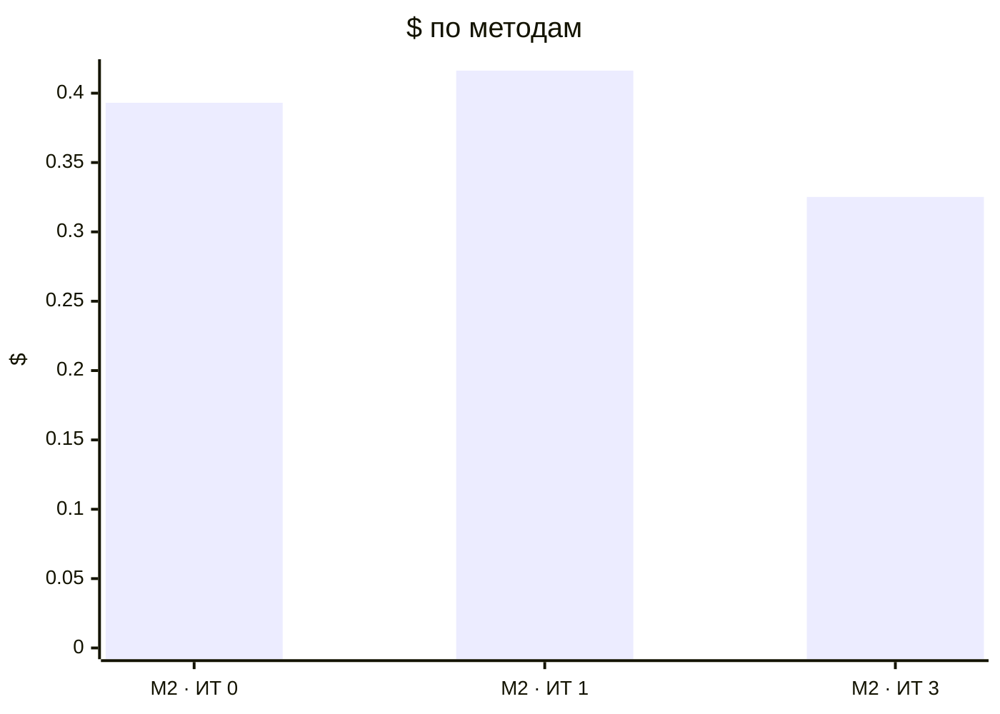

# Метрики прогонов (T-304)

recall — доля скрытых требований вне брифа, которые рассказал заказчик и система нашла полностью (сопоставление: эмбеддинги → судья); с частичными — вместе с найденными частично (тема без чисел или главного условия); recall_all — по всему эталону, с брифом и допущениями, только полные. Типовых и уникальных — recall по группам эталона (T-308, правило — evals/scenarios/README.md); «—» — эталон не размечен.

| Прогон | Вопросов | recall | с частичными | recall_all | типовых | уникальных | на 10 вопросов | Требований | Неоднозначных | Validity | Soundness | Trace | Сироты | Ошибок | Вызовов LLM | $ | Минут | Ошибка |
|---|---|---|---|---|---|---|---|---|---|---|---|---|---|---|---|---|---|---|
| dev-01-cooperative-it0-M2-r1 | 20 | 40% (10/25) | 60% | 53% | 35% (7/20) | 60% (3/5) | 5.0 | 46 | 11% | 100% | 100% | 100% | 0% | 0 | 129 | 0.0602 | 9.94 |  |
| dev-01-cooperative-it0-M2-r2 | 20 | 56% (14/25) | 64% | 67% | 50% (10/20) | 80% (4/5) | 7.0 | 52 | 8% | 100% | 100% | 100% | 7% | 0 | 124 | 0.0589 | 11.8 |  |
| dev-01-cooperative-it0-M2-r3 | 20 | 36% (9/25) | 64% | 47% | 40% (8/20) | 20% (1/5) | 4.5 | 48 | 2% | 100% | 100% | 100% | 0% | 0 | 124 | 0.0564 | 7.03 |  |
| dev-01-cooperative-it1-M2-r1 | 20 | 52% (13/25) | 60% | 63% | 55% (11/20) | 40% (2/5) | 6.5 | 60 | 3% | 100% | 100% | 100% | 0% | 0 | 122 | 0.0597 | 8.27 |  |
| dev-01-cooperative-it1-M2-r2 | 20 | 48% (12/25) | 76% | 57% | 40% (8/20) | 80% (4/5) | 6.0 | 46 | 7% | 100% | 100% | 100% | 0% | 0 | 128 | 0.0628 | 9.4 |  |
| dev-01-cooperative-it1-M2-r3 | 20 | 48% (12/25) | 56% | 57% | 45% (9/20) | 60% (3/5) | 6.0 | 45 | 7% | 100% | 100% | 100% | 0% | 0 | 126 | 0.0577 | 6.46 |  |
| dev-01-cooperative-M2-r1 | 20 | 0% (0/25) | 0% | 0% | 0% (0/20) | 0% (0/5) | 0.0 | 0 | 0% | 0% | 0% | 0% | 0% | 0 | 90 | 0.0457 | 7.23 | TimeoutError:  |
| dev-01-cooperative-M2-r2 | 20 | 52% (13/25) | 76% | 60% | 50% (10/20) | 60% (3/5) | 6.5 | 49 | 6% | 100% | 100% | 100% | 3% | 0 | 126 | 0.0590 | 6.83 |  |
| dev-01-cooperative-M2-r3 | 20 | 48% (12/25) | 60% | 60% | 35% (7/20) | 100% (5/5) | 6.0 | 52 | 8% | 100% | 100% | 100% | 0% | 0 | 125 | 0.0585 | 6.23 |  |
| dev-02-cooperative-it0-M2-r1 | 20 | 55% (18/33) | 64% | 64% | 56% (14/25) | 50% (4/8) | 9.0 | 70 | 10% | 100% | 100% | 100% | 0% | 0 | 140 | 0.0725 | 10.49 |  |
| dev-02-cooperative-it0-M2-r2 | 20 | 30% (10/33) | 52% | 49% | 28% (7/25) | 38% (3/8) | 5.0 | 62 | 3% | 100% | 100% | 100% | 0% | 0 | 140 | 0.0688 | 7.85 |  |
| dev-02-cooperative-it0-M2-r3 | 20 | 36% (12/33) | 55% | 51% | 28% (7/25) | 62% (5/8) | 6.0 | 60 | 8% | 100% | 100% | 100% | 0% | 0 | 148 | 0.0763 | 8.39 |  |
| dev-02-cooperative-it1-M2-r1 | 20 | 52% (17/33) | 64% | 62% | 52% (13/25) | 50% (4/8) | 8.5 | 78 | 4% | 100% | 100% | 100% | 7% | 0 | 145 | 0.0773 | 7.63 |  |
| dev-02-cooperative-it1-M2-r2 | 20 | 45% (15/33) | 61% | 56% | 32% (8/25) | 88% (7/8) | 7.5 | 74 | 3% | 100% | 100% | 100% | 7% | 0 | 144 | 0.0816 | 10.43 |  |
| dev-02-cooperative-it1-M2-r3 | 20 | 52% (17/33) | 67% | 64% | 48% (12/25) | 62% (5/8) | 8.5 | 82 | 2% | 100% | 100% | 100% | 0% | 0 | 143 | 0.0771 | 10.89 |  |
| dev-02-cooperative-M2-r1 | 20 | 42% (14/33) | 45% | 56% | 44% (11/25) | 38% (3/8) | 7.0 | 80 | 6% | 100% | 100% | 100% | 0% | 0 | 151 | 0.0876 | 15.42 |  |
| dev-02-cooperative-M2-r2 | 20 | 45% (15/33) | 64% | 58% | 44% (11/25) | 50% (4/8) | 7.5 | 78 | 3% | 100% | 100% | 100% | 3% | 0 | 141 | 0.0743 | 11.78 |  |

## Сводка по методам

Средние — по прогонам без ошибки; $ и минуты — по всем прогонам метода.

| Метод | Прогонов | без ошибки | recall | с частичными | Требований | Ошибок проверок | $ | Минут |
|---|---|---|---|---|---|---|---|---|
| M2 · ИТ 0 | 6 | 6 | 42% | 60% | 56.3 | 0.0 | 0.3931 | 55.5 |
| M2 · ИТ 1 | 6 | 6 | 49% | 64% | 64.2 | 0.0 | 0.4163 | 53.08 |
| M2 · ИТ 3 | 5 | 4 | 47% | 61% | 64.8 | 0.0 | 0.3252 | 47.49 |

